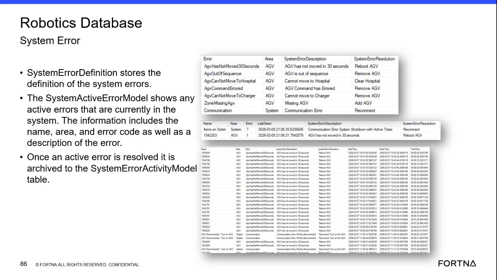

# Look Up System Error Definitions in the Robotics Database

## Runbook Header

| Field | Value |
| --- | --- |
| Procedure ID | `proc_look_up_system_error_definitions_in_the_robotics_database_v1` |
| Title | Look Up System Error Definitions in the Robotics Database |
| Procedure Type | `diagnostic` |
| Primary Role | `L2_support` |
| Supporting Roles | `L3_support` |
| Support Safe | Yes |
| Capability Tags | `agv_active_errors` |
| Access Surface | `wcs_sql` |
| Audience Roles | `L2_support`, `L3_support` |
| Failure Pattern Tags | None |
| Validation Status | `needs_sme_review` |
| Merge Status | `source_finalized` |

## Summary

Use read-only SSMS against the WCS / Helix Robotics Database to match a reported system error to its Error, Area, SystemErrorDescription, and SystemErrorResolution values.

## When To Use

Use this read-only SSMS diagnostic when a named system error must be interpreted using the Robotics Database SystemErrorDefinition table. Use the returned Area, SystemErrorDescription, and SystemErrorResolution values to support troubleshooting and escalation.

## Do Not Use For

* Do not use this procedure to execute the SystemErrorResolution value.
* Do not use this procedure to perform mutating database actions or equipment actions.
* Do not use this procedure as a substitute for checking current active errors in the SystemActiveError model.

## Safety And Operational Notes

* This procedure is read-only.
* Treat SystemErrorResolution as documented diagnostic information only; do not perform the listed resolution from this lookup procedure.

## Access Or Tools Needed

* WCS / Helix DB (SSMS)
* SSMS
* Robotics Database
* SystemErrorDefinition table

## Related Operational Context

* ctx_training_video_system_error_definition_table_v1

## Visual References

*Robotics Database SystemErrorDefinition view showing Error, Area, SystemErrorDescription, and SystemErrorResolution values and examples.*

## Procedure Steps

### Step 1 — Open the Robotics Database in SSMS

**Responsible role:** L2_support

**Instruction:**
In the WCS / Helix DB (SSMS) surface, open SSMS and select the Robotics Database.

**Expected result:**
The Robotics Database is selected in SSMS and the SystemErrorDefinition table is available for inspection.

**Stop or Escalate If:**

* Stop and escalate if the Robotics Database or the SystemErrorDefinition table is unavailable.

---

### Step 2 — Open the SystemErrorDefinition table

**Responsible role:** L2_support

**Instruction:**
In SSMS, open the SystemErrorDefinition table and inspect the displayed Error, Area, SystemErrorDescription, and SystemErrorResolution columns.

**Expected result:**
The SystemErrorDefinition table displays the reported error entry or confirms that no matching entry is present.

**Stop or Escalate If:**

* Stop the lookup if the reported error is not present.
* Escalate if the SystemErrorDefinition table cannot be read.

---

### Step 3 — Inspect the error definition values

**Responsible role:** L2_support

**Instruction:**
In the SSMS SystemErrorDefinition row, inspect and preserve the Error, Area, SystemErrorDescription, and SystemErrorResolution values. Examples shown in the table include AgvHasNotMoved30Seconds / AGV / AGV has not moved in 30 seconds / Reboot AGV and AgvOutOfSequence / AGV / AGV is out of sequence / Remove AGV.

**Expected result:**
The matching row provides a non-empty Error name with corresponding Area, SystemErrorDescription, and SystemErrorResolution values.

**Stop or Escalate If:**

* Stop the lookup if any required definition field is empty.
* Escalate if the definition values are inconsistent.

---

### Step 4 — Preserve unmatched or incomplete lookup results

**Responsible role:** L2_support

**Instruction:**
If the reported Error is not present or any required definition field is empty or inconsistent in SSMS, stop the lookup and preserve the observed error name together with the missing or inconsistent field information for escalation.

**Expected result:**
The escalation record identifies the observed error name and states whether the row was absent or which definition field was missing or inconsistent.

**Stop or Escalate If:**

* Escalate when the reported error has no matching SystemErrorDefinition row.
* Escalate when definition fields are missing or inconsistent.
* Do not perform a database or equipment action based only on the SystemErrorResolution value.

---

## Success Criteria

* The Robotics Database is accessible in SSMS.
* The reported Error has a matching SystemErrorDefinition row.
* The row provides Error, Area, SystemErrorDescription, and SystemErrorResolution values.
* The observed values are preserved for troubleshooting without executing a mutating action.

## Failure Conditions

* The Robotics Database or SystemErrorDefinition table is unavailable.
* The reported Error is not present.
* Area, SystemErrorDescription, or SystemErrorResolution is empty.
* Definition values are inconsistent with the reported Error.

## Escalation Guidance

* Escalate to L3_support when no matching SystemErrorDefinition row is found.
* Escalate to L3_support when required definition fields are missing or inconsistent.
* Include the observed error name and the available Area, SystemErrorDescription, and SystemErrorResolution values in the escalation record.
* Do not execute the documented SystemErrorResolution as part of this read-only lookup.

## Missing Details / Known Gaps

* The source does not provide SQL syntax or a query template.
* The source does not specify exact SSMS navigation or filtering actions for locating an Error entry.
* The source does not define how to resolve discrepancies between a reported error and the SystemErrorDefinition row.
* This procedure identifies documented resolution text only; execution of that resolution requires a separate, source-supported procedure.

## Source Lineage

- Candidate IDs: candidate_training_video_robotics_system_error_definition_lookup
- Source ID: `training_video_day2`
- Source Type: `training_video`
