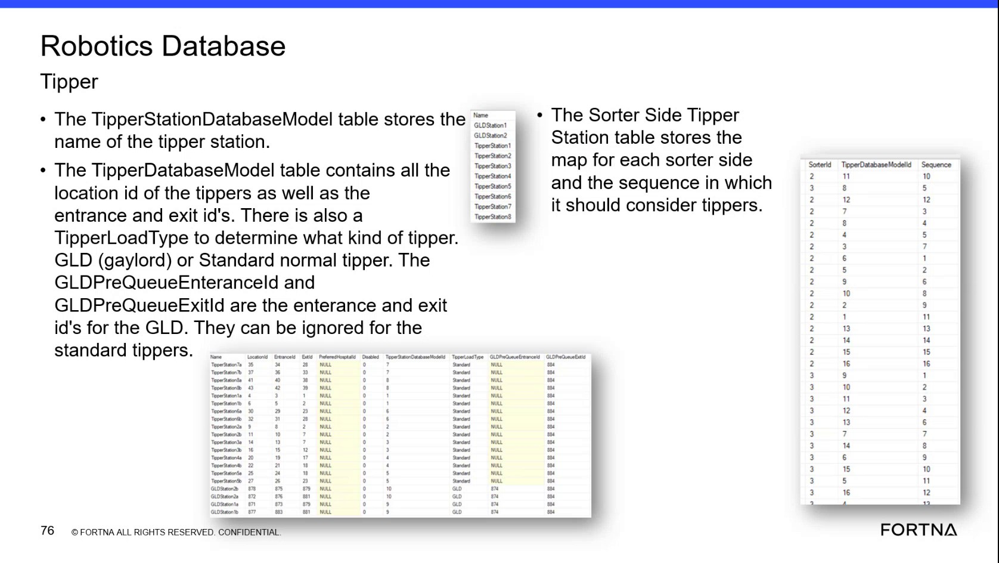

# Check Sorter-Side Charger Assignment in SSMS / Helix DB

## Runbook Header

| Field | Value |
| --- | --- |
| Procedure ID | `proc_sorter_side_charger_assignment_check_v1` |
| Title | Check Sorter-Side Charger Assignment in SSMS / Helix DB |
| Procedure Type | `diagnostic` |
| Primary Role | `L2_support` |
| Supporting Roles | `L3_support` |
| Support Safe | Yes |
| Capability Tags | `agv_charging_state`, `device_roster_state` |
| Access Surface | `wcs_sql` |
| Audience Roles | `L2_support`, `L3_support` |
| Failure Pattern Tags | `mapping_abnormal` |
| Validation Status | `needs_sme_review` |
| Merge Status | `source_finalized` |

## Summary

Use the WCS / Helix DB (SSMS) to inspect sorter-side and charger-assignment records. Confirm that the charger has a sorter-side model ID, that the charger is associated with the expected charging area or sorter side, and that its availability or disabled status is consistent with the investigation.

## When To Use

Use this read-only diagnostic when investigating whether a charger is assigned to the expected sorter side, whether the assignment is present, or whether charger availability or disabled status may explain charging behavior. Perform the inspection in the WCS / Helix DB (SSMS).

## Do Not Use For

* Do not use this procedure to change sorter-side assignments, charging-area mappings, charger availability, or disabled status.
* Do not use this procedure as a substitute for confirming an exact live table or column name; the supplied source does not provide the complete SSMS navigation path or schema.

## Safety And Operational Notes

* This is a read-only diagnostic. Do not modify sorter-side assignments or charger availability from SSMS.
* The source describes assigned-side chargers as the normal charging relationship and another side's available charger as an emergency relationship; do not infer or change operational policy beyond the configured records.

## Access Or Tools Needed

* WCS / Helix DB (SSMS) — read-only access
* The live sorter-side database model and charger-assignment or charging-location records

## Related Operational Context

* ctx_training_video_sorter_side_charger_assignment_v1

## Visual References

*WCS database model view showing sorter-side identifiers as model IDs and charging-area, charger, tote-stand, and disabled-status relationships.*

## Procedure Steps

### Step 1 — Open the WCS / Helix DB records in SSMS

**Responsible role:** L2_support

**Instruction:**
In the WCS / Helix DB (SSMS), locate the sorter-side database model and the charging database model or charging-location records for the charger under investigation. Use the live model or record names available in the environment; the supplied source does not specify an exact database name, table name, or navigation path.

**Expected result:**
The relevant sorter-side and charger-related records are available for read-only inspection in SSMS.

**Stop or Escalate If:**

* Escalate to L3 support or engineering if the live schema cannot be identified or the required charger-assignment records are unavailable.

---

### Step 2 — Inspect the charger and sorter-side model ID

**Responsible role:** L2_support

**Instruction:**
In the WCS / Helix DB (SSMS), find the investigated charger or charging location. Inspect the sorter-side identifier or model ID associated with it, along with the charging area, charger location or station, tote stand association, and any available or disabled status shown in the live records.

**Expected result:**
The charger record shows a sorter-side identifier or model ID and identifies its related charging-area or charger configuration.

**Stop or Escalate If:**

* Escalate if the sorter-side identifier or model ID is missing.
* Escalate if the charger has no identifiable charging-area or location association.
* Do not edit the record when the charger is disabled or unavailable.

---

### Step 3 — Compare the assignment with the expected charging relationship

**Responsible role:** L2_support

**Instruction:**
In the WCS / Helix DB (SSMS), compare the recorded sorter-side model ID and charger status with the expected sorter side for the charger. Confirm whether the charger is assigned to the expected side for normal charging. If the records describe cross-side use, identify whether another side's charger is available for emergency charging without changing the configuration.

**Expected result:**
The recorded assignment either maps the charger to the expected sorter side for normal charging or clearly identifies a configured cross-side available charger relationship for emergency use.

**Stop or Escalate If:**

* Escalate to L2/engineering if the sorter-side identifier is missing or maps to the wrong side.
* Escalate if the assignment conflicts with the charger's charging-area or disabled status.
* Do not change sorter-side assignments or charger availability from this diagnostic.

---

## Success Criteria

* The investigated charger is identifiable in the WCS / Helix DB (SSMS).
* A sorter-side identifier or model ID is present and maps to the expected sorter side.
* The charger’s charging-area, location, and disabled or availability status are observable.
* Normal assigned-side charging and any configured cross-side emergency relationship can be distinguished without modifying records.

## Failure Conditions

* Sorter-side identifier or model ID is missing.
* The charger maps to the wrong sorter side.
* The charger has an unexpected disabled or unavailable status.
* The charger’s charging-area or location association conflicts with the expected assignment.
* The live schema does not expose enough information to verify the assignment.

## Escalation Guidance

* Escalate to L3 support or engineering when the sorter-side identifier is missing, maps to the wrong side, or conflicts with the charger's charging-area or disabled status.
* Include the investigated charger or charging location, observed sorter-side model ID, charging-area association, and observed availability or disabled status in the escalation.
* Do not modify database records as part of this diagnostic.

## Missing Details / Known Gaps

* The source does not provide the exact live database name, table name, column name, or complete SSMS navigation path for the charger-assignment records.
* The source does not define a complete query or exact field-level rule for determining charger availability beyond the described disabled and available relationships.
* The expected sorter side for a specific charger must be supplied by live configuration or site context.
* The source describes emergency cross-side charger use but does not provide an exact live field that explicitly labels a charger as normal versus emergency.

## Source Lineage

- Candidate IDs: candidate_training_video_sorter_side_charger_assignment_check
- Source ID: `training_video_day2`
- Source Type: `training_video`
