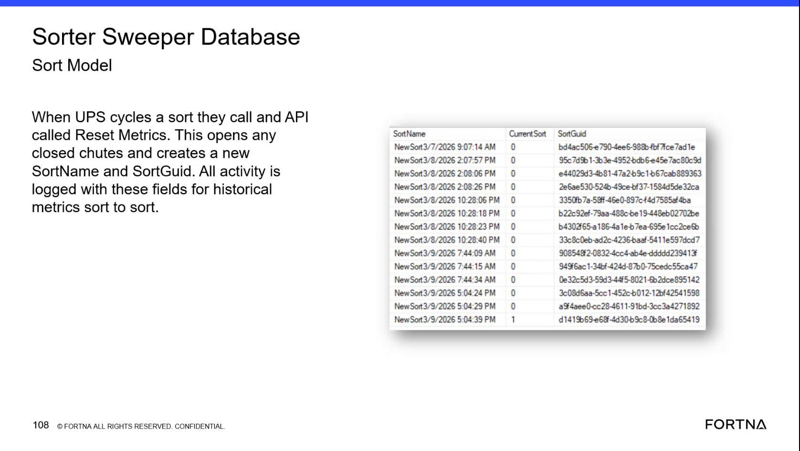

# Check Current Sort and SortGuid in the Sorter Sweeper Database

## Runbook Header

| Field | Value |
| --- | --- |
| Procedure ID | `proc_check_current_sort_and_sortguid_v1` |
| Title | Check Current Sort and SortGuid in the Sorter Sweeper Database |
| Procedure Type | `diagnostic` |
| Primary Role | `L2_support` |
| Supporting Roles | `L3_support` |
| Support Safe | Yes |
| Capability Tags | `sort_lifecycle_state` |
| Access Surface | `wcs_sql` |
| Audience Roles | `L2_support`, `L3_support` |
| Failure Pattern Tags | None |
| Validation Status | `needs_sme_review` |
| Merge Status | `source_finalized` |

## Summary

Use the WCS / Helix DB (SSMS) to inspect the Sorter Sweeper Database Sort Model. Verify the visible SortName, Current Sort, and SortGuid values, identify the current sort entry, and use its SortGuid to associate investigated activity with historical sort-to-sort metrics.

## When To Use

Use this read-only diagnostic on the WCS / Helix DB (SSMS) when troubleshooting live sort activity or validating which sort context owns activity. Inspect the Sorter Sweeper Database Sort Model and use the displayed SortGuid for historical sort-to-sort comparison.

## Do Not Use For

* Do not use this procedure to invoke the Reset Metrics API.
* Do not change Sort Model records or other database data.
* Do not assign an undocumented numeric meaning to the Current Sort value.

## Safety And Operational Notes

* Perform this as a read-only diagnostic in WCS / Helix DB (SSMS).
* Do not invoke Reset Metrics or alter database records. The source identifies Reset Metrics as the API operation that creates a new sort context.

## Access Or Tools Needed

* WCS / Helix DB (SSMS)
* Sorter Sweeper Database
* Sort Model
* SortName field
* Current Sort field
* SortGuid field

## Related Operational Context

* ctx_training_video_sort_model_reset_metrics_v1

## Visual References

*Sorter Sweeper Database Sort Model view showing SortName, Current Sort, and SortGuid values and example sort rows.*

## Procedure Steps

### Step 1 — Open the Sorter Sweeper Database Sort Model

**Responsible role:** L2_support

**Instruction:**
In the WCS / Helix DB (SSMS), open the Sorter Sweeper Database and locate the Sort Model. Inspect the displayed SortName, Current Sort, and SortGuid fields without modifying any records.

**Expected result:**
The Sort Model is open and the SortName, Current Sort, and SortGuid fields are visible for the available sort records.

**Stop or Escalate If:**

* The Sorter Sweeper Database or Sort Model cannot be opened.
* The SortName, Current Sort, or SortGuid field is unavailable.

---

### Step 2 — Record the current sort name and identifier

**Responsible role:** L2_support

**Instruction:**
In the WCS / Helix DB (SSMS) Sort Model, inspect the sort entry being investigated and record its displayed SortName and SortGuid.

**Expected result:**
A SortName and corresponding SortGuid are visible for the investigated sort entry.

**Stop or Escalate If:**

* The relevant SortGuid is missing.
* The sort entry cannot be associated with a SortName.

---

### Step 3 — Identify the current sort using Current Sort

**Responsible role:** L2_support

**Instruction:**
In the WCS / Helix DB (SSMS) Sort Model, inspect the Current Sort value for the entry identified as current and compare it with the Current Sort values on the other visible sort records. Use the displayed indicator as shown; do not infer an undocumented numeric meaning.

**Expected result:**
One sort entry can be identified as the current sort from the displayed Current Sort values, with its associated SortName and SortGuid visible.

**Stop or Escalate If:**

* No current sort entry is identifiable.
* The Current Sort indicator is missing or cannot be compared across the visible records.

---

### Step 4 — Associate investigated activity with SortGuid

**Responsible role:** L2_support

**Instruction:**
Use the displayed SortGuid from the identified current sort entry when reviewing the activity being investigated in the WCS / Helix DB (SSMS). Confirm that the activity can be associated with that SortGuid for historical sort-to-sort comparison.

**Expected result:**
The investigated activity can be associated with the displayed SortGuid, establishing its sort context for historical comparison.

**Stop or Escalate If:**

* The relevant activity cannot be associated with the displayed SortGuid.
* The SortGuid needed for historical comparison is missing.

---

## Success Criteria

* The Sorter Sweeper Database Sort Model opens in WCS / Helix DB (SSMS).
* SortName, Current Sort, and SortGuid are visible.
* An identifiable current sort entry has an associated SortName and SortGuid.
* The investigated activity can be associated with the displayed SortGuid for historical sort-to-sort comparison.

## Failure Conditions

* The Sort Model cannot be opened.
* No current sort entry is identifiable.
* SortName or SortGuid is missing from the relevant entry.
* Investigated activity cannot be associated with the displayed SortGuid.

## Escalation Guidance

* Escalate to L3_support or the responsible system owner if the Sort Model cannot be opened.
* Escalate if no current sort entry is identifiable.
* Escalate if the relevant SortGuid is missing or activity cannot be associated with it.
* Do not invoke Reset Metrics or modify database records during this diagnostic.

## Missing Details / Known Gaps

* The source does not provide exact SSMS navigation, database schema, table name, or a query for the Sort Model.
* The source does not define the numeric or boolean semantics of the Current Sort indicator.
* The source does not identify the specific activity table or query needed to verify a SortGuid association.
* The source does not provide live API request details for Reset Metrics; this runbook does not execute that API.

## Source Lineage

- Candidate IDs: candidate_training_video_sorter_sweeper_current_sort_diagnostic
- Source ID: `training_video_day2`
- Source Type: `training_video`
