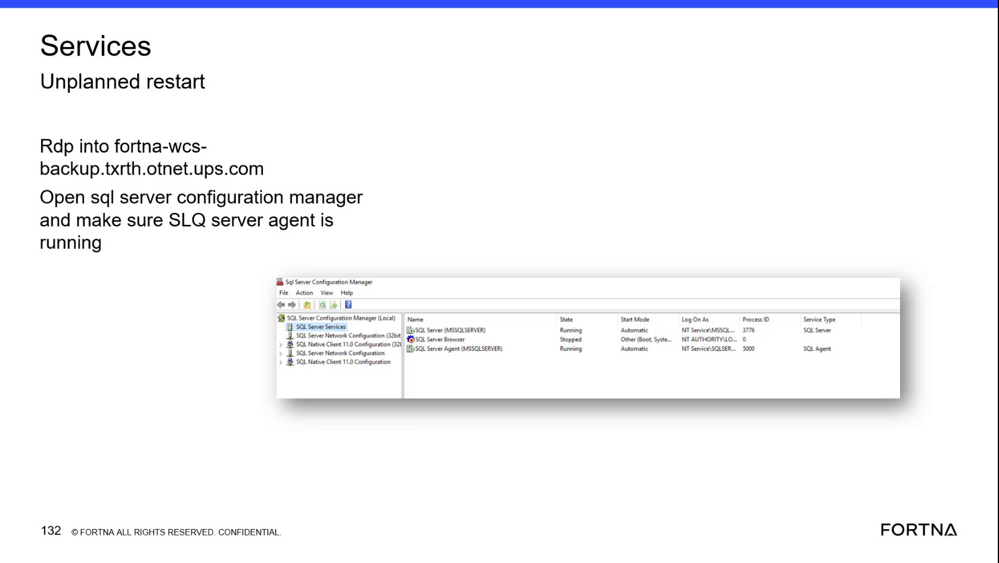

# Check SQL Server Agent Status in SQL Server Configuration Manager

## Runbook Header

| Field | Value |
| --- | --- |
| Procedure ID | `proc_check_sql_server_agent_status_in_sql_server_configuration_manager_v1` |
| Title | Check SQL Server Agent Status in SQL Server Configuration Manager |
| Procedure Type | `diagnostic` |
| Primary Role | `L1_support` |
| Supporting Roles | `L2_support` |
| Support Safe | Yes |
| Capability Tags | `wcs_service_health` |
| Access Surface | `event_viewer`, `rms_ui` |
| Audience Roles | `L1_support`, `L2_support` |
| Failure Pattern Tags | `unplanned_restart`, `service_crash_or_restart` |
| Validation Status | `needs_sme_review` |
| Merge Status | `source_finalized` |

## Summary

Use the Windows Event Viewer / services surface to RDP to the identified WCS backup server, open SQL Server Configuration Manager, and verify that SQL Server Agent (MSSQLSERVER) shows State as Running and Start Mode as Automatic. Then check the RMS / fleet status UI to confirm that RMS is up and running.

## When To Use

Use this diagnostic after an unplanned restart or while verifying WCS/RMS service health. Check SQL Server Agent on the Windows Event Viewer / services surface and corroborate availability in the RMS / fleet status UI.

## Do Not Use For

* Do not use this procedure to change SQL Server Agent configuration.
* Do not use this procedure to restart services.
* Do not use this procedure to troubleshoot or remediate SQL Server Agent jobs beyond escalating the issue.
* Do not use this procedure as a substitute for detailed RMS field-level diagnosis; the source does not identify additional RMS status fields.

## Safety And Operational Notes

* This is an inspection-only diagnostic. Do not change service configuration or restart services.
* The source identifies DBAs as the owner for fixing the related SQL Server Agent issue.

## Access Or Tools Needed

* Windows Event Viewer / services
* RDP access to the identified WCS backup server
* SQL Server Configuration Manager
* RMS / fleet status UI

## Related Operational Context

* ctx_training_video_sql_server_agent_service_v1
* ctx_training_video_sql_server_configuration_manager_services_v1
* ctx_training_video_unplanned_restart_job_cleanup_issue_v1

## Visual References

*SQL Server Configuration Manager (Local) service view showing SQL Server Agent (MSSQLSERVER), State, and Start Mode columns.*

## Procedure Steps

### Step 1 — Open SQL Server Configuration Manager on the WCS backup server

**Responsible role:** L1_support

**Instruction:**
Using the Windows Event Viewer / services surface, RDP into the identified WCS backup server at fortna-wcs-backup.txrth.otnet.ups.com and open SQL Server Configuration Manager.

**Expected result:**
SQL Server Configuration Manager (Local) opens and exposes the SQL Server Services view.

**Stop or Escalate If:**

* Stop and escalate if the identified WCS backup server is not reachable through the available RDP access.
* Escalate if SQL Server Configuration Manager is unavailable.

---

### Step 2 — Locate SQL Server Agent (MSSQLSERVER)

**Responsible role:** L1_support

**Instruction:**
In SQL Server Configuration Manager on the Windows Event Viewer / services surface, open SQL Server Services and locate the row named SQL Server Agent (MSSQLSERVER).

**Expected result:**
The SQL Server Agent (MSSQLSERVER) row is visible in the SQL Server Services list.

**Stop or Escalate If:**

* Escalate if SQL Server Agent (MSSQLSERVER) is not listed.

---

### Step 3 — Verify SQL Server Agent state and start mode

**Responsible role:** L1_support

**Instruction:**
In the SQL Server Services view on the Windows Event Viewer / services surface, inspect the State and Start Mode fields for SQL Server Agent (MSSQLSERVER).

**Expected result:**
The SQL Server Agent (MSSQLSERVER) row shows State as Running and Start Mode as Automatic.

**Stop or Escalate If:**

* Escalate to the DBA/support owner if SQL Server Agent (MSSQLSERVER) is not Running.
* Escalate to the DBA/support owner if SQL Server Agent (MSSQLSERVER) does not show Automatic start mode.
* Do not change the service configuration or restart the service.

---

### Step 4 — Check RMS availability

**Responsible role:** L1_support

**Instruction:**
Open the RMS / fleet status UI and check whether the RMS view is up and running.

**Expected result:**
RMS is available for the corresponding operational check.

**Stop or Escalate If:**

* Escalate if RMS is unavailable or is not up and running.
* Record that the RMS-specific status fields are not defined by this procedure and require deeper support if further diagnosis is needed.

---

## Success Criteria

* SQL Server Agent (MSSQLSERVER) is present in SQL Server Configuration Manager.
* SQL Server Agent (MSSQLSERVER) shows State as Running.
* SQL Server Agent (MSSQLSERVER) shows Start Mode as Automatic.
* RMS / fleet status UI is available and up and running.

## Failure Conditions

* The WCS backup server cannot be reached through RDP.
* SQL Server Configuration Manager cannot be opened.
* SQL Server Agent (MSSQLSERVER) is missing from the SQL Server Services list.
* SQL Server Agent (MSSQLSERVER) is not Running.
* SQL Server Agent (MSSQLSERVER) does not show Automatic start mode.
* RMS is unavailable or is not up and running.
* Jobs do not clean up expected items after an unplanned restart.

## Escalation Guidance

* Escalate SQL Server Agent state or start-mode failures to the DBA/support owner.
* Escalate job-cleanup issues after an unplanned restart for deeper database administration; the source does not identify the affected jobs, cleanup objects, or remediation.
* Escalate RMS unavailability for further WCS/RMS service-health diagnosis.
* Do not mutate service configuration or restart services within this runbook.

## Missing Details / Known Gaps

* The source does not define additional RMS screen fields or status values beyond confirming that the RMS view is up and running.
* The source does not identify the DBA/support owner by name or provide contact or routing details.
* The source associates an earlier unplanned restart with jobs not cleaning up items but does not identify the jobs, cleanup objects, or remediation steps.
* The source does not provide service-change, restart, or recovery instructions.

## Source Lineage

- Candidate IDs: candidate_training_video_sql_server_agent_configuration_manager_check
- Source ID: `training_video_day2`
- Source Type: `training_video`
