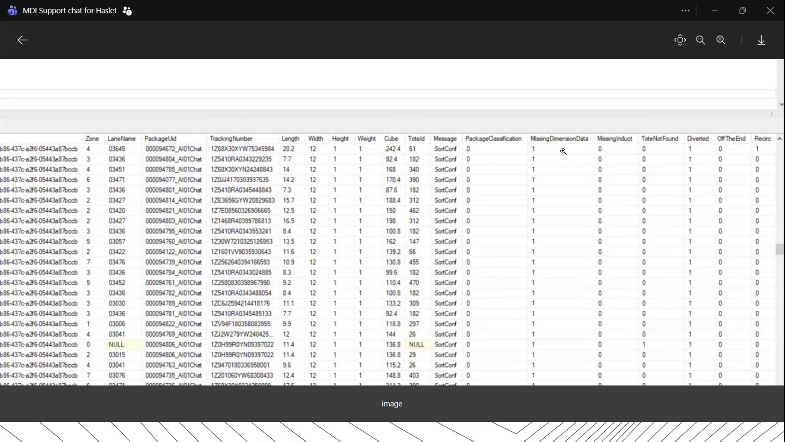
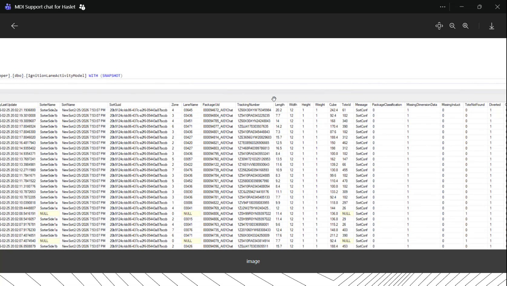
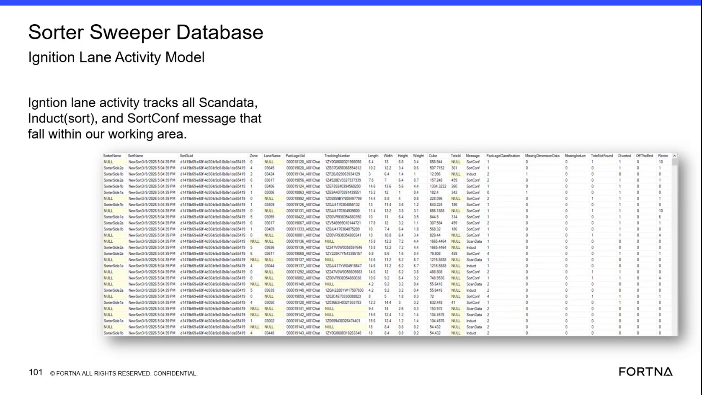
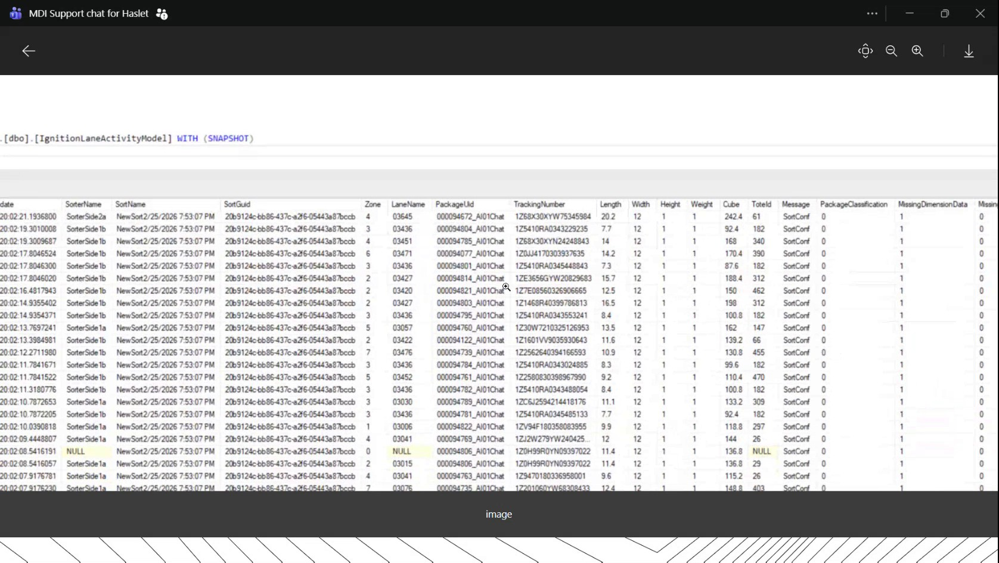

# Inspect Sort Confirmation and Dimension Data in the Helix Lane Activity Model with SSMS

## Runbook Header

| Field | Value |
| --- | --- |
| Procedure ID | `proc_inspect_sort_confirmation_dimension_data_helix_lane_activity_model_v1` |
| Title | Inspect Sort Confirmation and Dimension Data in the Helix Lane Activity Model with SSMS |
| Procedure Type | `diagnostic` |
| Primary Role | `L2_support` |
| Supporting Roles | None |
| Support Safe | Yes |
| Capability Tags | `sorter_item_or_scan_state` |
| Access Surface | `wcs_sql` |
| Audience Roles | `L2_support`, `L3_support` |
| Failure Pattern Tags | `miss_scan_or_dimension_fallback` |
| Validation Status | `needs_sme_review` |
| Merge Status | `source_finalized` |

## Summary

Use the WCS / Helix DB (SSMS) to review recent SortConf records in the Helix2x_1Prod_SorterSweeper database and determine whether lane activity contains package dimensions and sorter-event indicators relevant to missing dimension data, AI1 data loss, or tote overflow.

## When To Use

Use the WCS / Helix DB (SSMS) diagnostic when totes are overflowing, AI1 is reported as not sending data, default package dimensions may be in use, or recent lane activity needs to be checked for missing dimension data and related sorter events.

## Do Not Use For

* Do not use this read-only diagnostic to modify database records or configuration.
* Do not use this procedure to direct site personnel to reboot or modify dimensioner equipment; the source supports identifying missing data in the WCS / Helix DB (SSMS), not performing dimensioner repair.

## Safety And Operational Notes

* Keep the WCS / Helix DB (SSMS) activity read-only.
* Do not modify database records or configuration as part of this diagnostic.

## Access Or Tools Needed

* WCS / Helix DB (SSMS)
* SSMS
* Helix2x_1Prod_SorterSweeper database
* dbo.IgnitionLaneActivityModel

## Related Operational Context

* ctx_training_video_lane_activity_model_reference_v1
* ctx_training_video_ai1_default_dimensions_reference_v1

## Visual References

*WCS / Helix DB (SSMS) results view filtered to SortConf records, showing TrackingNumber, Length, Width, Height, Weight, Cube, and related event-indicator columns.*

*WCS / Helix DB (SSMS) results view showing recent SortConf rows and dimension fields in the IgnitionLaneActivityModel.*

*IgnitionLaneActivityModel field view showing lane, package, dimension, classification, and sorter-event fields, including MissingDimensionData and Recirc.*

*WCS / Helix DB (SSMS) results view showing recent IgnitionLaneActivityModel rows and SortConf-related fields.*

## Procedure Steps

### Step 1 — Open the Helix sorter database in SSMS

**Responsible role:** L2_support

**Instruction:**
In the WCS / Helix DB (SSMS), open the Helix2x_1Prod_SorterSweeper database without making changes to records or configuration.

**Expected result:**
The Helix2x_1Prod_SorterSweeper database is selected and available for inspection in SSMS.

**Stop or Escalate If:**

* The Helix2x_1Prod_SorterSweeper database is unavailable to the WCS / Helix DB (SSMS) user.

---

### Step 2 — Review recent SortConf records

**Responsible role:** L2_support

**Instruction:**
In the WCS / Helix DB (SSMS), open or query dbo.IgnitionLaneActivityModel and filter the Message field to SortConf. Review the most recent records, ordered by the available record identifier in descending order when using the source-supported query pattern.

**Expected result:**
Recent SortConf rows are visible in dbo.IgnitionLaneActivityModel with lane, package, dimension, classification, and sorter-event fields.

**Stop or Escalate If:**

* Recent SortConf records are absent from dbo.IgnitionLaneActivityModel.

---

### Step 3 — Inspect dimension and sorter-event fields

**Responsible role:** L2_support

**Instruction:**
In the WCS / Helix DB (SSMS) SortConf results, inspect TrackingNumber, Length, Width, Height, Weight, and Cube. Also inspect MissingDimensionData, MissingInduct, ToteNotFound, Diverted, OffTheEnd, and Recirc for the same records.

**Expected result:**
The selected SortConf rows show which package dimension fields are populated and the corresponding values of the sorter-event indicators.

**Stop or Escalate If:**

* Dimension fields are consistently missing or defaulted.
* The event indicators show an abnormal pattern that cannot be explained from the available WCS / Helix DB (SSMS) records.

---

### Step 4 — Compare the records with the reported condition

**Responsible role:** L2_support

**Instruction:**
Compare the recent SortConf dimension values and event indicators in the WCS / Helix DB (SSMS) with the reported condition. Treat repeated missing or defaulted dimensions together with MissingDimensionData or the reported AI1 data loss as evidence that the lane activity is not receiving expected dimension data. Do not infer a cause beyond the records.

**Expected result:**
The diagnostic identifies whether the live SortConf records support or do not support the reported missing-dimension or tote-overflow condition.

**Stop or Escalate If:**

* AI1-related data is not represented in recent lane activity records.
* Default dimensions or tote overflow continue and the available records do not explain the condition.

---

### Step 5 — Stop the read-only diagnostic and escalate unexplained findings

**Responsible role:** L2_support

**Instruction:**
Stop the WCS / Helix DB (SSMS) inspection without modifying records or configuration when recent SortConf rows are absent, dimensions remain consistently missing or defaulted, or event indicators show an unexplained abnormal pattern. Escalate the evidence and the reported operating condition to L3_support.

**Expected result:**
The diagnostic ends with the observed database evidence preserved for escalation and no database or configuration changes made.

**Stop or Escalate If:**

* Recent SortConf records are absent.
* Dimension fields are consistently missing or defaulted.
* Event indicators show an abnormal pattern that cannot be explained from the available records.
* Tote overflow continues while AI1 data or expected dimension data is not represented in the lane activity records.

---

## Success Criteria

* Recent SortConf rows are located in dbo.IgnitionLaneActivityModel using the WCS / Helix DB (SSMS).
* TrackingNumber, Length, Width, Height, Weight, Cube, and the listed sorter-event indicators are inspected.
* The records provide live evidence for or against missing dimension data, AI1 data loss, default dimensions, or tote overflow.
* No database records or configuration are modified.

## Failure Conditions

* Recent SortConf records are absent.
* TrackingNumber or dimension fields are consistently missing, blank, null, or defaulted.
* MissingDimensionData is repeatedly asserted or Width, Height, or Weight show the repeated defaulted pattern described in the source.
* AI1-related data is not represented in recent lane activity records.
* Tote overflow continues and the available SortConf records do not explain the condition.

## Escalation Guidance

* Escalate to L3_support when recent SortConf records are absent or the available WCS / Helix DB (SSMS) evidence cannot explain the reported condition.
* Include the reviewed database, table, SortConf filter, affected dimension fields, and observed event-indicator pattern in the escalation.
* Do not direct site personnel to modify dimensioner equipment based solely on this database diagnostic.

## Missing Details / Known Gaps

* The source does not provide a complete validated SQL statement beyond the visible filter and ordering pattern; do not invent or require a query beyond the named database, table, Message = SortConf filter, and recent-record review.
* The source does not define a numeric threshold for an acceptable missing-dimension rate or event-indicator rate.
* The source does not identify a definitive remediation procedure for AI1 or dimensioner equipment.
* The source does not establish a specific escalation queue, case number, or site-specific contact.

## Source Lineage

- Candidate IDs: candidate_training_video_ssms_inspect_lane_activity_sort_confirmation
- Source ID: `training_video_day2`
- Source Type: `training_video`
