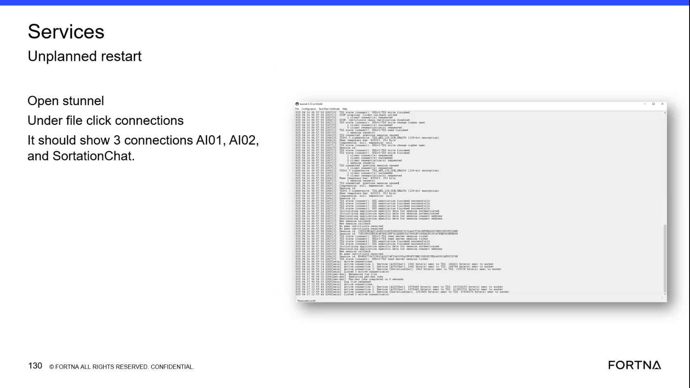

# Check S-Tunnel Active Connections and TLS Status

## Runbook Header

| Field | Value |
| --- | --- |
| Procedure ID | `proc_check_s_tunnel_active_connections_and_tls_status_v1` |
| Title | Check S-Tunnel Active Connections and TLS Status |
| Procedure Type | `diagnostic` |
| Primary Role | `L2_support` |
| Supporting Roles | `L3_support` |
| Support Safe | Yes |
| Capability Tags | `ups_chat_or_stunnel_health` |
| Access Surface | `stunnel` |
| Audience Roles | `L2_support`, `L3_support` |
| Failure Pattern Tags | `stunnel_or_chat_down` |
| Validation Status | `needs_sme_review` |
| Merge Status | `source_finalized` |

## Summary

Use the S-Tunnel / Chat path display on the remotely accessed WCS primary computer to inspect the connection list, active connection count, service names, traffic counters, and TLS status.

## When To Use

Use this diagnostic when verifying whether the live S-Tunnel / Chat path on the WCS primary computer has the expected service connections and successful TLS session status.

## Do Not Use For

* Do not use this procedure as a recovery or restart procedure; the source provides connection and TLS inspection only.
* Do not treat an isolated "No peer certificate received" message as a recovery instruction. Escalate for interpretation when it conflicts with the overall S-Tunnel / Chat path status.

## Safety And Operational Notes

* This is an inspection-only diagnostic. Do not restart S-Tunnel or other services based solely on this procedure.
* Do not infer recovery from an isolated "No peer certificate received" message.

## Access Or Tools Needed

* Remote access to the WCS primary computer
* S-Tunnel / Chat path
* S-Tunnel connections view

## Related Operational Context

* ctx_training_video_day2_remote_computer_access_v1
* ctx_training_video_day2_services_stunnel_screen_v1
* ctx_training_video_day2_stunnel_active_connections_v1
* ctx_training_video_day2_stunnel_tls_status_v1

## Visual References

*S-Tunnel / Chat path display showing the File menu, connections view, active connection messages, service names, traffic counters, and TLS log status.*

## Procedure Steps

### Step 1 — Open the S-Tunnel / Chat path on the WCS primary computer

**Responsible role:** L2_support

**Instruction:**
Using remote access to the WCS primary computer, open the S-Tunnel / Chat path application.

**Expected result:**
The S-Tunnel / Chat path window is visible with its connection log and menu bar.

**Stop or Escalate If:**

* Escalate to L3 support if the S-Tunnel / Chat path application cannot be opened or the connection log is unavailable.

---

### Step 2 — Open the S-Tunnel connections view

**Responsible role:** L2_support

**Instruction:**
In the S-Tunnel / Chat path application, open the File menu and select the connections option.

**Expected result:**
The S-Tunnel connections view opens and displays the active connection information.

**Stop or Escalate If:**

* Escalate to L3 support if the connections option is unavailable or the connections view cannot be opened.

---

### Step 3 — Inspect the active service connection list

**Responsible role:** L2_support

**Instruction:**
In the S-Tunnel connections view, inspect the active connection list for the expected service connections, including AI01, AI02, and SortationChat where displayed.

**Expected result:**
The active connection list shows the expected service entries, including AI01, AI02, and SortationChat where displayed.

**Stop or Escalate If:**

* Escalate to L2/L3 support if an expected service connection is missing.

---

### Step 4 — Verify active connection count and traffic counters

**Responsible role:** L2_support

**Instruction:**
In the S-Tunnel connections view and log, confirm that the display reports 3 active connection(s). Review the per-service bytes sent to TLS and bytes sent to socket counters.

**Expected result:**
The display reports 3 active connection(s), and the active service entries show bytes sent to TLS and bytes sent to socket counters.

**Stop or Escalate If:**

* Escalate to L2/L3 support if the active connection count is not 3.
* Escalate if the expected service entries do not show the traffic counters needed to assess the connection.

---

### Step 5 — Verify successful TLS status in the connection log

**Responsible role:** L2_support

**Instruction:**
Review the S-Tunnel connection log for messages including "TLS negotiation finished successfully" and, where present, session reuse or a connected status.

**Expected result:**
The connection log contains successful TLS negotiation messages and may also show session reuse, a connected status, TLS_AES_128_GCM_SHA256, or authenticated application data.

**Stop or Escalate If:**

* Escalate to L2/L3 support if the connection log does not show successful TLS negotiation.
* Do not treat an isolated "No peer certificate received" message as a recovery instruction; escalate for interpretation if it conflicts with the overall connection status.

---

## Success Criteria

* The S-Tunnel / Chat path connections view is open on the WCS primary computer.
* The expected service connections, including AI01, AI02, and SortationChat where displayed, are present.
* The display reports 3 active connection(s).
* Per-service bytes sent to TLS and bytes sent to socket counters are visible.
* The connection log shows "TLS negotiation finished successfully" and, where present, session reuse or connected status.

## Failure Conditions

* The active connection count is not 3.
* An expected service connection is missing.
* Traffic counters are absent for an expected active service.
* The connection log lacks successful TLS negotiation or connected-status evidence.
* An isolated "No peer certificate received" message conflicts with the overall connection status and requires interpretation.

## Escalation Guidance

* Escalate to L2/L3 support if the active connection count is not 3, an expected service connection is missing, or successful TLS negotiation is not shown.
* Do not restart S-Tunnel or other services under this diagnostic; the source does not provide a recovery or restart procedure.
* Escalate an isolated "No peer certificate received" message for interpretation when it conflicts with the overall connection status.

## Missing Details / Known Gaps

* The source does not specify the remote-access method or connection path to the WCS primary computer.
* The source does not provide a recovery, restart, certificate-remediation, or service-restoration procedure.
* The source does not define an authoritative mapping for every displayed service name or specify required byte-counter thresholds.
* The source does not establish whether the S-Tunnel window must be opened through Windows Services or another launcher.

## Source Lineage

- Candidate IDs: candidate_training_video_stunnel_active_connection_diagnostic
- Source ID: `training_video_day2`
- Source Type: `training_video`
