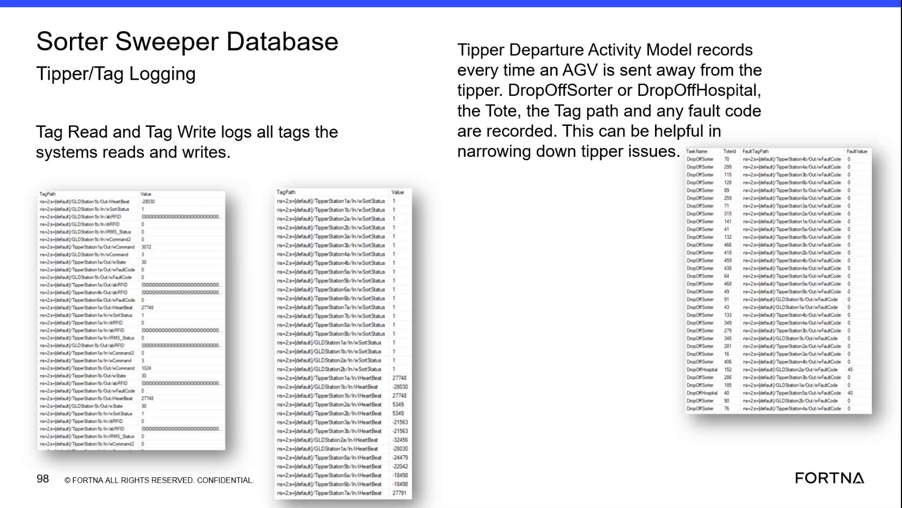

# Diagnose Tipper Issues in SSMS Using Sorter Sweeper Database Tipper Departure and Tag Logs

## Runbook Header

| Field | Value |
| --- | --- |
| Procedure ID | `proc_diagnose_tipper_issues_ssms_tipper_departure_tag_logs_v1` |
| Title | Diagnose Tipper Issues in SSMS Using Sorter Sweeper Database Tipper Departure and Tag Logs |
| Procedure Type | `diagnostic` |
| Primary Role | `L2_support` |
| Supporting Roles | None |
| Support Safe | Yes |
| Capability Tags | `tipper_station_fault` |
| Access Surface | `wcs_sql` |
| Audience Roles | `L2_support`, `L3_support` |
| Failure Pattern Tags | `tipper_fault` |
| Validation Status | `needs_sme_review` |
| Merge Status | `source_finalized` |

## Summary

Use read-only SSMS access to the WCS / Helix Sorter Sweeper Database to inspect Tipper Departure Activity Model records and Tag Read/Tag Write log values associated with an AGV departure. Review the departure destination, tote identifier, fault information, tag path, and recorded value to narrow down a tipper issue without inferring undocumented fault-code meanings or corrective actions.

## When To Use

Use this SSMS / WCS / Helix DB diagnostic when investigating a tipper issue and a corresponding AGV departure from a tipper, DropOffSorter, or DropOffHospital needs to be checked in the Sorter Sweeper Database.

## Do Not Use For

* Do not use this procedure to change database records, perform recovery, or prescribe corrective action.
* Do not infer the meaning of a fault code from the recorded database value alone.
* Do not use this procedure as a replacement for physical intervention or an operational stop.

## Safety And Operational Notes

* Use read-only SSMS inspection only.
* Do not modify database records or infer an unverified fault-code meaning or corrective action.

## Access Or Tools Needed

* SSMS
* WCS / Helix DB (SSMS)
* Sorter Sweeper Database
* Tipper Departure Activity Model records
* Tag Read and Tag Write logs

## Related Operational Context

* ctx_training_video_tag_read_write_logs_v1
* ctx_training_video_tipper_departure_activity_model_v1
* ctx_training_video_tipper_departure_record_fields_v1
* ctx_training_video_tipper_issue_log_context_v1

## Visual References

*Sorter Sweeper Database view showing Tipper Departure Activity Model records and Tag Read/Tag Write log fields, including Task Name, ToteId, Fault, TagPath, and Value.*

## Procedure Steps

### Step 1 — Open the Sorter Sweeper Database records in SSMS

**Responsible role:** L2_support

**Instruction:**
In SSMS on the WCS / Helix DB surface, open the Sorter Sweeper Database and locate the Tipper Departure Activity Model records and the Tag Read and Tag Write log view or model. Use the available record display without modifying data.

**Expected result:**
The live SSMS display exposes Tipper Departure Activity Model records and Tag Read/Tag Write entries with recorded tag paths and values.

**Stop or Escalate If:**

* Escalate if the expected Sorter Sweeper Database records or log fields are unavailable.

---

### Step 2 — Locate the relevant departure record

**Responsible role:** L2_support

**Instruction:**
In the SSMS Tipper Departure Activity Model records, review the entries for the relevant AGV departure from a tipper, DropOffSorter, or DropOffHospital.

**Expected result:**
A departure record is identified for the relevant tipper, DropOffSorter, or DropOffHospital event.

**Stop or Escalate If:**

* Escalate if the expected departure record is missing.

---

### Step 3 — Inspect the departure and tag log fields

**Responsible role:** L2_support

**Instruction:**
In the live SSMS record display, inspect the Task Name, ToteId, Fault or fault-code field, TagPath, and Value fields for the relevant departure and associated Tag Read/Tag Write entries.

**Expected result:**
The record display provides the Task Name, ToteId, Fault or fault-code information, TagPath, and Value associated with the departure or tag log entry.

**Stop or Escalate If:**

* Escalate if the record has an associated fault code.
* Escalate if the expected Task Name, ToteId, Fault, TagPath, or Value fields cannot be inspected.

---

### Step 4 — Correlate tag values with the departure record

**Responsible role:** L2_support

**Instruction:**
In SSMS, compare the TagPath and Value from the Tag Read/Tag Write entries with the relevant Tipper Departure Activity Model record, including its Task Name, ToteId, departure destination, and Fault or fault-code information. Treat the displayed values as recorded data; do not assign an undocumented meaning to a fault code.

**Expected result:**
The tag path and value can be associated with the relevant departure record, or the record shows that the event cannot be correlated.

**Stop or Escalate If:**

* Escalate if the TagPath and Value cannot be correlated with the tipper event.
* Do not infer a fault-code meaning or corrective action when the database record only provides the recorded value.

---

## Success Criteria

* A corresponding Tipper Departure Activity Model record is identified for the relevant tipper, DropOffSorter, or DropOffHospital departure.
* The live SSMS display provides the applicable Task Name, ToteId, Fault or fault-code information, TagPath, and Value fields.
* Tag Read/Tag Write entries can be correlated with the associated departure record, or the inability to correlate them is clearly identified for escalation.
* No database mutation or unsupported fault-code interpretation is performed.

## Failure Conditions

* The expected departure record is missing.
* The record contains an associated fault code.
* Task Name, ToteId, Fault, TagPath, or Value cannot be inspected.
* TagPath and Value cannot be correlated with the tipper departure.
* The available database value does not support a verified fault-code meaning or corrective action.

## Escalation Guidance

* Escalate to L3_support or the applicable engineering support path when the expected departure record is missing, the record has an associated fault code, or TagPath and Value cannot be correlated with the tipper event.
* Provide the observed Task Name, ToteId, Fault or fault-code value, TagPath, Value, and the associated departure destination in the escalation.
* Do not infer a fault-code meaning or corrective action from the database record alone.

## Missing Details / Known Gaps

* The source does not provide a table name or exact SSMS navigation path.
* The source does not provide a SQL statement or query filter for identifying the relevant AGV departure.
* The source does not define the meaning of individual fault-code values.
* The source does not specify a corrective action or recovery procedure for a fault code or an uncorrelated TagPath and Value.
* The source does not specify an estimate for procedure duration.
* No site, customer, or incident context metadata is supplied.

## Source Lineage

- Candidate IDs: candidate_training_video_tipper_departure_tag_log_diagnostic
- Source ID: `training_video_day2`
- Source Type: `training_video`
