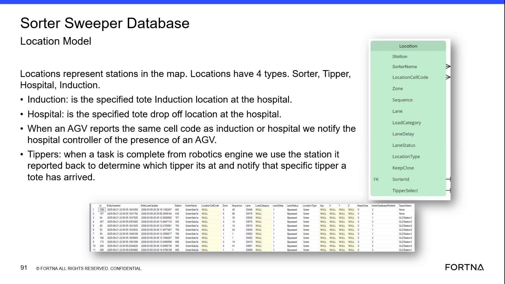

# Validate Sorter Location Records and Lane Status in SSMS

## Runbook Header

| Field | Value |
| --- | --- |
| Procedure ID | `proc_validate_sorter_location_records_and_lane_status_in_ssms_v1` |
| Title | Validate Sorter Location Records and Lane Status in SSMS |
| Procedure Type | `diagnostic` |
| Primary Role | `L2_support` |
| Supporting Roles | `L3_support` |
| Support Safe | Yes |
| Capability Tags | `lane_or_chute_state`, `zone_config_state` |
| Access Surface | `wcs_sql` |
| Audience Roles | `L2_support`, `L3_support` |
| Failure Pattern Tags | `mapping_abnormal`, `chute_bypassed_or_stuck_closed` |
| Validation Status | `needs_sme_review` |
| Merge Status | `source_finalized` |

## Summary

Use the WCS / Helix DB (SSMS) in read-only mode to inspect the SorterSweeper Location Model, verify station and location mappings, and interpret LaneStatus for a selected sorter, tipper, hospital, or induction location.

## When To Use

Use this read-only WCS / Helix DB (SSMS) diagnostic when support must validate a SorterSweeper location record, station or cell-code mapping, location category, lane status, or related KeepClose and TipperSelect configuration.

## Do Not Use For

* Do not use this procedure to modify database rows or configuration values.
* Do not use this procedure as a physical sorter, AGV, hospital, or tipper recovery procedure.
* Do not treat a nullable LoadCategory or AGV-related field as a fault solely because its value is NULL.
* Do not use this procedure to infer an undocumented LaneStatus value or an unverified station mapping.

## Safety And Operational Notes

* This is a read-only diagnostic. Do not update database or configuration values as part of this procedure.
* LaneStatus interpretation is observational: Active is open for use, Bypassed is closed, and Not tracking is excluded from use until it becomes Active or Bypassed.

## Access Or Tools Needed

* WCS / Helix DB (SSMS)
* Read-only access to the WCS / Helix SorterSweeper database
* SorterSweeper Location Model or corresponding location records

## Related Operational Context

* ctx_training_video_sorter_database_model_v1
* ctx_training_video_sorter_location_types_v1
* ctx_training_video_sorter_location_attributes_status_v1
* ctx_training_video_agv_location_presence_notifications_v1

## Visual References

*WCS / Helix DB (SSMS) Sorter Sweeper Database Location Model view showing Location, Station, SorterName, LocationCellCode, Zone, Sequence, Lane, LoadCategory, LaneDelay, LaneStatus, LocationType, KeepClose, TipperSelect, and sample rows.*

## Procedure Steps

### Step 1 — Open the SorterSweeper database in SSMS

**Responsible role:** L2_support

**Instruction:**
In WCS / Helix DB (SSMS), select the WCS / Helix SorterSweeper database and open the Location Model or its corresponding location records using read-only access.

**Expected result:**
The SorterSweeper location records are available for inspection in SSMS.

**Stop or Escalate If:**

* Escalate if the expected SorterSweeper database or Location Model is missing.
* Stop if the available access does not provide a read-only inspection path.

---

### Step 2 — Inspect the location record fields

**Responsible role:** L2_support

**Instruction:**
In the WCS / Helix DB (SSMS) Location Model records, inspect Location, Station, SorterName, LocationCellCode, Zone, Sequence, Lane, LoadCategory, LaneDelay, LaneStatus, LocationType, KeepClose, and TipperSelect.

**Expected result:**
The selected location row is present and its available fields can be read, including its station, cell code, lane, location type, and lane status.

**Stop or Escalate If:**

* Escalate if the expected location row is missing.
* Do not change a value because it appears NULL; verify whether the field is documented as nullable.

---

### Step 3 — Validate the location type

**Responsible role:** L2_support

**Instruction:**
In the WCS / Helix DB (SSMS) location record, inspect LocationType and compare it with the documented categories: Sorter, Tipper, Hospital, or Induction.

**Expected result:**
LocationType identifies the selected location as Sorter, Tipper, Hospital, or Induction.

**Stop or Escalate If:**

* Escalate if LocationType is undocumented or does not match the station mapping.

---

### Step 4 — Compare LocationCellCode with the station mapping

**Responsible role:** L2_support

**Instruction:**
In the WCS / Helix DB (SSMS), compare the selected location's LocationCellCode and Station with the associated station mapping. For an Induction or Hospital location, verify whether the AGV-reported cell code is the same cell code as the location used for the hospital-controller presence notification.

**Expected result:**
The selected LocationCellCode corresponds to the intended Station; for an Induction or Hospital location, the mapping identifies the cell code used for the documented hospital-controller notification behavior.

**Stop or Escalate If:**

* Escalate if LocationCellCode does not match the station mapping.
* Escalate if an Induction or Hospital location cannot be associated with the expected cell-code relationship.

---

### Step 5 — Interpret LaneStatus

**Responsible role:** L2_support

**Instruction:**
In the WCS / Helix DB (SSMS) location record, inspect LaneStatus and record whether it is Active, Bypassed, or Not tracking.

**Expected result:**
LaneStatus displays one of the documented values and support records the corresponding operational interpretation.

**Stop or Escalate If:**

* Escalate if LaneStatus contains an undocumented value.
* Escalate if the location remains Not tracking when it is expected to participate in sorter operation.
* Do not change LaneStatus or other database values as part of this diagnostic.

---

### Step 6 — Review KeepClose and TipperSelect when applicable

**Responsible role:** L2_support

**Instruction:**
In the WCS / Helix DB (SSMS) location record, inspect KeepClose and TipperSelect when those configuration values are relevant to the location. Preserve source-supported NULL values for nullable fields, including applicable load-category or AGV-related values, rather than treating every NULL as an error.

**Expected result:**
KeepClose and TipperSelect are recorded when applicable, and nullable fields are distinguished from mapping or status faults.

**Stop or Escalate If:**

* Escalate if a relevant KeepClose or TipperSelect value conflicts with the expected location mapping.
* Do not modify configuration values.
* Do not escalate a nullable field solely because its value is NULL.

---

## Success Criteria

* The selected location row is present in the SorterSweeper Location Model.
* LocationType is one of Sorter, Tipper, Hospital, or Induction and matches the intended station category.
* LocationCellCode corresponds to the associated Station mapping.
* LaneStatus is Active, Bypassed, or Not tracking and its operational meaning is recorded.
* KeepClose and TipperSelect are reviewed when relevant without treating supported NULL values as faults.
* No database or configuration values are changed.

## Failure Conditions

* The expected location row is missing.
* LocationType or LocationCellCode does not match the station mapping.
* LaneStatus contains an undocumented value.
* The location remains Not tracking when it is expected to participate in sorter operation.
* A relevant KeepClose or TipperSelect value conflicts with the expected location use.

## Escalation Guidance

* Escalate missing rows, station or cell-code mapping mismatches, and undocumented LaneStatus values to L3_support or the owning engineering team.
* Escalate a location that remains Not tracking when it is expected to participate in sorter operation.
* Include the observed location identity, Station, LocationCellCode, LocationType, LaneStatus, and relevant KeepClose or TipperSelect values in the escalation.
* Do not make database or configuration changes during this read-only diagnostic.

## Missing Details / Known Gaps

* The source does not provide exact SSMS navigation steps, database-instance details, or a validated SQL query.
* The source does not define the complete station-mapping lookup procedure or identify a specific live location to validate.
* The source does not provide escalation contact names or an engineering-team routing path.
* The source does not establish a time estimate for completing the diagnostic.

## Source Lineage

- Candidate IDs: candidate_training_video_validate_sorter_location_status_in_ssms
- Source ID: `training_video_day2`
- Source Type: `training_video`
