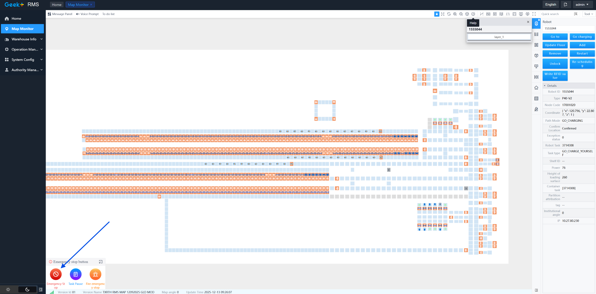
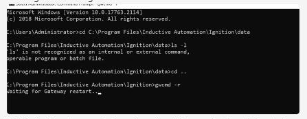
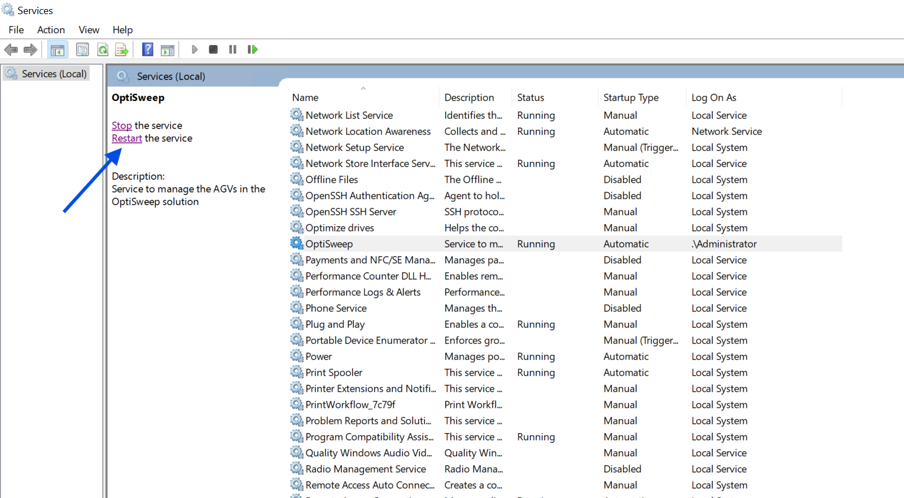

# Site-wide robotic movement stoppage with abnormal RMS/HMI state and possible service failure

## Playbook Header

| Field | Value |
| --- | --- |
| Playbook ID | `playbook_incident_228086_sitewide_motion_stop_optisweep_recovery` |
| Case ID | `228086` |
| Extraction Mode | `one_playbook_candidate_per_incident` |
| Confidence | `high` |
| Validation Status | `needs_sme_review` |

## Entry Symptoms

- Nothing is moving at the site.
- Robotic system reported as not responding.
- Small sort is not running.
- Multiple bots or AGVs are not moving in various areas.
- Totes cannot be removed from hospital.
- RMS or HMI shows question marks or an abnormal blank state.
- RMS/HMI screen shows '.NET Control not created.'

## Affected Systems

- OptiSweep service
- AGV/robotic system
- RMS / Geek+ RMS
- Ignition gateway
- Windows Event Viewer
- Windows Services
- WCSWebApplication
- GetAgvStatuses API endpoint

## Nodes

### 1 — Confirm site-wide stoppage pattern and abnormal interface state (`diagnostic_decision`)

**Intent:** Determine whether the reported issue matches the broad stoppage pattern that warrants checking the OptiSweep, RMS, and Ignition recovery path.

**Runbook Links:**

- `proc_verify_agvs_are_in_the_szonestaging_state_on_the_hmi_v1` (high, score=0.6222, boosted=0.7922) — Verify AGVs Are in the "szonestaging" State on the HMI
  - gaps: No retrieved runbook explicitly covers confirming site-wide stoppage symptoms with the site; No retrieved runbook explicitly references RMS blank-state or '.NET Control not created.'; Candidate is narrower than the node's multi-symptom intake intent

**Decision Outcomes:**

- `healthy`: Movement is not broadly stopped and HMI/RMS does not show the abnormal blank or question-mark state associated with this incident pattern.
- `unhealthy`: Site-wide or multi-area stoppage pattern is confirmed, with supporting abnormal HMI/RMS indicators such as question marks or blank '.NET Control not created.' state.
- `inconclusive`: Initial symptom pattern cannot be confidently confirmed from site report or visible HMI/RMS evidence.

**Branches:**

- `unhealthy` → `node_2` when stoppage_pattern_confirmed
- `inconclusive` → `node_7` when entry_pattern_not_confirmed

**Linked Runbook Procedures:**

#### Runbook: Verify AGVs Are in the "szonestaging" State on the HMI

- **Procedure ID:** `proc_verify_agvs_are_in_the_szonestaging_state_on_the_hmi_v1`
- **Procedure Type:** `diagnostic`
- **Role:** `L1_support`
- **Merge Status:** `pass_through`

**Summary:**
Confirm on the HMI that the AGVs being checked are displayed in the documented "szonestaging" state before restart or resume actions in AGV fault recovery.

**When To Use:**
Use this check when AGV fault recovery or restart guidance requires confirmation that AGVs are in the documented ready state before restarting or resuming the system.

**Safety Notes:**

- Stop and escalate if the HMI does not show AGV state or if the AGVs are not shown as "szonestaging" when this verification is required.
- Do not infer equivalent AGV states that are not explicitly documented in the source.

- **Source:** `manual` / `manual_optisweep_om_v3`

**Procedure Steps:**

##### Step 1 — Open the HMI view showing AGV state

**Responsible role:** L1_support

**Instruction:**
Open or view the HMI area where AGV state is displayed for the AGVs being checked.

**Healthy condition:**
The AGV state field or status area is visible on the HMI.

**Expected result:**
The HMI view showing AGV state is visible.

**Step Images:**

*Use the nearby page 90 AGV recovery screen as contextual visual support for the HMI-based AGV status verification; review the AGV status area referenced by the source.*

---

##### Step 2 — Identify the AGV state value

**Responsible role:** L1_support

**Instruction:**
Identify the AGV state value shown on the HMI for the AGVs being checked.

**Healthy condition:**
The HMI clearly shows a readable AGV state value.

**Expected result:**
A visible AGV state value is identified for each AGV being checked.

**Step Images:**

*Look for the AGV status/state information referenced by the page 90 recovery guidance.*

---

##### Step 3 — Verify the state is "szonestaging"

**Responsible role:** L1_support

**Instruction:**
Verify that the displayed AGV state is exactly "szonestaging" for the AGVs being checked.

**Healthy condition:**
The displayed AGV state is exactly "szonestaging".

**Expected result:**
The AGVs are confirmed either to be in "szonestaging" or not in the required state.

**Step Images:**

*Confirm the AGV status/state matches the documented value "szonestaging" referenced by the source.*

---

##### Step 4 — Confirm readiness before restart or resume

**Responsible role:** L1_support

**Instruction:**
Record or confirm that the AGVs are in the documented ready state before proceeding with restart or resume actions.

**Healthy condition:**
The AGVs have been confirmed as being in "szonestaging" before restart or resume actions.

**Expected result:**
A clear confirmation is made that the AGVs are in the documented ready state, or escalation is initiated if they are not.

---

**Success Criteria:**

- The HMI displays AGV state for the AGVs being checked.
- The displayed AGV state is confirmed as exactly "szonestaging".
- The AGVs are confirmed in the documented ready state before restart or resume actions.

**Failure Conditions:**

- The HMI does not show AGV state.
- The AGV state cannot be identified or read.
- The AGV state is not "szonestaging" when this verification is required.
- Proceeding would require inferring an undocumented equivalent state.

---

### 2 — Check for OptiSweep service failure and related application evidence (`diagnostic_decision`)

**Intent:** Determine whether the stoppage correlates with an OptiSweep service termination and nearby application-log errors that support the service-recovery path.

**Runbook Links:**

- `proc_gather_required_fault_information_before_entering_the_grid_for_agv_recovery_v1` (medium, score=0.5248, boosted=0.4748) — Gather Required Fault Information Before Entering the Grid for AGV Recovery
  - gaps: No retrieved runbook explicitly covers Windows Event Viewer review; No retrieved runbook explicitly references Service Control Manager Event 7031; No retrieved runbook explicitly covers WCSWebApplication/Application Error log correlation

**Decision Outcomes:**

- `healthy`: No correlated OptiSweep service-failure evidence is found around the outage window.
- `unhealthy`: Event Viewer shows OptiSweep termination or equivalent service-failure evidence correlated with the outage.
- `inconclusive`: Evidence is incomplete or ambiguous and does not clearly confirm or rule out the service-failure path.

**Branches:**

- `unhealthy` → `node_3` when optisweep_service_failure_evidence
- `inconclusive` → `node_7` when no_supported_service_path_confirmed

**Linked Runbook Procedures:**

#### Runbook: Gather Required Fault Information Before Entering the Grid for AGV Recovery

- **Procedure ID:** `proc_gather_required_fault_information_before_entering_the_grid_for_agv_recovery_v1`
- **Procedure Type:** `diagnostic`
- **Role:** `L2_support`
- **Merge Status:** `pass_through`

**Summary:**
Collect the source-required AGV and RMS details before going inside the grid (Dance Floor) to perform fault recovery.

**When To Use:**
Use before going inside the grid (also called the Dance Floor) for AGV fault recovery, to ensure the required Robot ID, RMS fault description, bin/tote status, tote ID when applicable, and under-rack empty-AGV zone status have been gathered.

**Safety Notes:**

- Entering the grid (Dance Floor) implies elevated operational risk per the candidate context.
- Before going inside the grid, make sure to have the required Robot ID, fault description from RMS, bin/tote status, tote ID when applicable, and under-rack empty-AGV zone status.
- Do not proceed into the grid without the documented information.

- **Source:** `manual` / `manual_optisweep_om_v3`

**Procedure Steps:**

##### Step 1 — Identify the Robot ID for the faulted AGV

**Responsible role:** L2_support

**Instruction:**
Identify and record the Robot ID for the faulted AGV before going inside the grid.

**Healthy condition:**
A single faulted AGV is clearly identified and its Robot ID is available for recovery preparation.

**Expected result:**
The Robot ID for the faulted AGV is known and recorded.

**Step Images:**

*Look for the AGV fault interface context associated with Robot ID and fault recovery information.*

*Look for AGV details/status context that may support identifying the affected AGV.*

---

##### Step 2 — Obtain the fault description from RMS

**Responsible role:** L2_support

**Instruction:**
Access RMS and obtain the fault description for the faulted AGV.

**Healthy condition:**
The RMS fault description is visible and clearly associated with the identified faulted AGV.

**Expected result:**
The RMS fault description for the faulted AGV is available and recorded.

**Step Images:**

*Look for the AGV fault screen context referenced for RMS fault description during fault recovery.*

---

##### Step 3 — Check whether RMS indicates the AGV is holding a bin

**Responsible role:** L2_support

**Instruction:**
Check in RMS whether the faulted AGV is indicated as holding a bin.

**Healthy condition:**
RMS clearly indicates whether the faulted AGV is or is not holding a bin.

**Expected result:**
The bin/tote holding status of the faulted AGV is known.

**Step Images:**

*Look for fault recovery screen context related to RMS fault and tote/bin status.*

---

##### Step 4 — Record the tote ID if the AGV is holding a bin

**Responsible role:** L2_support

**Instruction:**
If RMS indicates the faulted AGV is holding a bin, record the tote ID.

**Healthy condition:**
A tote ID is documented for a faulted AGV that RMS shows as holding a bin, or the step is not applicable because no bin is held.

**Expected result:**
The tote ID is recorded when the faulted AGV is holding a bin.

**Step Images:**

*Look for screen context related to tote ID during AGV fault recovery.*

*Look for a faulted AGV with tote context that may help interpret tote-related recovery information.*

---

##### Step 5 — Verify under-rack empty-AGV zone status when applicable

**Responsible role:** L2_support

**Instruction:**
If the faulted AGV is under a rack, verify whether that AGV is the empty AGV for that zone.

**Healthy condition:**
For an AGV under a rack, it is known whether that AGV is the empty AGV for the zone; otherwise the step is not applicable.

**Expected result:**
The under-rack empty-AGV zone status is confirmed when applicable.

**Step Images:**

*Look for no-empty-AGV zone context relevant to determining whether the under-rack AGV is the empty AGV for that zone.*

*Look for AGV positioning and zone context that may help interpret under-rack AGV status.*

---

##### Step 6 — Confirm all required information before entering the grid

**Responsible role:** L2_support

**Instruction:**
Confirm that you have the Robot ID, RMS fault description, bin/tote status, tote ID when applicable, and under-rack empty-AGV zone status when applicable before going inside the grid.

**Healthy condition:**
The required information set is complete and ready for use during AGV recovery.

**Expected result:**
All source-required pre-entry information has been collected and confirmed.

**Step Images:**

*Use as a reference for AGV fault recovery context while confirming the collected information.*

---

**Success Criteria:**

- The Robot ID for the faulted AGV is documented.
- The RMS fault description is documented.
- The AGV bin/tote holding status is documented.
- The tote ID is documented when RMS indicates the AGV is holding a bin.
- The under-rack empty-AGV zone status is documented when applicable.
- The information is confirmed before entering the grid.

**Failure Conditions:**

- Robot ID cannot be confirmed.
- RMS fault description cannot be obtained.
- Bin/tote holding status cannot be determined.
- Tote ID cannot be confirmed when the AGV is holding a bin.
- Under-rack empty-AGV zone status cannot be confirmed when applicable.
- Any required information is missing before grid entry.

---

### 3 — Perform approved recovery for the affected service or gateway path (`procedure_reference`)

**Intent:** Carry out the supported recovery action for the named service or gateway when the diagnostic evidence supports that path and the role is authorized.

**Runbook Links:**

- `proc_restart_ignition_and_verify_optisweep_service_response_with_getagvstatuses_v1` (high, score=0.626, boosted=0.716) — Restart Ignition and verify OptiSweep service response with GetAgvStatuses
  - gaps: May not fully cover standalone OptiSweep service reset if gateway restart is not required

**Decision Outcomes:**

- `healthy`: Approved service/gateway recovery completes and the service path appears responsive enough to proceed to validation.
- `unhealthy`: Recovery completes but site movement remains blocked or AGVs still appear abnormal in RMS.
- `escalate`: Authorized recovery cannot be safely performed, fails, or does not produce a supported next step.

**Branches:**

- `unhealthy` → `node_4` when movement_still_blocked_or_agvs_abnormal
- `healthy` → `node_6` when service_path_recovered
- `escalate` → `node_7` when recovery_not_safe_or_unsuccessful

**Linked Runbook Procedures:**

#### Runbook: Restart Ignition and verify OptiSweep service response with GetAgvStatuses

- **Procedure ID:** `proc_restart_ignition_and_verify_optisweep_service_response_with_getagvstatuses_v1`
- **Procedure Type:** `recovery`
- **Role:** `L2_support`
- **Merge Status:** `pass_through`

**Summary:**
Conditional incident-derived recovery guidance for restarting Ignition and confirming OptiSweep service responsiveness before releasing the E-stop. The source instructs the operator to first E-stop the system, restart Ignition with `gwcmd -r`, wait until the gateway is back up and login is possible, then verify OptiSweep by sending a GetAgvStatuses request. If no response is returned, restart OptiSweep, send the request again, and only then release the E-stop.

**When To Use:**
Use when the incident-specific guidance indicates Ignition may need to be restarted and you need to confirm the OptiSweep service is responding again before releasing the E-stop.

**Safety Notes:**

- First E-stop the system before attempting the restart.
- Do not release the E-stop until OptiSweep response is confirmed.
- If Ignition does not come back up to a login-capable state, stop and do not perform undocumented changes beyond the source-shared restart sequence.
- If response still cannot be confirmed after the documented restart steps, stop and escalate rather than inventing additional recovery actions.

- **Source:** `incident_case` / `source_case_228086`

**Procedure Steps:**

##### Step 1 — E-stop the system before restart

**Responsible role:** L2_support

**Instruction:**
First E-stop the system before attempting the restart.

**Healthy condition:**
The system is in E-stop and restart activity has not yet begun.

**Expected result:**
The system is placed in E-stop before any Ignition restart action is taken.

**Step Images:**

*Emergency stop control area highlighted in the RMS/system control context.*

---

##### Step 2 — Restart Ignition from the Ignition directory

**Responsible role:** L2_support

**Instruction:**
Open a Windows command prompt on the Ignition host, navigate to the Ignition installation directory, and run `gwcmd -r` from `C:\Program Files\Inductive Automation\Ignition>`. Observe the console message `Waiting for Gateway restart...`.

**Healthy condition:**
The command prompt shows `gwcmd -r` executed from the Ignition directory and displays `Waiting for Gateway restart...`.

**Expected result:**
The Ignition gateway restart command is accepted and the console shows `Waiting for Gateway restart...`.

**Step Images:**

*Command prompt in `C:\Program Files\Inductive Automation\Ignition>` showing `gwcmd -r` and `Waiting for Gateway restart...`.*

*Restart-instruction screenshot context showing the Ignition restart command sequence.*

---

##### Step 3 — Wait for Ignition to come back up

**Responsible role:** L2_support

**Instruction:**
Wait for Ignition to come back up, meaning it lets you log in and does not show the gateway starting up. Use the Ignition status/login page to confirm the gateway is reachable.

**Healthy condition:**
The Ignition Status > Systems > Overview page is reachable, with visible system widgets and no gateway-starting-up screen.

**Expected result:**
Ignition is reachable again and presents a login-capable or status page rather than a startup screen.

**Step Images:**

*Ignition Status > Systems > Overview page reachable in the browser, with Current Response Time and no startup screen.*

---

##### Step 4 — Send GetAgvStatuses request after Ignition restart

**Responsible role:** L2_support

**Instruction:**
Open the API client identified in the source as api dog and send a GetAgvStatuses request to `http://10.27.80.165:5000/GetAgvStatuses`.

**Healthy condition:**
The API client shows the GetAgvStatuses request executed successfully against the documented endpoint.

**Expected result:**
The request executes against the shown endpoint and returns a response from the OptiSweep service.

**Step Images:**

*API client showing GET request to `http://10.27.80.165:5000/GetAgvStatuses`.*

---

##### Step 5 — Confirm HTTP 200 and returned AGV records

**Responsible role:** L2_support

**Instruction:**
Check that the GetAgvStatuses request returns HTTP 200 and returned AGV records. Visible records in the source include status values such as `NORMAL`. Do not treat the visible schema validation warning alone as a service outage if the request still returns HTTP 200 with data.

**Healthy condition:**
The response panel shows Success (200) / Status: 200 and returned JSON records with visible AGV status values such as `NORMAL`.

**Expected result:**
The API response shows Success/Status 200 and returned AGV records, including visible status values such as `NORMAL`.

**Step Images:**

*Response panel showing Success/Status 200 and returned records with visible `NORMAL` values; note the validation warning but do not treat it alone as outage proof.*

---

##### Step 6 — If no response, restart OptiSweep and retry GetAgvStatuses

**Responsible role:** L2_support

**Instruction:**
If no response is given, restart OptiSweep, then send another GetAgvStatuses request to confirm response. The source supports this at a high level only; use the Windows Services console context shown for OptiSweep and do not invent additional click-by-click steps not present in the source.

**Healthy condition:**
The follow-up request returns a confirmed response after the OptiSweep restart.

**Expected result:**
OptiSweep is restarted and a follow-up GetAgvStatuses request is sent to confirm response.

**Step Images:**

*Windows Services console with OptiSweep selected, showing Running state and restart control visible.*

*Use the same GetAgvStatuses request view to retry and confirm response.*

---

##### Step 7 — Release the E-stop after response is confirmed

**Responsible role:** L2_support

**Instruction:**
Once the response is confirmed, release the E-stop.

**Healthy condition:**
A confirmed GetAgvStatuses response exists before the E-stop is released.

**Expected result:**
The E-stop is released only after OptiSweep response has been confirmed.

**Step Images:**

*System control context with emergency stop control area relevant to release after confirmation.*

---

**Success Criteria:**

- Ignition is reachable again and allows login or status-page access rather than showing gateway startup.
- The GetAgvStatuses request to `http://10.27.80.165:5000/GetAgvStatuses` returns HTTP 200.
- Returned AGV records are visible in the response, including status values such as `NORMAL`.
- If OptiSweep had to be restarted, a follow-up GetAgvStatuses request confirms response.
- The E-stop is released only after response confirmation.

**Failure Conditions:**

- Ignition does not come back up to a login-capable state.
- The GetAgvStatuses endpoint is unreachable or returns no response.
- The request returns no data.
- Response still cannot be confirmed after the documented OptiSweep restart and retry.
- Recovery would require undocumented actions beyond the source-shared sequence.

---

### 4 — Determine whether AGVs remain out of sync after service recovery (`diagnostic_decision`)

**Intent:** Check whether the service or gateway recovery left AGVs in an abnormal synchronization or mapping state that still blocks site operation.

**Runbook Links:**

- `proc_gather_required_fault_information_before_entering_the_grid_for_agv_recovery_v1` (high, score=0.6668, boosted=0.6568) — Gather Required Fault Information Before Entering the Grid for AGV Recovery
  - gaps: No retrieved runbook explicitly covers Geek+ RMS out-of-sync or removed AGV identification; No explicit roster/map-monitor or zone-missing workflow in retrieved candidates

**Decision Outcomes:**

- `healthy`: RMS does not show remaining out-of-sync, missing, or abnormal AGVs after service recovery.
- `unhealthy`: Specific AGVs or zones are identified as out of sync, missing, unexpectedly removed, or otherwise abnormal.
- `inconclusive`: RMS evidence is insufficient to determine whether AGVs remain out of sync.

**Branches:**

- `unhealthy` → `node_5` when agvs_identified_for_correction
- `healthy` → `node_6` when no_remaining_agv_sync_issue
- `inconclusive` → `node_7` when agv_state_unclear

**Linked Runbook Procedures:**

#### Runbook: Gather Required Fault Information Before Entering the Grid for AGV Recovery

- **Procedure ID:** `proc_gather_required_fault_information_before_entering_the_grid_for_agv_recovery_v1`
- **Procedure Type:** `diagnostic`
- **Role:** `L2_support`
- **Merge Status:** `pass_through`

**Summary:**
Collect the source-required AGV and RMS details before going inside the grid (Dance Floor) to perform fault recovery.

**When To Use:**
Use before going inside the grid (also called the Dance Floor) for AGV fault recovery, to ensure the required Robot ID, RMS fault description, bin/tote status, tote ID when applicable, and under-rack empty-AGV zone status have been gathered.

**Safety Notes:**

- Entering the grid (Dance Floor) implies elevated operational risk per the candidate context.
- Before going inside the grid, make sure to have the required Robot ID, fault description from RMS, bin/tote status, tote ID when applicable, and under-rack empty-AGV zone status.
- Do not proceed into the grid without the documented information.

- **Source:** `manual` / `manual_optisweep_om_v3`

**Procedure Steps:**

##### Step 1 — Identify the Robot ID for the faulted AGV

**Responsible role:** L2_support

**Instruction:**
Identify and record the Robot ID for the faulted AGV before going inside the grid.

**Healthy condition:**
A single faulted AGV is clearly identified and its Robot ID is available for recovery preparation.

**Expected result:**
The Robot ID for the faulted AGV is known and recorded.

**Step Images:**

*Look for the AGV fault interface context associated with Robot ID and fault recovery information.*

*Look for AGV details/status context that may support identifying the affected AGV.*

---

##### Step 2 — Obtain the fault description from RMS

**Responsible role:** L2_support

**Instruction:**
Access RMS and obtain the fault description for the faulted AGV.

**Healthy condition:**
The RMS fault description is visible and clearly associated with the identified faulted AGV.

**Expected result:**
The RMS fault description for the faulted AGV is available and recorded.

**Step Images:**

*Look for the AGV fault screen context referenced for RMS fault description during fault recovery.*

---

##### Step 3 — Check whether RMS indicates the AGV is holding a bin

**Responsible role:** L2_support

**Instruction:**
Check in RMS whether the faulted AGV is indicated as holding a bin.

**Healthy condition:**
RMS clearly indicates whether the faulted AGV is or is not holding a bin.

**Expected result:**
The bin/tote holding status of the faulted AGV is known.

**Step Images:**

*Look for fault recovery screen context related to RMS fault and tote/bin status.*

---

##### Step 4 — Record the tote ID if the AGV is holding a bin

**Responsible role:** L2_support

**Instruction:**
If RMS indicates the faulted AGV is holding a bin, record the tote ID.

**Healthy condition:**
A tote ID is documented for a faulted AGV that RMS shows as holding a bin, or the step is not applicable because no bin is held.

**Expected result:**
The tote ID is recorded when the faulted AGV is holding a bin.

**Step Images:**

*Look for screen context related to tote ID during AGV fault recovery.*

*Look for a faulted AGV with tote context that may help interpret tote-related recovery information.*

---

##### Step 5 — Verify under-rack empty-AGV zone status when applicable

**Responsible role:** L2_support

**Instruction:**
If the faulted AGV is under a rack, verify whether that AGV is the empty AGV for that zone.

**Healthy condition:**
For an AGV under a rack, it is known whether that AGV is the empty AGV for the zone; otherwise the step is not applicable.

**Expected result:**
The under-rack empty-AGV zone status is confirmed when applicable.

**Step Images:**

*Look for no-empty-AGV zone context relevant to determining whether the under-rack AGV is the empty AGV for that zone.*

*Look for AGV positioning and zone context that may help interpret under-rack AGV status.*

---

##### Step 6 — Confirm all required information before entering the grid

**Responsible role:** L2_support

**Instruction:**
Confirm that you have the Robot ID, RMS fault description, bin/tote status, tote ID when applicable, and under-rack empty-AGV zone status when applicable before going inside the grid.

**Healthy condition:**
The required information set is complete and ready for use during AGV recovery.

**Expected result:**
All source-required pre-entry information has been collected and confirmed.

**Step Images:**

*Use as a reference for AGV fault recovery context while confirming the collected information.*

---

**Success Criteria:**

- The Robot ID for the faulted AGV is documented.
- The RMS fault description is documented.
- The AGV bin/tote holding status is documented.
- The tote ID is documented when RMS indicates the AGV is holding a bin.
- The under-rack empty-AGV zone status is documented when applicable.
- The information is confirmed before entering the grid.

**Failure Conditions:**

- Robot ID cannot be confirmed.
- RMS fault description cannot be obtained.
- Bin/tote holding status cannot be determined.
- Tote ID cannot be confirmed when the AGV is holding a bin.
- Under-rack empty-AGV zone status cannot be confirmed when applicable.
- Any required information is missing before grid entry.

---

### 5 — Correct identified out-of-sync AGVs in RMS (`procedure_reference`)

**Intent:** Apply the approved RMS-based correction process to the specific AGVs or zones identified as abnormal after service recovery.

**Runbook Links:**

- `proc_recover_empty_agvs_that_lost_tasks_after_rms_restart_v1` (high, score=0.6742, boosted=0.8442) — Recover Empty AGVs That Lost Tasks After an RMS Restart
  - gaps: Node intent is broader than empty AGVs that lost tasks; No retrieved runbook explicitly covers generic out-of-sync AGV correction one by one in RMS; May not cover missing or unexpectedly removed AGV cases
- `proc_add_agv_to_zone_when_no_empty_agv_is_available_v1` (high, score=0.6704, boosted=0.8404) — Add AGV to zone when no empty AGV is available
  - gaps: Applies only when the abnormality is specifically a missing empty AGV in a zone; Does not cover general out-of-sync correction; No explicit incident proof that this exact correction was used for all affected AGVs

**Decision Outcomes:**

- `healthy`: Identified AGVs are corrected and RMS no longer shows the blocking abnormal condition.
- `unhealthy`: One or more AGVs remain out of sync or abnormal after attempted correction.
- `escalate`: No supported RMS correction remains for the identified AGV condition.

**Branches:**

- `healthy` → `node_6` when agv_correction_complete
- `unhealthy` → `node_7` when agv_correction_failed_or_incomplete

**Linked Runbook Procedures:**

#### Runbook: Recover Empty AGVs That Lost Tasks After an RMS Restart

- **Procedure ID:** `proc_recover_empty_agvs_that_lost_tasks_after_rms_restart_v1`
- **Procedure Type:** `recovery`
- **Role:** `L2_support`
- **Merge Status:** `pass_through`

**Summary:**
Restore empty AGVs after task loss caused by an RMS restart by stopping RMS, removing and re-adding AGVs without totes twice using Tote API Controls, verifying the documented HMI state when restart is involved, and then resuming RMS using the documented start procedure.

**When To Use:**
Use when empty AGVs have lost their tasks because the RMS was restarted.

**Safety Notes:**

- This procedure includes E-stop use and system recovery actions.
- If the system needs to be restarted, make sure the AGVs are in the "szonestaging" state.
- The manual notes that the best practice is to shut down and restart to ensure everything is in sync.

- **Source:** `manual` / `manual_optisweep_om_v3`

**Procedure Steps:**

##### Step 1 — E-stop RMS

**Responsible role:** L2_support

**Instruction:**
E-stop RMS.

**Healthy condition:**
RMS is in the E-stopped/stopped condition required by the recovery procedure.

**Expected result:**
RMS is stopped so AGV recovery actions can be performed.

---

##### Step 2 — Remove and re-add empty AGVs twice

**Responsible role:** L2_support

**Instruction:**
Remove and re-add AGVs without totes twice using the Tote API Controls referenced by the manual.

**Healthy condition:**
AGVs without totes have completed the documented remove/re-add cycle twice.

**Expected result:**
The affected empty AGVs have been removed and re-added twice through the documented controls.

**Step Images:**

*AGV API Controls for Remove AGV and Recover AGV functions used to remove and add AGVs back into the system.*

---

##### Step 3 — Verify AGVs are in "szonestaging" before restart-related actions

**Responsible role:** L2_support

**Instruction:**
If the system is to be restarted, verify on the HMI that the AGVs are in the "szonestaging" state.

**Healthy condition:**
Affected AGVs display the "szonestaging" state on the HMI.

**Expected result:**
The AGV state shown on the HMI is confirmed as "szonestaging" when restart-related actions are needed.

**Step Images:**

*The recovery screen context associated with verifying AGV status is "szonestaging" on the HMI.*

---

##### Step 4 — Press the E-stop again when ready to resume

**Responsible role:** L2_support

**Instruction:**
Press the E-stop again when ready to resume.

**Healthy condition:**
The procedure is positioned to proceed to RMS resume per the manual sequence.

**Expected result:**
The documented pre-resume E-stop action has been completed.

---

##### Step 5 — Resume RMS using the documented start procedure

**Responsible role:** L2_support

**Instruction:**
Resume RMS using the documented system start procedure.

**Healthy condition:**
RMS resumes successfully after AGV recovery.

**Expected result:**
RMS is resumed using the referenced starting procedure.

**Step Images:**

*System shut-down/startup context associated with restarting and resuming the system.*

---

**Success Criteria:**

- Empty AGVs that lost tasks have been removed and re-added twice using Tote API Controls.
- When restart-related actions are involved, AGVs are verified on the HMI to be in the "szonestaging" state.
- RMS is resumed using the documented system start procedure.

**Failure Conditions:**

- RMS cannot be E-stopped or resumed as required.
- Affected AGVs cannot be removed and re-added twice.
- AGVs are not in the documented "szonestaging" state before restart-related actions.
- The required HMI state cannot be verified.
- System synchronization concerns remain after recovery actions.

#### Runbook: Add AGV to zone when no empty AGV is available

- **Procedure ID:** `proc_add_agv_to_zone_when_no_empty_agv_is_available_v1`
- **Procedure Type:** `recovery`
- **Role:** `L1_support`
- **Merge Status:** `pass_through`

**Summary:**
Restore operation by stopping RMS, moving an AGV into the zone under the tote rack, adding the AGV through RMS using Tote API Controls, verifying the AGV turns blue and shows status/state "szonestaging" on the HMI, then resuming RMS.

**When To Use:**
Use this recovery procedure when an AGV must be added to a zone and no empty AGV is available, and the source directs recovery by placing an AGV into the zone under the tote rack and confirming the AGV reaches the expected state before restart.

**Safety Notes:**

- The source instructs the user to E-stop RMS before moving and adding the AGV.
- If the system needs to be restarted, make sure the AGVs are in the "szonestaging" state.
- No lockout/tagout instruction is provided in the supplied source packet.

- **Source:** `manual` / `manual_optisweep_om_v3`

**Procedure Steps:**

##### Step 1 — E-stop RMS

**Responsible role:** L1_support

**Instruction:**
E-stop RMS.

**Healthy condition:**
RMS is in a stopped/E-stopped condition.

**Expected result:**
RMS is stopped and the recovery can proceed.

**Step Images:**

*System shut-down mode context relevant to stopping the system before recovery.*

---

##### Step 2 — Move an AGV into the zone under the tote rack

**Responsible role:** L1_support

**Instruction:**
Move an AGV into the zone under the tote rack.

**Healthy condition:**
The AGV is in the intended zone under the tote rack and ready to be added in RMS.

**Expected result:**
An AGV is physically positioned in the zone under the tote rack.

**Step Images:**

*Screen/figure associated with the Add AGV to Zone with No Empty AGV context and the zone under the tote rack.*

---

##### Step 3 — Add the AGV in RMS using Tote API Controls

**Responsible role:** L1_support

**Instruction:**
Add the AGV in RMS using Tote API Controls.

**Healthy condition:**
RMS accepts the AGV add action through Tote API Controls.

**Expected result:**
The AGV is added in RMS.

**Step Images:**

*Recovery screen context for adding an AGV when no empty AGV is available.*

---

##### Step 4 — Wait for the AGV to turn blue

**Responsible role:** L1_support

**Instruction:**
Wait for the AGV to turn blue.

**Healthy condition:**
The AGV is shown in blue, indicating the expected visual recovery state.

**Expected result:**
The AGV turns blue on the relevant display.

**Step Images:**

*AGV display state showing the AGV turning blue after add.*

---

##### Step 5 — Verify AGV status is szonestaging on the HMI

**Responsible role:** L1_support

**Instruction:**
Verify on the HMI that the AGV status/state is "szonestaging".

**Healthy condition:**
The AGV status/state is displayed as "szonestaging" on the HMI.

**Expected result:**
The HMI shows the AGV status/state as "szonestaging".

**Step Images:**

*Screen associated with the fault recovery procedure for adding an AGV to a zone when there is no empty AGV available.*

---

##### Step 6 — If AGV is moving to the Hospital, remove and add it again

**Responsible role:** L1_support

**Instruction:**
If the AGV is moving to the Hospital, remove the AGV and add it again.

**Healthy condition:**
After retry, the AGV no longer moves to the Hospital and can be verified in the expected state.

**Expected result:**
The AGV is removed and re-added so recovery can be retried.

**Step Images:**

*Recovery screen context noting the Hospital-routing retry condition.*

---

##### Step 7 — Press E-stop again

**Responsible role:** L1_support

**Instruction:**
Press E-stop again.

**Healthy condition:**
The sequence proceeds to the final resume step as documented.

**Expected result:**
The documented E-stop action is completed as part of the recovery sequence.

---

##### Step 8 — Resume RMS

**Responsible role:** L1_support

**Instruction:**
Resume RMS.

**Healthy condition:**
RMS is resumed after the AGV has been added and verified in the expected state.

**Expected result:**
RMS resumes operation.

---

**Success Criteria:**

- The AGV is added to the zone under the tote rack.
- The AGV turns blue.
- The HMI shows the AGV status/state as "szonestaging".
- RMS can be resumed.

**Failure Conditions:**

- RMS cannot be E-stopped or resumed.
- The AGV cannot be moved into the zone under the tote rack.
- The AGV cannot be added in RMS using Tote API Controls.
- The AGV does not turn blue.
- The AGV status/state does not become "szonestaging".
- The AGV moves to the Hospital and does not recover after remove/add retry.

---

### 6 — Validate service responsiveness, AGV status, and site recovery (`validation_gate`)

**Intent:** Confirm that the service and gateway path are responsive, AGV status data is returning, RMS no longer shows blocking abnormal state, and the site can resume automated work.

**Runbook Links:**

- `proc_gather_required_fault_information_before_entering_the_grid_for_agv_recovery_v1` (high, score=0.6341, boosted=0.6241) — Gather Required Fault Information Before Entering the Grid for AGV Recovery
  - gaps: No retrieved runbook explicitly covers GetAgvStatuses validation; No retrieved runbook explicitly covers Windows Services OptiSweep running-state validation; No retrieved runbook explicitly covers Ignition Systems Overview validation; No retrieved runbook explicitly covers end-to-end site recovery confirmation

**Decision Outcomes:**

- `healthy`: Service responsiveness, AGV status data, RMS state, and site operation all indicate recovery is complete.
- `unhealthy`: Validation fails because service state, API response, RMS state, or site operation remains abnormal.
- `inconclusive`: Validation evidence is incomplete and recovery cannot yet be declared.

**Branches:**

- `unhealthy` → `node_7` when validation_failed
- `healthy` → `` when validation_passed

**Linked Runbook Procedures:**

#### Runbook: Gather Required Fault Information Before Entering the Grid for AGV Recovery

- **Procedure ID:** `proc_gather_required_fault_information_before_entering_the_grid_for_agv_recovery_v1`
- **Procedure Type:** `diagnostic`
- **Role:** `L2_support`
- **Merge Status:** `pass_through`

**Summary:**
Collect the source-required AGV and RMS details before going inside the grid (Dance Floor) to perform fault recovery.

**When To Use:**
Use before going inside the grid (also called the Dance Floor) for AGV fault recovery, to ensure the required Robot ID, RMS fault description, bin/tote status, tote ID when applicable, and under-rack empty-AGV zone status have been gathered.

**Safety Notes:**

- Entering the grid (Dance Floor) implies elevated operational risk per the candidate context.
- Before going inside the grid, make sure to have the required Robot ID, fault description from RMS, bin/tote status, tote ID when applicable, and under-rack empty-AGV zone status.
- Do not proceed into the grid without the documented information.

- **Source:** `manual` / `manual_optisweep_om_v3`

**Procedure Steps:**

##### Step 1 — Identify the Robot ID for the faulted AGV

**Responsible role:** L2_support

**Instruction:**
Identify and record the Robot ID for the faulted AGV before going inside the grid.

**Healthy condition:**
A single faulted AGV is clearly identified and its Robot ID is available for recovery preparation.

**Expected result:**
The Robot ID for the faulted AGV is known and recorded.

**Step Images:**

*Look for the AGV fault interface context associated with Robot ID and fault recovery information.*

*Look for AGV details/status context that may support identifying the affected AGV.*

---

##### Step 2 — Obtain the fault description from RMS

**Responsible role:** L2_support

**Instruction:**
Access RMS and obtain the fault description for the faulted AGV.

**Healthy condition:**
The RMS fault description is visible and clearly associated with the identified faulted AGV.

**Expected result:**
The RMS fault description for the faulted AGV is available and recorded.

**Step Images:**

*Look for the AGV fault screen context referenced for RMS fault description during fault recovery.*

---

##### Step 3 — Check whether RMS indicates the AGV is holding a bin

**Responsible role:** L2_support

**Instruction:**
Check in RMS whether the faulted AGV is indicated as holding a bin.

**Healthy condition:**
RMS clearly indicates whether the faulted AGV is or is not holding a bin.

**Expected result:**
The bin/tote holding status of the faulted AGV is known.

**Step Images:**

*Look for fault recovery screen context related to RMS fault and tote/bin status.*

---

##### Step 4 — Record the tote ID if the AGV is holding a bin

**Responsible role:** L2_support

**Instruction:**
If RMS indicates the faulted AGV is holding a bin, record the tote ID.

**Healthy condition:**
A tote ID is documented for a faulted AGV that RMS shows as holding a bin, or the step is not applicable because no bin is held.

**Expected result:**
The tote ID is recorded when the faulted AGV is holding a bin.

**Step Images:**

*Look for screen context related to tote ID during AGV fault recovery.*

*Look for a faulted AGV with tote context that may help interpret tote-related recovery information.*

---

##### Step 5 — Verify under-rack empty-AGV zone status when applicable

**Responsible role:** L2_support

**Instruction:**
If the faulted AGV is under a rack, verify whether that AGV is the empty AGV for that zone.

**Healthy condition:**
For an AGV under a rack, it is known whether that AGV is the empty AGV for the zone; otherwise the step is not applicable.

**Expected result:**
The under-rack empty-AGV zone status is confirmed when applicable.

**Step Images:**

*Look for no-empty-AGV zone context relevant to determining whether the under-rack AGV is the empty AGV for that zone.*

*Look for AGV positioning and zone context that may help interpret under-rack AGV status.*

---

##### Step 6 — Confirm all required information before entering the grid

**Responsible role:** L2_support

**Instruction:**
Confirm that you have the Robot ID, RMS fault description, bin/tote status, tote ID when applicable, and under-rack empty-AGV zone status when applicable before going inside the grid.

**Healthy condition:**
The required information set is complete and ready for use during AGV recovery.

**Expected result:**
All source-required pre-entry information has been collected and confirmed.

**Step Images:**

*Use as a reference for AGV fault recovery context while confirming the collected information.*

---

**Success Criteria:**

- The Robot ID for the faulted AGV is documented.
- The RMS fault description is documented.
- The AGV bin/tote holding status is documented.
- The tote ID is documented when RMS indicates the AGV is holding a bin.
- The under-rack empty-AGV zone status is documented when applicable.
- The information is confirmed before entering the grid.

**Failure Conditions:**

- Robot ID cannot be confirmed.
- RMS fault description cannot be obtained.
- Bin/tote holding status cannot be determined.
- Tote ID cannot be confirmed when the AGV is holding a bin.
- Under-rack empty-AGV zone status cannot be confirmed when applicable.
- Any required information is missing before grid entry.

---

### 7 — Stop and escalate if supported recovery path does not restore stable operation (`escalation_gate`)

**Intent:** Hand off when the supported checks and authorized recovery path do not identify a safe next step, AGVs cannot be resynchronized, or validation fails after recovery.

**Runbook Links:**

- `proc_gather_required_fault_information_before_entering_the_grid_for_agv_recovery_v1` (high, score=0.5893, boosted=0.7593) — Gather Required Fault Information Before Entering the Grid for AGV Recovery
  - gaps: No retrieved runbook explicitly covers escalation handoff packaging; No explicit cross-system evidence checklist in retrieved candidates; Candidate is diagnostic evidence gathering, not a true escalation procedure

**Decision Outcomes:**

- `escalate`: Supported recovery path did not restore stable operation or no safe supported next step remains.
- `inconclusive`: Evidence package is still being assembled for higher-tier review.

**Linked Runbook Procedures:**

#### Runbook: Gather Required Fault Information Before Entering the Grid for AGV Recovery

- **Procedure ID:** `proc_gather_required_fault_information_before_entering_the_grid_for_agv_recovery_v1`
- **Procedure Type:** `diagnostic`
- **Role:** `L2_support`
- **Merge Status:** `pass_through`

**Summary:**
Collect the source-required AGV and RMS details before going inside the grid (Dance Floor) to perform fault recovery.

**When To Use:**
Use before going inside the grid (also called the Dance Floor) for AGV fault recovery, to ensure the required Robot ID, RMS fault description, bin/tote status, tote ID when applicable, and under-rack empty-AGV zone status have been gathered.

**Safety Notes:**

- Entering the grid (Dance Floor) implies elevated operational risk per the candidate context.
- Before going inside the grid, make sure to have the required Robot ID, fault description from RMS, bin/tote status, tote ID when applicable, and under-rack empty-AGV zone status.
- Do not proceed into the grid without the documented information.

- **Source:** `manual` / `manual_optisweep_om_v3`

**Procedure Steps:**

##### Step 1 — Identify the Robot ID for the faulted AGV

**Responsible role:** L2_support

**Instruction:**
Identify and record the Robot ID for the faulted AGV before going inside the grid.

**Healthy condition:**
A single faulted AGV is clearly identified and its Robot ID is available for recovery preparation.

**Expected result:**
The Robot ID for the faulted AGV is known and recorded.

**Step Images:**

*Look for the AGV fault interface context associated with Robot ID and fault recovery information.*

*Look for AGV details/status context that may support identifying the affected AGV.*

---

##### Step 2 — Obtain the fault description from RMS

**Responsible role:** L2_support

**Instruction:**
Access RMS and obtain the fault description for the faulted AGV.

**Healthy condition:**
The RMS fault description is visible and clearly associated with the identified faulted AGV.

**Expected result:**
The RMS fault description for the faulted AGV is available and recorded.

**Step Images:**

*Look for the AGV fault screen context referenced for RMS fault description during fault recovery.*

---

##### Step 3 — Check whether RMS indicates the AGV is holding a bin

**Responsible role:** L2_support

**Instruction:**
Check in RMS whether the faulted AGV is indicated as holding a bin.

**Healthy condition:**
RMS clearly indicates whether the faulted AGV is or is not holding a bin.

**Expected result:**
The bin/tote holding status of the faulted AGV is known.

**Step Images:**

*Look for fault recovery screen context related to RMS fault and tote/bin status.*

---

##### Step 4 — Record the tote ID if the AGV is holding a bin

**Responsible role:** L2_support

**Instruction:**
If RMS indicates the faulted AGV is holding a bin, record the tote ID.

**Healthy condition:**
A tote ID is documented for a faulted AGV that RMS shows as holding a bin, or the step is not applicable because no bin is held.

**Expected result:**
The tote ID is recorded when the faulted AGV is holding a bin.

**Step Images:**

*Look for screen context related to tote ID during AGV fault recovery.*

*Look for a faulted AGV with tote context that may help interpret tote-related recovery information.*

---

##### Step 5 — Verify under-rack empty-AGV zone status when applicable

**Responsible role:** L2_support

**Instruction:**
If the faulted AGV is under a rack, verify whether that AGV is the empty AGV for that zone.

**Healthy condition:**
For an AGV under a rack, it is known whether that AGV is the empty AGV for the zone; otherwise the step is not applicable.

**Expected result:**
The under-rack empty-AGV zone status is confirmed when applicable.

**Step Images:**

*Look for no-empty-AGV zone context relevant to determining whether the under-rack AGV is the empty AGV for that zone.*

*Look for AGV positioning and zone context that may help interpret under-rack AGV status.*

---

##### Step 6 — Confirm all required information before entering the grid

**Responsible role:** L2_support

**Instruction:**
Confirm that you have the Robot ID, RMS fault description, bin/tote status, tote ID when applicable, and under-rack empty-AGV zone status when applicable before going inside the grid.

**Healthy condition:**
The required information set is complete and ready for use during AGV recovery.

**Expected result:**
All source-required pre-entry information has been collected and confirmed.

**Step Images:**

*Use as a reference for AGV fault recovery context while confirming the collected information.*

---

**Success Criteria:**

- The Robot ID for the faulted AGV is documented.
- The RMS fault description is documented.
- The AGV bin/tote holding status is documented.
- The tote ID is documented when RMS indicates the AGV is holding a bin.
- The under-rack empty-AGV zone status is documented when applicable.
- The information is confirmed before entering the grid.

**Failure Conditions:**

- Robot ID cannot be confirmed.
- RMS fault description cannot be obtained.
- Bin/tote holding status cannot be determined.
- Tote ID cannot be confirmed when the AGV is holding a bin.
- Under-rack empty-AGV zone status cannot be confirmed when applicable.
- Any required information is missing before grid entry.

---

## Branch Graph

| From Node | Outcome | Condition | Next Node |
| --- | --- | --- | --- |
| `node_1` | `unhealthy` | stoppage_pattern_confirmed | `node_2` |
| `node_1` | `inconclusive` | entry_pattern_not_confirmed | `node_7` |
| `node_2` | `unhealthy` | optisweep_service_failure_evidence | `node_3` |
| `node_2` | `inconclusive` | no_supported_service_path_confirmed | `node_7` |
| `node_3` | `unhealthy` | movement_still_blocked_or_agvs_abnormal | `node_4` |
| `node_3` | `healthy` | service_path_recovered | `node_6` |
| `node_3` | `escalate` | recovery_not_safe_or_unsuccessful | `node_7` |
| `node_4` | `unhealthy` | agvs_identified_for_correction | `node_5` |
| `node_4` | `healthy` | no_remaining_agv_sync_issue | `node_6` |
| `node_4` | `inconclusive` | agv_state_unclear | `node_7` |
| `node_5` | `healthy` | agv_correction_complete | `node_6` |
| `node_5` | `unhealthy` | agv_correction_failed_or_incomplete | `node_7` |
| `node_6` | `unhealthy` | validation_failed | `node_7` |
| `node_6` | `healthy` | validation_passed | `` |
| `` | `unhealthy` | optisweep_service_failure_evidence | `node_3` |
| `` | `unhealthy` | movement_still_blocked_or_agvs_abnormal | `node_4` |
| `` | `unhealthy` | agvs_identified_for_correction | `node_5` |
| `` | `unhealthy` | validation_failed | `node_7` |
