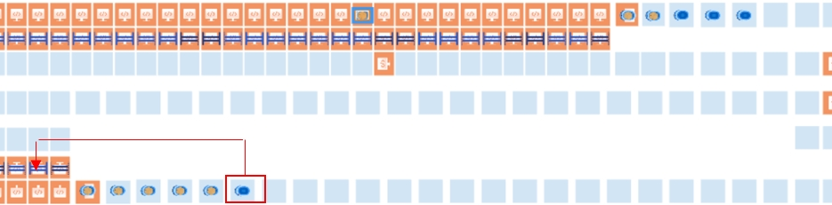

# Zone unable to get a pair with AMRs diverting to hospital after recent robot replacement or remove/add activity

## Playbook Header

| Field | Value |
| --- | --- |
| Playbook ID | `playbook_incident_228723_zone5_pairing_amr_roster_recovery` |
| Case ID | `228723` |
| Extraction Mode | `one_playbook_candidate_per_incident` |
| Confidence | `medium` |
| Validation Status | `needs_sme_review` |

## Entry Symptoms

- Site reports the ACB system is down
- A specific zone, especially zone 5 in this incident, is unable to get a pair
- After a low-battery AMR event or replacement attempt, AMRs begin going to the hospital lane
- The issue appears after recent robot replacement, remove/add, or attempted addition of one or more AGVs

## Affected Systems

- ACB system
- AMR/robot fleet
- RMS
- Zone 5 pairing behavior
- Specific robots discussed in incident evidence including robot 158 and robot 153

## Nodes

### 1 — Confirm the observable symptom pattern and recent robot-handling context (`diagnostic_decision`)

**Intent:** Determine whether the incident matches the pattern of zone pairing failure plus abnormal AMR hospital diversion after a recent low-battery event, replacement attempt, or robot remove/add activity.

**Runbook Links:**

- `proc_gather_required_fault_information_before_entering_the_grid_for_agv_recovery_v1` (high, score=0.6205, boosted=0.6105) — Gather Required Fault Information Before Entering the Grid for AGV Recovery
  - gaps: No explicit zone-pairing confirmation language; No explicit hospital-lane diversion verification; No explicit recent robot replace/remove-add context; RMS fleet/roster correlation is only partially implied

**Decision Outcomes:**

- `healthy`: Reported symptoms do not match the target pattern of zone pairing failure with broad AMR hospital diversion after recent robot handling activity.
- `unhealthy`: Incident matches the target symptom pattern and warrants RMS abnormal-robot review.
- `inconclusive`: Symptom pattern cannot be confirmed clearly from site report or available RMS views.

**Branches:**

- `unhealthy` → `node_2` when pattern_confirmed
- `inconclusive` → `node_6` when pattern_not_confirmed_or_unclear

**Linked Runbook Procedures:**

#### Runbook: Gather Required Fault Information Before Entering the Grid for AGV Recovery

- **Procedure ID:** `proc_gather_required_fault_information_before_entering_the_grid_for_agv_recovery_v1`
- **Procedure Type:** `diagnostic`
- **Role:** `L2_support`
- **Merge Status:** `pass_through`

**Summary:**
Collect the source-required AGV and RMS details before going inside the grid (Dance Floor) to perform fault recovery.

**When To Use:**
Use before going inside the grid (also called the Dance Floor) for AGV fault recovery, to ensure the required Robot ID, RMS fault description, bin/tote status, tote ID when applicable, and under-rack empty-AGV zone status have been gathered.

**Safety Notes:**

- Entering the grid (Dance Floor) implies elevated operational risk per the candidate context.
- Before going inside the grid, make sure to have the required Robot ID, fault description from RMS, bin/tote status, tote ID when applicable, and under-rack empty-AGV zone status.
- Do not proceed into the grid without the documented information.

- **Source:** `manual` / `manual_optisweep_om_v3`

**Procedure Steps:**

##### Step 1 — Identify the Robot ID for the faulted AGV

**Responsible role:** L2_support

**Instruction:**
Identify and record the Robot ID for the faulted AGV before going inside the grid.

**Healthy condition:**
A single faulted AGV is clearly identified and its Robot ID is available for recovery preparation.

**Expected result:**
The Robot ID for the faulted AGV is known and recorded.

**Step Images:**

*Look for the AGV fault interface context associated with Robot ID and fault recovery information.*

*Look for AGV details/status context that may support identifying the affected AGV.*

---

##### Step 2 — Obtain the fault description from RMS

**Responsible role:** L2_support

**Instruction:**
Access RMS and obtain the fault description for the faulted AGV.

**Healthy condition:**
The RMS fault description is visible and clearly associated with the identified faulted AGV.

**Expected result:**
The RMS fault description for the faulted AGV is available and recorded.

**Step Images:**

*Look for the AGV fault screen context referenced for RMS fault description during fault recovery.*

---

##### Step 3 — Check whether RMS indicates the AGV is holding a bin

**Responsible role:** L2_support

**Instruction:**
Check in RMS whether the faulted AGV is indicated as holding a bin.

**Healthy condition:**
RMS clearly indicates whether the faulted AGV is or is not holding a bin.

**Expected result:**
The bin/tote holding status of the faulted AGV is known.

**Step Images:**

*Look for fault recovery screen context related to RMS fault and tote/bin status.*

---

##### Step 4 — Record the tote ID if the AGV is holding a bin

**Responsible role:** L2_support

**Instruction:**
If RMS indicates the faulted AGV is holding a bin, record the tote ID.

**Healthy condition:**
A tote ID is documented for a faulted AGV that RMS shows as holding a bin, or the step is not applicable because no bin is held.

**Expected result:**
The tote ID is recorded when the faulted AGV is holding a bin.

**Step Images:**

*Look for screen context related to tote ID during AGV fault recovery.*

*Look for a faulted AGV with tote context that may help interpret tote-related recovery information.*

---

##### Step 5 — Verify under-rack empty-AGV zone status when applicable

**Responsible role:** L2_support

**Instruction:**
If the faulted AGV is under a rack, verify whether that AGV is the empty AGV for that zone.

**Healthy condition:**
For an AGV under a rack, it is known whether that AGV is the empty AGV for the zone; otherwise the step is not applicable.

**Expected result:**
The under-rack empty-AGV zone status is confirmed when applicable.

**Step Images:**

*Look for no-empty-AGV zone context relevant to determining whether the under-rack AGV is the empty AGV for that zone.*

*Look for AGV positioning and zone context that may help interpret under-rack AGV status.*

---

##### Step 6 — Confirm all required information before entering the grid

**Responsible role:** L2_support

**Instruction:**
Confirm that you have the Robot ID, RMS fault description, bin/tote status, tote ID when applicable, and under-rack empty-AGV zone status when applicable before going inside the grid.

**Healthy condition:**
The required information set is complete and ready for use during AGV recovery.

**Expected result:**
All source-required pre-entry information has been collected and confirmed.

**Step Images:**

*Use as a reference for AGV fault recovery context while confirming the collected information.*

---

**Success Criteria:**

- The Robot ID for the faulted AGV is documented.
- The RMS fault description is documented.
- The AGV bin/tote holding status is documented.
- The tote ID is documented when RMS indicates the AGV is holding a bin.
- The under-rack empty-AGV zone status is documented when applicable.
- The information is confirmed before entering the grid.

**Failure Conditions:**

- Robot ID cannot be confirmed.
- RMS fault description cannot be obtained.
- Bin/tote holding status cannot be determined.
- Tote ID cannot be confirmed when the AGV is holding a bin.
- Under-rack empty-AGV zone status cannot be confirmed when applicable.
- Any required information is missing before grid entry.

---

### 2 — Inspect RMS for abnormal robot roster, mapping, charging, or stuck-state indicators tied to the affected zone (`diagnostic_decision`)

**Intent:** Determine whether one or more specific robots appear to be in an abnormal state that could explain the pairing failure and broad AMR diversion behavior.

**Runbook Links:**

- `proc_interpret_agv_bump_exception_codes_on_the_bump_fault_screen_v1` (high, score=0.5192, boosted=0.8092) — Interpret AGV BUMP Exception Codes On The Bump Fault Screen

**Decision Outcomes:**

- `healthy`: No abnormal robot state is identified that explains the pairing failure and diversion behavior.
- `unhealthy`: A specific robot appears abnormal and is a candidate for supported isolation decisioning.
- `inconclusive`: RMS evidence is incomplete or ambiguous and does not support safe action.

**Branches:**

- `unhealthy` → `node_3` when abnormal_robot_identified
- `inconclusive` → `node_6` when no_supported_target

**Linked Runbook Procedures:**

#### Runbook: Interpret AGV BUMP Exception Codes On The Bump Fault Screen

- **Procedure ID:** `proc_interpret_agv_bump_exception_codes_on_the_bump_fault_screen_v1`
- **Procedure Type:** `reference`
- **Role:** `L1_support`
- **Merge Status:** `pass_through`

**Summary:**
Use the documented BUMP exception codes in the source manual to identify whether an AGV BUMP fault corresponds to a front collision bar trigger or an obstacle avoidance trigger, and record the interpretation with the AGV fault details.

**When To Use:**
Use when reviewing an AGV BUMP fault in RMS or on the AGV Bump Fault Screen and you need to interpret the documented meaning of exception code 21057 or 21060 from the source manual.

**Safety Notes:**

- This runbook is a reference/interpretation aid only and does not authorize physical intervention or unsupported recovery actions.
- The source states that before going inside the grid (the Dance Floor), specific AGV fault information should be gathered first: Robot ID, fault description from RMS, whether the AGV is holding a bin and tote ID, and whether an AGV under a rack is the empty AGV for that zone.

- **Source:** `manual` / `manual_optisweep_om_v3`

**Procedure Steps:**

##### Step 1 — Open or view the AGV Bump Fault Screen or related fault information

**Responsible role:** L1_support

**Instruction:**
Open or view the AGV Bump Fault Screen or related RMS fault information for the affected AGV.

**Healthy condition:**
The affected AGV fault information is displayed and available for inspection.

**Expected result:**
The AGV BUMP fault details are visible for review.

**Step Images:**

*The AGV "Bump" Fault Screen shown in Figure 5-2, used as the reference screen for BUMP fault information.*

---

##### Step 2 — Locate the displayed BUMP exception code

**Responsible role:** L1_support

**Instruction:**
Locate the displayed exception code associated with the BUMP fault.

**Healthy condition:**
The exception code is clearly visible and can be read for comparison.

**Expected result:**
A specific BUMP exception code is identified from the displayed fault information.

**Step Images:**

*The BUMP fault display area where the exception code information appears.*

---

##### Step 3 — Compare the displayed code to the documented values

**Responsible role:** L1_support

**Instruction:**
Compare the displayed exception code to the documented values in the source manual.

**Healthy condition:**
The displayed code matches one of the documented values: 21057 or 21060.

**Expected result:**
The displayed code is matched to a documented exception meaning or identified as not covered by the source.

**Step Images:**

*The BUMP fault screen context while comparing the displayed exception code to the documented code meanings.*

---

##### Step 4 — Interpret code 21057 as front collision bar triggered

**Responsible role:** L1_support

**Instruction:**
If the code is 21057, record that the robot front collision bar triggered.

**Healthy condition:**
The interpretation recorded for code 21057 is "Robot front collision bar triggers."

**Expected result:**
Code 21057 is interpreted using the source-provided meaning.

---

##### Step 5 — Interpret code 21060 as obstacle avoidance triggered

**Responsible role:** L1_support

**Instruction:**
If the code is 21060, record that the robot triggered obstacle avoidance.

**Healthy condition:**
The interpretation recorded for code 21060 is "The robot triggers the obstacle avoidance."

**Expected result:**
Code 21060 is interpreted using the source-provided meaning.

---

##### Step 6 — Record the Robot ID, RMS fault description, and interpreted meaning

**Responsible role:** L1_support

**Instruction:**
Record the Robot ID and the fault description from RMS together with the interpreted exception meaning.

**Healthy condition:**
The record includes Robot ID, RMS fault description, and the correct interpretation for code 21057 or 21060.

**Expected result:**
The AGV fault record includes the Robot ID, RMS fault description, and the documented meaning of the exception code.

**Step Images:**

*The AGV Bump Fault Screen context while capturing the Robot ID and fault information for documentation.*

---

**Success Criteria:**

- The displayed AGV BUMP exception code is identified and matched to a documented source value.
- Code 21057 is recorded as "Robot front collision bar triggers" when present.
- Code 21060 is recorded as "The robot triggers the obstacle avoidance" when present.
- The Robot ID and RMS fault description are recorded together with the interpreted exception meaning.

**Failure Conditions:**

- The BUMP fault information cannot be accessed or read.
- The displayed exception code is not 21057 or 21060.
- The user attempts to infer additional meanings or corrective actions not supported by the source.
- Required AGV fault details such as Robot ID or RMS fault description are missing.

---

### 3 — Decide whether an identified robot should be isolated from active operation using an approved procedure (`branching_condition`)

**Intent:** Choose whether to proceed with supported robot isolation or remove-from-system handling for a specific abnormal robot, or continue investigation if no supported target is identified.

**Runbook Links:**

- `proc_interpret_agv_bump_exception_codes_on_the_bump_fault_screen_v1` (high, score=0.4873, boosted=0.7373) — Interpret AGV BUMP Exception Codes On The Bump Fault Screen

**Decision Outcomes:**

- `healthy`: Evidence does not support isolating or removing the identified robot under an approved procedure.
- `unhealthy`: Evidence and authorization support isolating the identified abnormal robot.
- `inconclusive`: Decision cannot be made safely from available evidence.
- `escalate`: Higher-tier review is required before any robot isolation action.

**Branches:**

- `unhealthy` → `node_4` when approved_isolation_supported
- `escalate` → `node_6` when not_supported_or_not_authorized

**Linked Runbook Procedures:**

#### Runbook: Interpret AGV BUMP Exception Codes On The Bump Fault Screen

- **Procedure ID:** `proc_interpret_agv_bump_exception_codes_on_the_bump_fault_screen_v1`
- **Procedure Type:** `reference`
- **Role:** `L1_support`
- **Merge Status:** `pass_through`

**Summary:**
Use the documented BUMP exception codes in the source manual to identify whether an AGV BUMP fault corresponds to a front collision bar trigger or an obstacle avoidance trigger, and record the interpretation with the AGV fault details.

**When To Use:**
Use when reviewing an AGV BUMP fault in RMS or on the AGV Bump Fault Screen and you need to interpret the documented meaning of exception code 21057 or 21060 from the source manual.

**Safety Notes:**

- This runbook is a reference/interpretation aid only and does not authorize physical intervention or unsupported recovery actions.
- The source states that before going inside the grid (the Dance Floor), specific AGV fault information should be gathered first: Robot ID, fault description from RMS, whether the AGV is holding a bin and tote ID, and whether an AGV under a rack is the empty AGV for that zone.

- **Source:** `manual` / `manual_optisweep_om_v3`

**Procedure Steps:**

##### Step 1 — Open or view the AGV Bump Fault Screen or related fault information

**Responsible role:** L1_support

**Instruction:**
Open or view the AGV Bump Fault Screen or related RMS fault information for the affected AGV.

**Healthy condition:**
The affected AGV fault information is displayed and available for inspection.

**Expected result:**
The AGV BUMP fault details are visible for review.

**Step Images:**

*The AGV "Bump" Fault Screen shown in Figure 5-2, used as the reference screen for BUMP fault information.*

---

##### Step 2 — Locate the displayed BUMP exception code

**Responsible role:** L1_support

**Instruction:**
Locate the displayed exception code associated with the BUMP fault.

**Healthy condition:**
The exception code is clearly visible and can be read for comparison.

**Expected result:**
A specific BUMP exception code is identified from the displayed fault information.

**Step Images:**

*The BUMP fault display area where the exception code information appears.*

---

##### Step 3 — Compare the displayed code to the documented values

**Responsible role:** L1_support

**Instruction:**
Compare the displayed exception code to the documented values in the source manual.

**Healthy condition:**
The displayed code matches one of the documented values: 21057 or 21060.

**Expected result:**
The displayed code is matched to a documented exception meaning or identified as not covered by the source.

**Step Images:**

*The BUMP fault screen context while comparing the displayed exception code to the documented code meanings.*

---

##### Step 4 — Interpret code 21057 as front collision bar triggered

**Responsible role:** L1_support

**Instruction:**
If the code is 21057, record that the robot front collision bar triggered.

**Healthy condition:**
The interpretation recorded for code 21057 is "Robot front collision bar triggers."

**Expected result:**
Code 21057 is interpreted using the source-provided meaning.

---

##### Step 5 — Interpret code 21060 as obstacle avoidance triggered

**Responsible role:** L1_support

**Instruction:**
If the code is 21060, record that the robot triggered obstacle avoidance.

**Healthy condition:**
The interpretation recorded for code 21060 is "The robot triggers the obstacle avoidance."

**Expected result:**
Code 21060 is interpreted using the source-provided meaning.

---

##### Step 6 — Record the Robot ID, RMS fault description, and interpreted meaning

**Responsible role:** L1_support

**Instruction:**
Record the Robot ID and the fault description from RMS together with the interpreted exception meaning.

**Healthy condition:**
The record includes Robot ID, RMS fault description, and the correct interpretation for code 21057 or 21060.

**Expected result:**
The AGV fault record includes the Robot ID, RMS fault description, and the documented meaning of the exception code.

**Step Images:**

*The AGV Bump Fault Screen context while capturing the Robot ID and fault information for documentation.*

---

**Success Criteria:**

- The displayed AGV BUMP exception code is identified and matched to a documented source value.
- Code 21057 is recorded as "Robot front collision bar triggers" when present.
- Code 21060 is recorded as "The robot triggers the obstacle avoidance" when present.
- The Robot ID and RMS fault description are recorded together with the interpreted exception meaning.

**Failure Conditions:**

- The BUMP fault information cannot be accessed or read.
- The displayed exception code is not 21057 or 21060.
- The user attempts to infer additional meanings or corrective actions not supported by the source.
- Required AGV fault details such as Robot ID or RMS fault description are missing.

---

### 4 — Perform the approved robot isolation or remove-from-system recovery action (`procedure_reference`)

**Intent:** Use the authorized operational procedure to remove the identified abnormal robot from active fleet participation or otherwise keep it out of service when that is the supported recovery path.

**Runbook Links:**

- `proc_remove_a_faulted_motionless_agv_from_the_floor_and_restore_operation_v1` (high, score=0.6018, boosted=0.7718) — Remove A Faulted Motionless AGV From The Floor And Restore Operation
  - gaps: No explicit RMS remove-from-system wording; No explicit leave-out-for-sort workflow; No explicit charger/parking post-action handling in title; May assume a motionless on-floor condition not stated in every case

**Branches:**

- `healthy` → `node_5` when recovery_action_completed
- `escalate` → `node_6` when recovery_action_not_completed

**Linked Runbook Procedures:**

#### Runbook: Remove A Faulted Motionless AGV From The Floor And Restore Operation

- **Procedure ID:** `proc_remove_a_faulted_motionless_agv_from_the_floor_and_restore_operation_v1`
- **Procedure Type:** `recovery`
- **Role:** `L2_support`
- **Merge Status:** `pass_through`

**Summary:**
Recover from an AGV motionless-on-floor fault by locating the faulted AGV, identifying and stopping the correct E-stop zone, removing the AGV from the floor, then restoring operation with the documented E-stop release and blue RESET sequence.

**When To Use:**
Use when an AGV is faulted and motionless on the floor and the documented troubleshooting sequence calls for locating the AGV, stopping the appropriate E-stop zone, removing the AGV, and resetting the system.

**Safety Notes:**

- This procedure is not marked support-safe because the source does not describe the safe handling method for physically removing the AGV.
- Use site safety controls and local procedures for physical AGV removal; this source does not provide those details.
- Stop and escalate if the AGV cannot be safely removed.

- **Source:** `manual` / `manual_optisweep_om_v3`

**Procedure Steps:**

##### Step 1 — Locate the faulted AGV

**Responsible role:** L2_support

**Instruction:**
Locate the faulted AGV on the floor. If needed, reference RMS for AGV error information to help identify the AGV.

**Healthy condition:**
The specific AGV requiring recovery is clearly identified from floor observation and/or RMS error information.

**Expected result:**
The faulted motionless AGV is identified.

**Step Images:**

*Use as a visual example of a faulted AGV screen context during recovery.*

---

##### Step 2 — Identify the appropriate E-stop zone

**Responsible role:** L2_support

**Instruction:**
Reference the E-stop zone map to identify the appropriate E-stop zone for the faulted AGV.

**Healthy condition:**
The E-stop zone corresponding to the faulted AGV location is known before the zone is stopped.

**Expected result:**
The correct E-stop zone is identified.

---

##### Step 3 — Stop the appropriate E-stop zone

**Responsible role:** L2_support

**Instruction:**
Press E-STOP to stop the appropriate E-stop zone.

**Healthy condition:**
The intended E-stop zone is stopped and the area is isolated for AGV removal.

**Expected result:**
The appropriate E-stop zone is stopped.

---

##### Step 4 — Remove the faulted AGV from the floor

**Responsible role:** L2_support

**Instruction:**
Remove the faulted AGV from the floor.

**Healthy condition:**
The faulted AGV is no longer on the floor in the affected area.

**Expected result:**
The faulted AGV is removed from the floor.

---

##### Step 5 — Release the E-stop

**Responsible role:** L2_support

**Instruction:**
Pull E-STOP.

**Healthy condition:**
The E-stop is pulled out/released and the system is ready for reset.

**Expected result:**
The E-stop is released.

**Step Images:**

*Reference ESTOP clearing and RESET context associated with pulling out ESTOP and clearing faults.*

---

##### Step 6 — Press the blue RESET button

**Responsible role:** L2_support

**Instruction:**
Press the blue RESET button.

**Healthy condition:**
The reset completes without additional fault indication.

**Expected result:**
The reset is accepted and the system clears the fault condition.

**Step Images:**

*Candidate-provided image support for a faulted AGV screen during the fault recovery procedure.*

*Reference RESET-related HMI context associated with clearing faults after ESTOP is pulled out.*

---

##### Step 7 — Verify the system resumes operation

**Responsible role:** L2_support

**Instruction:**
Verify that the system resumes operation.

**Healthy condition:**
Normal operation resumes after the reset sequence.

**Expected result:**
The system resumes operation.

---

**Success Criteria:**

- The faulted AGV is identified.
- The appropriate E-stop zone is stopped.
- The faulted AGV is removed from the floor.
- The E-stop is released and the blue RESET button is pressed.
- The system resumes operation.

**Failure Conditions:**

- The faulted AGV cannot be identified from floor observation and RMS reference.
- The correct E-stop zone cannot be determined.
- The AGV cannot be safely removed.
- The reset sequence does not clear the fault.
- The system does not resume operation after the documented reset sequence.

---

### 5 — Validate that pairing and fleet behavior recover and remain stable during monitoring (`validation_gate`)

**Intent:** Confirm that the affected zone can pair again, AMRs are no longer broadly diverting to the hospital lane, and the site remains operational after the recovery action.

**Runbook Links:**

- `proc_verify_agvs_are_in_the_szonestaging_state_on_the_hmi_v1` (high, score=0.5642, boosted=0.7342) — Verify AGVs Are in the "szonestaging" State on the HMI
  - gaps: No explicit zone-pair restoration check; No explicit hospital-lane diversion validation; No explicit monitoring-period guidance; No explicit remaining abnormal roster review

**Decision Outcomes:**

- `healthy`: Pairing and fleet behavior have recovered and remain stable during monitoring.
- `unhealthy`: Recovery has not been validated because the primary symptoms persist.
- `inconclusive`: Monitoring data is insufficient to declare recovery.

**Branches:**

- `unhealthy` → `node_6` when validation_failed
- `healthy` → `` when validation_passed

**Linked Runbook Procedures:**

#### Runbook: Verify AGVs Are in the "szonestaging" State on the HMI

- **Procedure ID:** `proc_verify_agvs_are_in_the_szonestaging_state_on_the_hmi_v1`
- **Procedure Type:** `diagnostic`
- **Role:** `L1_support`
- **Merge Status:** `pass_through`

**Summary:**
Confirm on the HMI that the AGVs being checked are displayed in the documented "szonestaging" state before restart or resume actions in AGV fault recovery.

**When To Use:**
Use this check when AGV fault recovery or restart guidance requires confirmation that AGVs are in the documented ready state before restarting or resuming the system.

**Safety Notes:**

- Stop and escalate if the HMI does not show AGV state or if the AGVs are not shown as "szonestaging" when this verification is required.
- Do not infer equivalent AGV states that are not explicitly documented in the source.

- **Source:** `manual` / `manual_optisweep_om_v3`

**Procedure Steps:**

##### Step 1 — Open the HMI view showing AGV state

**Responsible role:** L1_support

**Instruction:**
Open or view the HMI area where AGV state is displayed for the AGVs being checked.

**Healthy condition:**
The AGV state field or status area is visible on the HMI.

**Expected result:**
The HMI view showing AGV state is visible.

**Step Images:**

*Use the nearby page 90 AGV recovery screen as contextual visual support for the HMI-based AGV status verification; review the AGV status area referenced by the source.*

---

##### Step 2 — Identify the AGV state value

**Responsible role:** L1_support

**Instruction:**
Identify the AGV state value shown on the HMI for the AGVs being checked.

**Healthy condition:**
The HMI clearly shows a readable AGV state value.

**Expected result:**
A visible AGV state value is identified for each AGV being checked.

**Step Images:**

*Look for the AGV status/state information referenced by the page 90 recovery guidance.*

---

##### Step 3 — Verify the state is "szonestaging"

**Responsible role:** L1_support

**Instruction:**
Verify that the displayed AGV state is exactly "szonestaging" for the AGVs being checked.

**Healthy condition:**
The displayed AGV state is exactly "szonestaging".

**Expected result:**
The AGVs are confirmed either to be in "szonestaging" or not in the required state.

**Step Images:**

*Confirm the AGV status/state matches the documented value "szonestaging" referenced by the source.*

---

##### Step 4 — Confirm readiness before restart or resume

**Responsible role:** L1_support

**Instruction:**
Record or confirm that the AGVs are in the documented ready state before proceeding with restart or resume actions.

**Healthy condition:**
The AGVs have been confirmed as being in "szonestaging" before restart or resume actions.

**Expected result:**
A clear confirmation is made that the AGVs are in the documented ready state, or escalation is initiated if they are not.

---

**Success Criteria:**

- The HMI displays AGV state for the AGVs being checked.
- The displayed AGV state is confirmed as exactly "szonestaging".
- The AGVs are confirmed in the documented ready state before restart or resume actions.

**Failure Conditions:**

- The HMI does not show AGV state.
- The AGV state cannot be identified or read.
- The AGV state is not "szonestaging" when this verification is required.
- Proceeding would require inferring an undocumented equivalent state.

---

### 6 — Stop and escalate if no supported abnormal-robot recovery path is identified or validation fails (`escalation_gate`)

**Intent:** Hand off when RMS review does not reveal a supported robot isolation target, when authorized recovery cannot be performed, or when the zone and fleet behavior do not stabilize after the attempted action.

**Runbook Links:**

- `proc_gather_required_fault_information_before_entering_the_grid_for_agv_recovery_v1` (high, score=0.5908, boosted=0.7608) — Gather Required Fault Information Before Entering the Grid for AGV Recovery
  - gaps: No explicit escalation handoff procedure; No explicit evidence package checklist for higher-tier support; No explicit failed-validation escalation workflow; No explicit recent remove/add history handoff guidance

**Decision Outcomes:**

- `escalate`: Escalate with collected symptom summary, RMS evidence, affected robot IDs, attempted actions, and validation results.

**Linked Runbook Procedures:**

#### Runbook: Gather Required Fault Information Before Entering the Grid for AGV Recovery

- **Procedure ID:** `proc_gather_required_fault_information_before_entering_the_grid_for_agv_recovery_v1`
- **Procedure Type:** `diagnostic`
- **Role:** `L2_support`
- **Merge Status:** `pass_through`

**Summary:**
Collect the source-required AGV and RMS details before going inside the grid (Dance Floor) to perform fault recovery.

**When To Use:**
Use before going inside the grid (also called the Dance Floor) for AGV fault recovery, to ensure the required Robot ID, RMS fault description, bin/tote status, tote ID when applicable, and under-rack empty-AGV zone status have been gathered.

**Safety Notes:**

- Entering the grid (Dance Floor) implies elevated operational risk per the candidate context.
- Before going inside the grid, make sure to have the required Robot ID, fault description from RMS, bin/tote status, tote ID when applicable, and under-rack empty-AGV zone status.
- Do not proceed into the grid without the documented information.

- **Source:** `manual` / `manual_optisweep_om_v3`

**Procedure Steps:**

##### Step 1 — Identify the Robot ID for the faulted AGV

**Responsible role:** L2_support

**Instruction:**
Identify and record the Robot ID for the faulted AGV before going inside the grid.

**Healthy condition:**
A single faulted AGV is clearly identified and its Robot ID is available for recovery preparation.

**Expected result:**
The Robot ID for the faulted AGV is known and recorded.

**Step Images:**

*Look for the AGV fault interface context associated with Robot ID and fault recovery information.*

*Look for AGV details/status context that may support identifying the affected AGV.*

---

##### Step 2 — Obtain the fault description from RMS

**Responsible role:** L2_support

**Instruction:**
Access RMS and obtain the fault description for the faulted AGV.

**Healthy condition:**
The RMS fault description is visible and clearly associated with the identified faulted AGV.

**Expected result:**
The RMS fault description for the faulted AGV is available and recorded.

**Step Images:**

*Look for the AGV fault screen context referenced for RMS fault description during fault recovery.*

---

##### Step 3 — Check whether RMS indicates the AGV is holding a bin

**Responsible role:** L2_support

**Instruction:**
Check in RMS whether the faulted AGV is indicated as holding a bin.

**Healthy condition:**
RMS clearly indicates whether the faulted AGV is or is not holding a bin.

**Expected result:**
The bin/tote holding status of the faulted AGV is known.

**Step Images:**

*Look for fault recovery screen context related to RMS fault and tote/bin status.*

---

##### Step 4 — Record the tote ID if the AGV is holding a bin

**Responsible role:** L2_support

**Instruction:**
If RMS indicates the faulted AGV is holding a bin, record the tote ID.

**Healthy condition:**
A tote ID is documented for a faulted AGV that RMS shows as holding a bin, or the step is not applicable because no bin is held.

**Expected result:**
The tote ID is recorded when the faulted AGV is holding a bin.

**Step Images:**

*Look for screen context related to tote ID during AGV fault recovery.*

*Look for a faulted AGV with tote context that may help interpret tote-related recovery information.*

---

##### Step 5 — Verify under-rack empty-AGV zone status when applicable

**Responsible role:** L2_support

**Instruction:**
If the faulted AGV is under a rack, verify whether that AGV is the empty AGV for that zone.

**Healthy condition:**
For an AGV under a rack, it is known whether that AGV is the empty AGV for the zone; otherwise the step is not applicable.

**Expected result:**
The under-rack empty-AGV zone status is confirmed when applicable.

**Step Images:**

*Look for no-empty-AGV zone context relevant to determining whether the under-rack AGV is the empty AGV for that zone.*

*Look for AGV positioning and zone context that may help interpret under-rack AGV status.*

---

##### Step 6 — Confirm all required information before entering the grid

**Responsible role:** L2_support

**Instruction:**
Confirm that you have the Robot ID, RMS fault description, bin/tote status, tote ID when applicable, and under-rack empty-AGV zone status when applicable before going inside the grid.

**Healthy condition:**
The required information set is complete and ready for use during AGV recovery.

**Expected result:**
All source-required pre-entry information has been collected and confirmed.

**Step Images:**

*Use as a reference for AGV fault recovery context while confirming the collected information.*

---

**Success Criteria:**

- The Robot ID for the faulted AGV is documented.
- The RMS fault description is documented.
- The AGV bin/tote holding status is documented.
- The tote ID is documented when RMS indicates the AGV is holding a bin.
- The under-rack empty-AGV zone status is documented when applicable.
- The information is confirmed before entering the grid.

**Failure Conditions:**

- Robot ID cannot be confirmed.
- RMS fault description cannot be obtained.
- Bin/tote holding status cannot be determined.
- Tote ID cannot be confirmed when the AGV is holding a bin.
- Under-rack empty-AGV zone status cannot be confirmed when applicable.
- Any required information is missing before grid entry.

---

## Branch Graph

| From Node | Outcome | Condition | Next Node |
| --- | --- | --- | --- |
| `node_1` | `unhealthy` | pattern_confirmed | `node_2` |
| `node_1` | `inconclusive` | pattern_not_confirmed_or_unclear | `node_6` |
| `node_2` | `unhealthy` | abnormal_robot_identified | `node_3` |
| `node_2` | `inconclusive` | no_supported_target | `node_6` |
| `node_3` | `unhealthy` | approved_isolation_supported | `node_4` |
| `node_3` | `escalate` | not_supported_or_not_authorized | `node_6` |
| `node_4` | `healthy` | recovery_action_completed | `node_5` |
| `node_4` | `escalate` | recovery_action_not_completed | `node_6` |
| `node_5` | `unhealthy` | validation_failed | `node_6` |
| `node_5` | `healthy` | validation_passed | `` |
| `node_3` | `unhealthy` | approved_isolation_supported | `node_4` |
| `node_3` | `escalate` | not_supported_or_not_authorized | `node_6` |
