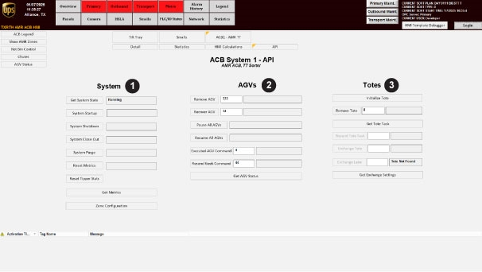
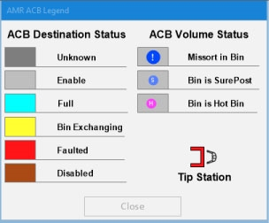
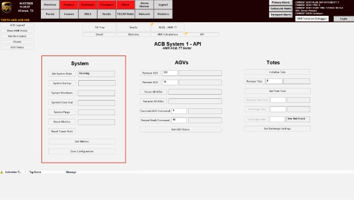
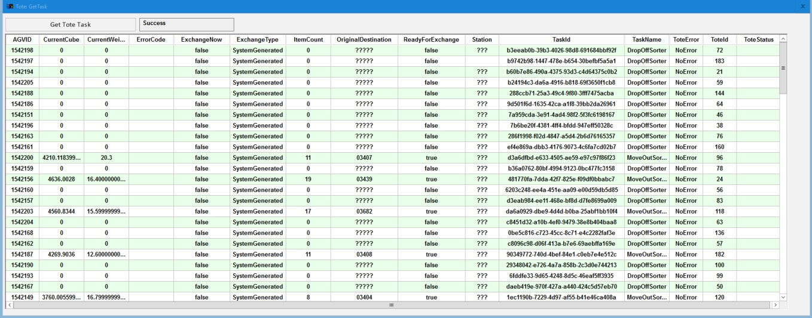
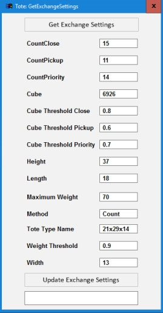
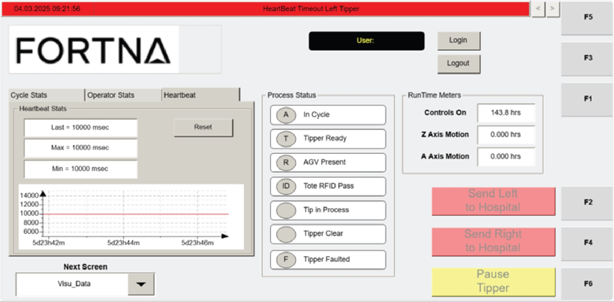
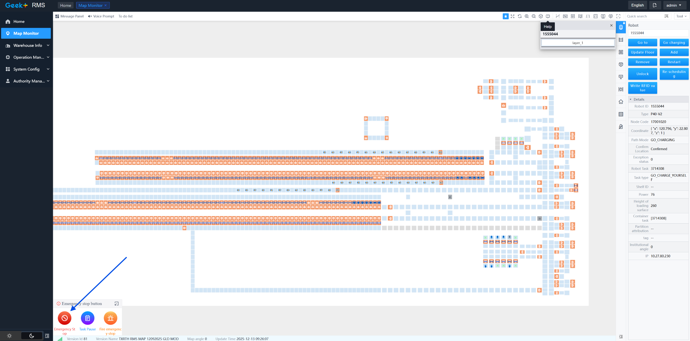
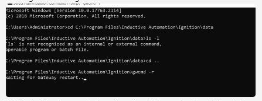

# Site-wide robotic movement stopped with AGVs out of sync after control-service disruption

## Playbook Header

| Field | Value |
| --- | --- |
| Playbook ID | `playbook_incident_228086_site_motion_stoppage_optisweep_recovery` |
| Case ID | `228086` |
| Extraction Mode | `one_or_more_playbook_candidates_when_separable` |
| Confidence | `high` |
| Validation Status | `needs_sme_review` |

## Entry Symptoms

- Site reports that nothing is moving.
- Robotic system is reported as not responding.
- Small sort is not running.
- Multiple bots or AGVs are not moving in various areas.
- RMS/HMI shows an abnormal blank state with '.NET Control not created.'
- Question marks are visible on the HMI.
- Totes cannot be removed from hospital.

## Affected Systems

- OptiSweep service
- AGV/robotic system
- RMS / Geek+ RMS
- HMI
- Windows Event Viewer
- Windows Services
- Ignition gateway
- GetAgvStatuses API endpoint

## Nodes

### 1 — Confirm site-wide robotic stoppage and abnormal RMS/HMI presentation (`diagnostic_decision`)

**Intent:** Determine whether the incident matches the observable symptom pattern of site-wide motion stoppage with abnormal RMS/HMI behavior rather than a single isolated AGV issue.

**Runbook Links:**

- `proc_interpret_agv_bump_exception_codes_on_the_bump_fault_screen_v1` (high, score=0.5762, boosted=0.8662) — Interpret AGV BUMP Exception Codes On The Bump Fault Screen
- `proc_identify_control_domains_on_acb_api_screen_v1` (high, score=0.5525, boosted=0.7225) — Identify the OptiSweep System, AGV, and Tote Control Areas on the ACB API Screen
  - gaps: Reference-oriented rather than a true diagnostic triage procedure; Does not explicitly address abnormal blank-state or HMI question-mark symptoms; Does not clearly distinguish site-wide stoppage from isolated AGV issues

**Decision Outcomes:**

- `healthy`: Site is not in a site-wide stoppage pattern; movement continues or issue appears isolated to a single AGV/area.
- `unhealthy`: Site-wide stoppage pattern is confirmed with abnormal RMS/HMI presentation.
- `inconclusive`: Symptoms are incomplete or conflicting and the responder cannot confidently classify the issue as site-wide versus isolated.

**Branches:**

- `unhealthy` → `node_2` when site_wide_stoppage_confirmed
- `healthy` → `node_7` when not_site_wide_or_isolated_issue
- `inconclusive` → `node_7` when symptoms_inconclusive

**Linked Runbook Procedures:**

#### Runbook: Interpret AGV BUMP Exception Codes On The Bump Fault Screen

- **Procedure ID:** `proc_interpret_agv_bump_exception_codes_on_the_bump_fault_screen_v1`
- **Procedure Type:** `reference`
- **Role:** `L1_support`
- **Merge Status:** `pass_through`

**Summary:**
Use the documented BUMP exception codes in the source manual to identify whether an AGV BUMP fault corresponds to a front collision bar trigger or an obstacle avoidance trigger, and record the interpretation with the AGV fault details.

**When To Use:**
Use when reviewing an AGV BUMP fault in RMS or on the AGV Bump Fault Screen and you need to interpret the documented meaning of exception code 21057 or 21060 from the source manual.

**Safety Notes:**

- This runbook is a reference/interpretation aid only and does not authorize physical intervention or unsupported recovery actions.
- The source states that before going inside the grid (the Dance Floor), specific AGV fault information should be gathered first: Robot ID, fault description from RMS, whether the AGV is holding a bin and tote ID, and whether an AGV under a rack is the empty AGV for that zone.

- **Source:** `manual` / `manual_optisweep_om_v3`

**Procedure Steps:**

##### Step 1 — Open or view the AGV Bump Fault Screen or related fault information

**Responsible role:** L1_support

**Instruction:**
Open or view the AGV Bump Fault Screen or related RMS fault information for the affected AGV.

**Healthy condition:**
The affected AGV fault information is displayed and available for inspection.

**Expected result:**
The AGV BUMP fault details are visible for review.

**Step Images:**

*The AGV "Bump" Fault Screen shown in Figure 5-2, used as the reference screen for BUMP fault information.*

---

##### Step 2 — Locate the displayed BUMP exception code

**Responsible role:** L1_support

**Instruction:**
Locate the displayed exception code associated with the BUMP fault.

**Healthy condition:**
The exception code is clearly visible and can be read for comparison.

**Expected result:**
A specific BUMP exception code is identified from the displayed fault information.

**Step Images:**

*The BUMP fault display area where the exception code information appears.*

---

##### Step 3 — Compare the displayed code to the documented values

**Responsible role:** L1_support

**Instruction:**
Compare the displayed exception code to the documented values in the source manual.

**Healthy condition:**
The displayed code matches one of the documented values: 21057 or 21060.

**Expected result:**
The displayed code is matched to a documented exception meaning or identified as not covered by the source.

**Step Images:**

*The BUMP fault screen context while comparing the displayed exception code to the documented code meanings.*

---

##### Step 4 — Interpret code 21057 as front collision bar triggered

**Responsible role:** L1_support

**Instruction:**
If the code is 21057, record that the robot front collision bar triggered.

**Healthy condition:**
The interpretation recorded for code 21057 is "Robot front collision bar triggers."

**Expected result:**
Code 21057 is interpreted using the source-provided meaning.

---

##### Step 5 — Interpret code 21060 as obstacle avoidance triggered

**Responsible role:** L1_support

**Instruction:**
If the code is 21060, record that the robot triggered obstacle avoidance.

**Healthy condition:**
The interpretation recorded for code 21060 is "The robot triggers the obstacle avoidance."

**Expected result:**
Code 21060 is interpreted using the source-provided meaning.

---

##### Step 6 — Record the Robot ID, RMS fault description, and interpreted meaning

**Responsible role:** L1_support

**Instruction:**
Record the Robot ID and the fault description from RMS together with the interpreted exception meaning.

**Healthy condition:**
The record includes Robot ID, RMS fault description, and the correct interpretation for code 21057 or 21060.

**Expected result:**
The AGV fault record includes the Robot ID, RMS fault description, and the documented meaning of the exception code.

**Step Images:**

*The AGV Bump Fault Screen context while capturing the Robot ID and fault information for documentation.*

---

**Success Criteria:**

- The displayed AGV BUMP exception code is identified and matched to a documented source value.
- Code 21057 is recorded as "Robot front collision bar triggers" when present.
- Code 21060 is recorded as "The robot triggers the obstacle avoidance" when present.
- The Robot ID and RMS fault description are recorded together with the interpreted exception meaning.

**Failure Conditions:**

- The BUMP fault information cannot be accessed or read.
- The displayed exception code is not 21057 or 21060.
- The user attempts to infer additional meanings or corrective actions not supported by the source.
- Required AGV fault details such as Robot ID or RMS fault description are missing.

#### Runbook: Identify the OptiSweep System, AGV, and Tote Control Areas on the ACB API Screen

- **Procedure ID:** `proc_identify_control_domains_on_acb_api_screen_v1`
- **Procedure Type:** `reference`
- **Role:** `operator`
- **Merge Status:** `pass_through`

**Summary:**
Use the documented ACB API screen layout to identify which screen areas correspond to the OptiSweep system, AGVs, and totes before reviewing or performing actions on that screen.

**When To Use:**
Use this reference when navigating to the ACB API screen and confirming which numbered screen areas correspond to the OptiSweep system, AGVs, and totes.

**Safety Notes:**

- This runbook is a screen-identification reference only.
- If the displayed screen does not match the documented three-domain layout, stop and escalate because the source provides no alternate layout interpretation.

- **Source:** `manual` / `manual_optisweep_om_v3`

**Procedure Steps:**

##### Step 1 — Open the ACB API screen

**Responsible role:** operator

**Instruction:**
From the "ACB System" screen, press API to access the ACB API screen.

**Healthy condition:**
The displayed screen matches the documented ACB API screen referenced in Figure 4-8.

**Expected result:**
The ACB API screen is displayed.

**Step Images:**

*The ACB API interface used to control the OptiSweep system, AGVs, and totes.*

*The ACB System screen context from which the API button is accessed.*

---

##### Step 2 — Locate the numbered control areas

**Responsible role:** operator

**Instruction:**
On the ACB API screen, locate the areas labeled as items (1), (2), and (3) using Figure 4-8 as the reference.

**Healthy condition:**
Items (1), (2), and (3) are visible and correspond to the documented numbered layout in Figure 4-8.

**Expected result:**
The three numbered screen areas are identified on the displayed ACB API screen.

**Step Images:**

*Figure 4-8 showing the labeled screen sections and numbered items (1), (2), and (3).*

---

##### Step 3 — Identify item (1) as the OptiSweep system control area

**Responsible role:** operator

**Instruction:**
Identify item (1) on the ACB API screen as the OptiSweep system control area.

**Healthy condition:**
The user can correctly associate item (1) with the OptiSweep system.

**Expected result:**
Item (1) is recognized as the OptiSweep system control area.

**Step Images:**

*The numbered item (1) on the ACB API screen.*

*The system control area context associated with the System section of the API screen.*

---

##### Step 4 — Identify item (2) as the AGV control area

**Responsible role:** operator

**Instruction:**
Identify item (2) on the ACB API screen as the AGV control area.

**Healthy condition:**
The user can correctly associate item (2) with AGVs.

**Expected result:**
Item (2) is recognized as the AGV control area.

**Step Images:**

*The numbered item (2) on the ACB API screen.*

*The AGV control area context associated with the AGV section of the API screen.*

---

##### Step 5 — Identify item (3) as the tote control area

**Responsible role:** operator

**Instruction:**
Identify item (3) on the ACB API screen as the tote control area.

**Healthy condition:**
The user can correctly associate item (3) with totes.

**Expected result:**
Item (3) is recognized as the tote control area.

**Step Images:**

*The numbered item (3) on the ACB API screen.*

*Tote-related API context associated with the tote section of the API screen.*

*Additional tote control context related to tote exchange settings.*

---

##### Step 6 — Confirm the intended action matches the correct control domain

**Responsible role:** operator

**Instruction:**
Before proceeding with any review or control action, verify that the action you intend to review or perform is associated with the correct domain: OptiSweep system, AGVs, or totes.

**Healthy condition:**
The user can clearly determine whether the intended action belongs to the system, AGV, or tote area.

**Expected result:**
The intended action is matched to the correct control domain on the ACB API screen.

**Step Images:**

*The three documented control domains on the ACB API screen.*

---

**Success Criteria:**

- The ACB API screen is accessed from the "ACB System" screen.
- The user identifies the three documented control domains on the ACB API screen.
- Item (1) is identified as the OptiSweep system control area.
- Item (2) is identified as the AGV control area.
- Item (3) is identified as the tote control area.
- The intended review or action is confirmed against the correct domain before proceeding.

**Failure Conditions:**

- The displayed screen does not match the documented three-domain layout.
- The numbered areas cannot be located or interpreted from the displayed screen.
- The user cannot confidently determine whether an intended action belongs to the system, AGV, or tote domain.

---

### 2 — Check whether OptiSweep service failure evidence is present (`diagnostic_decision`)

**Intent:** Determine whether the stoppage correlates with abnormal OptiSweep service state using named Windows service and log sources.

**Runbook Links:**

- `proc_review_heartbeat_statistics_on_the_visu_data_screen_v1` (high, score=0.4849, boosted=0.6149) — Review Heartbeat Statistics On The VISU_DATA Screen
  - gaps: No retrieved runbook explicitly covers Windows Event Viewer System log review; No retrieved runbook explicitly covers Service Control Manager Event 7031; No retrieved runbook explicitly covers checking Windows Services state for OptiSweep

**Decision Outcomes:**

- `healthy`: No clear OptiSweep service failure evidence is found and service appears normal.
- `unhealthy`: OptiSweep failure evidence is present or service state is abnormal.
- `inconclusive`: Evidence is incomplete or access to logs/services is insufficient to determine service health.

**Branches:**

- `unhealthy` → `node_3` when optisweep_failure_evidence_present_and_authorized
- `healthy` → `node_7` when no_service_failure_evidence
- `inconclusive` → `node_7` when service_state_inconclusive

**Linked Runbook Procedures:**

#### Runbook: Review Heartbeat Statistics On The VISU_DATA Screen

- **Procedure ID:** `proc_review_heartbeat_statistics_on_the_visu_data_screen_v1`
- **Procedure Type:** `diagnostic`
- **Role:** `L1_support`
- **Merge Status:** `pass_through`

**Summary:**
Use the Heartbeat section on the VISU_DATA screen to review Last, Max, and Min heartbeat signal times between the tipper and WCS in milliseconds and determine whether a signal longer than 10 seconds is present, which the manual warns can cause operation issues due to mis-synchronization.

**When To Use:**
Use when troubleshooting communication-health or synchronization concerns between the tipper and WCS and when heartbeat timing evidence is needed from the operator station HMI VISU_DATA screen.

**Safety Notes:**

- The manual warns that a heartbeat signal longer than 10 seconds can cause operation issues with the tipper due to mis-synchronization.

- **Source:** `manual` / `manual_optisweep_om_v3`

**Procedure Steps:**

##### Step 1 — Open VISU_DATA and locate the Heartbeat section

**Responsible role:** L1_support

**Instruction:**
Open the VISU_DATA screen on the operator station HMI and locate the Heartbeat section that shows Last, Max, Min, and RESET.

**Healthy condition:**
The Heartbeat section is present and the Last, Max, and Min fields are readable.

**Expected result:**
The Heartbeat section is visible on the VISU_DATA screen.

**Step Images:**

*Heartbeat section with Last, Max, Min, and RESET.*

*Overall VISU_DATA screen layout to orient to the data screen.*

---

##### Step 2 — Read the Last heartbeat value

**Responsible role:** L1_support

**Instruction:**
Read the Last heartbeat value and interpret it as the most recent signal time in milliseconds.

**Healthy condition:**
A Last value is displayed and can be read in milliseconds.

**Expected result:**
The most recent heartbeat signal time is identified from the Last field.

**Step Images:**

*The Last field in the Heartbeat section.*

---

##### Step 3 — Read the Max heartbeat value

**Responsible role:** L1_support

**Instruction:**
Read the Max heartbeat value and interpret it as the longest signal time in milliseconds.

**Healthy condition:**
A Max value is displayed and can be read in milliseconds.

**Expected result:**
The longest heartbeat signal time is identified from the Max field.

**Step Images:**

*The Max field in the Heartbeat section.*

---

##### Step 4 — Read the Min heartbeat value

**Responsible role:** L1_support

**Instruction:**
Read the Min heartbeat value and interpret it as the shortest signal time in milliseconds.

**Healthy condition:**
A Min value is displayed and can be read in milliseconds.

**Expected result:**
The shortest heartbeat signal time is identified from the Min field.

**Step Images:**

*The Min field in the Heartbeat section.*

---

##### Step 5 — Check for heartbeat signal time longer than 10 seconds

**Responsible role:** L1_support

**Instruction:**
Check whether any displayed heartbeat signal time is longer than 10 seconds, using the source warning that signals longer than 10 seconds can cause operation issues with the tipper due to mis-synchronization.

**Healthy condition:**
No displayed heartbeat signal time indicates a duration longer than 10 seconds.

**Expected result:**
You determine whether the longer-than-10-seconds condition is present.

**Step Images:**

*Displayed Last, Max, and Min heartbeat timing values in the Heartbeat section.*

---

##### Step 6 — Record displayed heartbeat values for troubleshooting evidence

**Responsible role:** L1_support

**Instruction:**
Record the displayed Last, Max, and Min values if needed for troubleshooting evidence.

**Healthy condition:**
Last, Max, and Min values are captured accurately from the screen.

**Expected result:**
The displayed heartbeat values are documented for later review or escalation.

**Step Images:**

*The Last, Max, and Min values to be recorded.*

---

**Success Criteria:**

- The Heartbeat section on the VISU_DATA screen is located.
- The Last, Max, and Min heartbeat values are read and interpreted as milliseconds.
- A determination is made about whether any displayed heartbeat signal time is longer than 10 seconds.
- Displayed values are recorded if needed for troubleshooting evidence.

**Failure Conditions:**

- A heartbeat signal longer than 10 seconds is observed.
- The Heartbeat section is unavailable.
- Displayed heartbeat values are unreadable.

---

### 3 — Perform approved OptiSweep service recovery if abnormal and authorized (`procedure_reference`)

**Intent:** Use the approved recovery procedure for the OptiSweep service when service failure evidence is present and the responder is authorized to act.

**Runbook Links:**

- `proc_restart_ignition_and_verify_optisweep_service_response_with_getagvstatuses_v1` (high, score=0.6048, boosted=0.6948) — Restart Ignition and verify OptiSweep service response with GetAgvStatuses
  - gaps: Title emphasizes Ignition restart rather than explicit OptiSweep service reset; May not fully represent all safety preconditions or authorization boundaries for service recovery

**Decision Outcomes:**

- `healthy`: Service already appears normal and no recovery action is needed.
- `unhealthy`: Recovery action was required and completed, but downstream AGV consistency still must be checked.
- `escalate`: Authorized recovery cannot be performed or does not restore service responsiveness.

**Branches:**

- `inconclusive` → `node_4` when Service recovery completed or service appears running

**Linked Runbook Procedures:**

#### Runbook: Restart Ignition and verify OptiSweep service response with GetAgvStatuses

- **Procedure ID:** `proc_restart_ignition_and_verify_optisweep_service_response_with_getagvstatuses_v1`
- **Procedure Type:** `recovery`
- **Role:** `L2_support`
- **Merge Status:** `pass_through`

**Summary:**
Conditional incident-derived recovery guidance for restarting Ignition and confirming OptiSweep service responsiveness before releasing the E-stop. The source instructs the operator to first E-stop the system, restart Ignition with `gwcmd -r`, wait until the gateway is back up and login is possible, then verify OptiSweep by sending a GetAgvStatuses request. If no response is returned, restart OptiSweep, send the request again, and only then release the E-stop.

**When To Use:**
Use when the incident-specific guidance indicates Ignition may need to be restarted and you need to confirm the OptiSweep service is responding again before releasing the E-stop.

**Safety Notes:**

- First E-stop the system before attempting the restart.
- Do not release the E-stop until OptiSweep response is confirmed.
- If Ignition does not come back up to a login-capable state, stop and do not perform undocumented changes beyond the source-shared restart sequence.
- If response still cannot be confirmed after the documented restart steps, stop and escalate rather than inventing additional recovery actions.

- **Source:** `incident_case` / `source_case_228086`

**Procedure Steps:**

##### Step 1 — E-stop the system before restart

**Responsible role:** L2_support

**Instruction:**
First E-stop the system before attempting the restart.

**Healthy condition:**
The system is in E-stop and restart activity has not yet begun.

**Expected result:**
The system is placed in E-stop before any Ignition restart action is taken.

**Step Images:**

*Emergency stop control area highlighted in the RMS/system control context.*

---

##### Step 2 — Restart Ignition from the Ignition directory

**Responsible role:** L2_support

**Instruction:**
Open a Windows command prompt on the Ignition host, navigate to the Ignition installation directory, and run `gwcmd -r` from `C:\Program Files\Inductive Automation\Ignition>`. Observe the console message `Waiting for Gateway restart...`.

**Healthy condition:**
The command prompt shows `gwcmd -r` executed from the Ignition directory and displays `Waiting for Gateway restart...`.

**Expected result:**
The Ignition gateway restart command is accepted and the console shows `Waiting for Gateway restart...`.

**Step Images:**

*Command prompt in `C:\Program Files\Inductive Automation\Ignition>` showing `gwcmd -r` and `Waiting for Gateway restart...`.*

*Restart-instruction screenshot context showing the Ignition restart command sequence.*

---

##### Step 3 — Wait for Ignition to come back up

**Responsible role:** L2_support

**Instruction:**
Wait for Ignition to come back up, meaning it lets you log in and does not show the gateway starting up. Use the Ignition status/login page to confirm the gateway is reachable.

**Healthy condition:**
The Ignition Status > Systems > Overview page is reachable, with visible system widgets and no gateway-starting-up screen.

**Expected result:**
Ignition is reachable again and presents a login-capable or status page rather than a startup screen.

**Step Images:**

*Ignition Status > Systems > Overview page reachable in the browser, with Current Response Time and no startup screen.*

---

##### Step 4 — Send GetAgvStatuses request after Ignition restart

**Responsible role:** L2_support

**Instruction:**
Open the API client identified in the source as api dog and send a GetAgvStatuses request to `http://10.27.80.165:5000/GetAgvStatuses`.

**Healthy condition:**
The API client shows the GetAgvStatuses request executed successfully against the documented endpoint.

**Expected result:**
The request executes against the shown endpoint and returns a response from the OptiSweep service.

**Step Images:**

*API client showing GET request to `http://10.27.80.165:5000/GetAgvStatuses`.*

---

##### Step 5 — Confirm HTTP 200 and returned AGV records

**Responsible role:** L2_support

**Instruction:**
Check that the GetAgvStatuses request returns HTTP 200 and returned AGV records. Visible records in the source include status values such as `NORMAL`. Do not treat the visible schema validation warning alone as a service outage if the request still returns HTTP 200 with data.

**Healthy condition:**
The response panel shows Success (200) / Status: 200 and returned JSON records with visible AGV status values such as `NORMAL`.

**Expected result:**
The API response shows Success/Status 200 and returned AGV records, including visible status values such as `NORMAL`.

**Step Images:**

*Response panel showing Success/Status 200 and returned records with visible `NORMAL` values; note the validation warning but do not treat it alone as outage proof.*

---

##### Step 6 — If no response, restart OptiSweep and retry GetAgvStatuses

**Responsible role:** L2_support

**Instruction:**
If no response is given, restart OptiSweep, then send another GetAgvStatuses request to confirm response. The source supports this at a high level only; use the Windows Services console context shown for OptiSweep and do not invent additional click-by-click steps not present in the source.

**Healthy condition:**
The follow-up request returns a confirmed response after the OptiSweep restart.

**Expected result:**
OptiSweep is restarted and a follow-up GetAgvStatuses request is sent to confirm response.

**Step Images:**

*Windows Services console with OptiSweep selected, showing Running state and restart control visible.*

*Use the same GetAgvStatuses request view to retry and confirm response.*

---

##### Step 7 — Release the E-stop after response is confirmed

**Responsible role:** L2_support

**Instruction:**
Once the response is confirmed, release the E-stop.

**Healthy condition:**
A confirmed GetAgvStatuses response exists before the E-stop is released.

**Expected result:**
The E-stop is released only after OptiSweep response has been confirmed.

**Step Images:**

*System control context with emergency stop control area relevant to release after confirmation.*

---

**Success Criteria:**

- Ignition is reachable again and allows login or status-page access rather than showing gateway startup.
- The GetAgvStatuses request to `http://10.27.80.165:5000/GetAgvStatuses` returns HTTP 200.
- Returned AGV records are visible in the response, including status values such as `NORMAL`.
- If OptiSweep had to be restarted, a follow-up GetAgvStatuses request confirms response.
- The E-stop is released only after response confirmation.

**Failure Conditions:**

- Ignition does not come back up to a login-capable state.
- The GetAgvStatuses endpoint is unreachable or returns no response.
- The request returns no data.
- Response still cannot be confirmed after the documented OptiSweep restart and retry.
- Recovery would require undocumented actions beyond the source-shared sequence.

---

### 4 — Determine whether AGVs remain out of sync after service recovery (`diagnostic_decision`)

**Intent:** Check whether service recovery alone restored fleet consistency or whether specific AGVs still require correction in RMS.

**Runbook Links:**

- `proc_interpret_agv_bump_exception_codes_on_the_bump_fault_screen_v1` (high, score=0.5206, boosted=0.8106) — Interpret AGV BUMP Exception Codes On The Bump Fault Screen

**Decision Outcomes:**

- `healthy`: No AGVs remain out of sync after service recovery.
- `unhealthy`: One or more AGVs remain out of sync or missing and require targeted correction.
- `inconclusive`: Fleet state cannot be confidently assessed.

**Branches:**

- `unhealthy` → `node_5` when agvs_out_of_sync_or_missing
- `healthy` → `node_6` when fleet_consistent_after_recovery
- `inconclusive` → `node_7` when fleet_state_inconclusive

**Linked Runbook Procedures:**

#### Runbook: Interpret AGV BUMP Exception Codes On The Bump Fault Screen

- **Procedure ID:** `proc_interpret_agv_bump_exception_codes_on_the_bump_fault_screen_v1`
- **Procedure Type:** `reference`
- **Role:** `L1_support`
- **Merge Status:** `pass_through`

**Summary:**
Use the documented BUMP exception codes in the source manual to identify whether an AGV BUMP fault corresponds to a front collision bar trigger or an obstacle avoidance trigger, and record the interpretation with the AGV fault details.

**When To Use:**
Use when reviewing an AGV BUMP fault in RMS or on the AGV Bump Fault Screen and you need to interpret the documented meaning of exception code 21057 or 21060 from the source manual.

**Safety Notes:**

- This runbook is a reference/interpretation aid only and does not authorize physical intervention or unsupported recovery actions.
- The source states that before going inside the grid (the Dance Floor), specific AGV fault information should be gathered first: Robot ID, fault description from RMS, whether the AGV is holding a bin and tote ID, and whether an AGV under a rack is the empty AGV for that zone.

- **Source:** `manual` / `manual_optisweep_om_v3`

**Procedure Steps:**

##### Step 1 — Open or view the AGV Bump Fault Screen or related fault information

**Responsible role:** L1_support

**Instruction:**
Open or view the AGV Bump Fault Screen or related RMS fault information for the affected AGV.

**Healthy condition:**
The affected AGV fault information is displayed and available for inspection.

**Expected result:**
The AGV BUMP fault details are visible for review.

**Step Images:**

*The AGV "Bump" Fault Screen shown in Figure 5-2, used as the reference screen for BUMP fault information.*

---

##### Step 2 — Locate the displayed BUMP exception code

**Responsible role:** L1_support

**Instruction:**
Locate the displayed exception code associated with the BUMP fault.

**Healthy condition:**
The exception code is clearly visible and can be read for comparison.

**Expected result:**
A specific BUMP exception code is identified from the displayed fault information.

**Step Images:**

*The BUMP fault display area where the exception code information appears.*

---

##### Step 3 — Compare the displayed code to the documented values

**Responsible role:** L1_support

**Instruction:**
Compare the displayed exception code to the documented values in the source manual.

**Healthy condition:**
The displayed code matches one of the documented values: 21057 or 21060.

**Expected result:**
The displayed code is matched to a documented exception meaning or identified as not covered by the source.

**Step Images:**

*The BUMP fault screen context while comparing the displayed exception code to the documented code meanings.*

---

##### Step 4 — Interpret code 21057 as front collision bar triggered

**Responsible role:** L1_support

**Instruction:**
If the code is 21057, record that the robot front collision bar triggered.

**Healthy condition:**
The interpretation recorded for code 21057 is "Robot front collision bar triggers."

**Expected result:**
Code 21057 is interpreted using the source-provided meaning.

---

##### Step 5 — Interpret code 21060 as obstacle avoidance triggered

**Responsible role:** L1_support

**Instruction:**
If the code is 21060, record that the robot triggered obstacle avoidance.

**Healthy condition:**
The interpretation recorded for code 21060 is "The robot triggers the obstacle avoidance."

**Expected result:**
Code 21060 is interpreted using the source-provided meaning.

---

##### Step 6 — Record the Robot ID, RMS fault description, and interpreted meaning

**Responsible role:** L1_support

**Instruction:**
Record the Robot ID and the fault description from RMS together with the interpreted exception meaning.

**Healthy condition:**
The record includes Robot ID, RMS fault description, and the correct interpretation for code 21057 or 21060.

**Expected result:**
The AGV fault record includes the Robot ID, RMS fault description, and the documented meaning of the exception code.

**Step Images:**

*The AGV Bump Fault Screen context while capturing the Robot ID and fault information for documentation.*

---

**Success Criteria:**

- The displayed AGV BUMP exception code is identified and matched to a documented source value.
- Code 21057 is recorded as "Robot front collision bar triggers" when present.
- Code 21060 is recorded as "The robot triggers the obstacle avoidance" when present.
- The Robot ID and RMS fault description are recorded together with the interpreted exception meaning.

**Failure Conditions:**

- The BUMP fault information cannot be accessed or read.
- The displayed exception code is not 21057 or 21060.
- The user attempts to infer additional meanings or corrective actions not supported by the source.
- Required AGV fault details such as Robot ID or RMS fault description are missing.

---

### 5 — Apply approved RMS correction for affected out-of-sync AGVs (`procedure_reference`)

**Intent:** Carry out the supported AGV correction workflow in RMS for the specific assets identified as out of sync.

**Runbook Links:**

- `proc_recover_empty_agvs_that_lost_tasks_after_rms_restart_v1` (high, score=0.6581, boosted=0.8281) — Recover Empty AGVs That Lost Tasks After an RMS Restart
  - gaps: Focused on empty AGVs that lost tasks after RMS restart, not all out-of-sync/missing AGV states; Does not clearly cover every possible AGV correction type needed one by one
- `proc_relocate_an_agv_without_a_tote_to_the_missing_zone_and_add_it_to_rms_v1` (high, score=0.6338, boosted=0.8038) — Relocate An AGV Without A Tote To The Missing Zone And Add It To RMS
  - gaps: Applies only to a subset of missing AGV scenarios; Does not represent the full generic RMS correction workflow for all affected AGVs

**Decision Outcomes:**

- `healthy`: Affected AGVs were corrected and fleet state is ready for validation.
- `unhealthy`: One or more AGVs still cannot be corrected through the supported path.
- `escalate`: Correction cannot be safely completed or requires unsupported intervention.

**Branches:**

- `inconclusive` → `node_6` when AGV corrections completed

**Linked Runbook Procedures:**

#### Runbook: Recover Empty AGVs That Lost Tasks After an RMS Restart

- **Procedure ID:** `proc_recover_empty_agvs_that_lost_tasks_after_rms_restart_v1`
- **Procedure Type:** `recovery`
- **Role:** `L2_support`
- **Merge Status:** `pass_through`

**Summary:**
Restore empty AGVs after task loss caused by an RMS restart by stopping RMS, removing and re-adding AGVs without totes twice using Tote API Controls, verifying the documented HMI state when restart is involved, and then resuming RMS using the documented start procedure.

**When To Use:**
Use when empty AGVs have lost their tasks because the RMS was restarted.

**Safety Notes:**

- This procedure includes E-stop use and system recovery actions.
- If the system needs to be restarted, make sure the AGVs are in the "szonestaging" state.
- The manual notes that the best practice is to shut down and restart to ensure everything is in sync.

- **Source:** `manual` / `manual_optisweep_om_v3`

**Procedure Steps:**

##### Step 1 — E-stop RMS

**Responsible role:** L2_support

**Instruction:**
E-stop RMS.

**Healthy condition:**
RMS is in the E-stopped/stopped condition required by the recovery procedure.

**Expected result:**
RMS is stopped so AGV recovery actions can be performed.

---

##### Step 2 — Remove and re-add empty AGVs twice

**Responsible role:** L2_support

**Instruction:**
Remove and re-add AGVs without totes twice using the Tote API Controls referenced by the manual.

**Healthy condition:**
AGVs without totes have completed the documented remove/re-add cycle twice.

**Expected result:**
The affected empty AGVs have been removed and re-added twice through the documented controls.

**Step Images:**

*AGV API Controls for Remove AGV and Recover AGV functions used to remove and add AGVs back into the system.*

---

##### Step 3 — Verify AGVs are in "szonestaging" before restart-related actions

**Responsible role:** L2_support

**Instruction:**
If the system is to be restarted, verify on the HMI that the AGVs are in the "szonestaging" state.

**Healthy condition:**
Affected AGVs display the "szonestaging" state on the HMI.

**Expected result:**
The AGV state shown on the HMI is confirmed as "szonestaging" when restart-related actions are needed.

**Step Images:**

*The recovery screen context associated with verifying AGV status is "szonestaging" on the HMI.*

---

##### Step 4 — Press the E-stop again when ready to resume

**Responsible role:** L2_support

**Instruction:**
Press the E-stop again when ready to resume.

**Healthy condition:**
The procedure is positioned to proceed to RMS resume per the manual sequence.

**Expected result:**
The documented pre-resume E-stop action has been completed.

---

##### Step 5 — Resume RMS using the documented start procedure

**Responsible role:** L2_support

**Instruction:**
Resume RMS using the documented system start procedure.

**Healthy condition:**
RMS resumes successfully after AGV recovery.

**Expected result:**
RMS is resumed using the referenced starting procedure.

**Step Images:**

*System shut-down/startup context associated with restarting and resuming the system.*

---

**Success Criteria:**

- Empty AGVs that lost tasks have been removed and re-added twice using Tote API Controls.
- When restart-related actions are involved, AGVs are verified on the HMI to be in the "szonestaging" state.
- RMS is resumed using the documented system start procedure.

**Failure Conditions:**

- RMS cannot be E-stopped or resumed as required.
- Affected AGVs cannot be removed and re-added twice.
- AGVs are not in the documented "szonestaging" state before restart-related actions.
- The required HMI state cannot be verified.
- System synchronization concerns remain after recovery actions.

#### Runbook: Relocate An AGV Without A Tote To The Missing Zone And Add It To RMS

- **Procedure ID:** `proc_relocate_an_agv_without_a_tote_to_the_missing_zone_and_add_it_to_rms_v1`
- **Procedure Type:** `recovery`
- **Role:** `L2_support`
- **Merge Status:** `pass_through`

**Summary:**
Restore the documented AGV distribution needed for start-up by identifying a zone missing an AGV, moving an AGV without a tote into that zone, and adding the moved AGV to RMS. The source states the required startup distribution is nine AGVs without totes in the system: five under the north rack and four under the south rack.

**When To Use:**
Use when the system has been started or is being prepared for start-up and the documented AGV-without-tote distribution is not present, specifically when a zone is missing an AGV and an AGV without a tote must be relocated into that zone and then added to RMS.

**Safety Notes:**

- The source does not describe the physical movement method for the AGV; use site-specific safe handling instructions.
- Do not invent RMS screens, commands, or confirmation indicators that are not provided in the source.
- The source wording says 'started without nine totes' while the surrounding text discusses AGVs without totes; this inconsistency should be reviewed before operational use.

- **Source:** `manual` / `manual_optisweep_om_v3`

**Procedure Steps:**

##### Step 1 — Identify the missing AGV zone against startup distribution

**Responsible role:** L2_support

**Instruction:**
Check AGV placement by zone against the documented startup distribution. Confirm whether the system has fewer than the required AGVs without totes in the expected locations and identify the zone that is missing an AGV.

**Healthy condition:**
Nine AGVs without totes are present in the system, distributed as five under the north rack and four under the south rack.

**Expected result:**
A specific zone missing an AGV is identified relative to the documented startup distribution.

**Step Images:**

*Startup-related system context associated with the requirement for nine AGVs without totes and the AGV distribution expectation.*

---

##### Step 2 — Select an AGV without a tote for relocation

**Responsible role:** L2_support

**Instruction:**
Select an AGV without a tote to be moved into the zone that is missing an AGV.

**Healthy condition:**
The selected AGV does not have a tote and can be used to restore the missing-zone distribution.

**Expected result:**
An AGV without a tote is identified and ready for relocation.

**Step Images:**

*Use startup-related AGV distribution context to identify an AGV without a tote.*

---

##### Step 3 — Move the AGV into the missing zone

**Responsible role:** L2_support

**Instruction:**
Move the selected AGV without a tote into the zone that is missing an AGV.

**Healthy condition:**
The relocated AGV is positioned in the zone that was missing an AGV.

**Expected result:**
The missing zone now has the relocated AGV without a tote.

---

##### Step 4 — Add the moved AGV to RMS

**Responsible role:** L2_support

**Instruction:**
After moving the AGV, add the moved AGV to RMS using the available AGV API Controls or site-specific RMS procedure.

**Healthy condition:**
The relocated AGV is present in RMS following the move.

**Expected result:**
The moved AGV is added to RMS after relocation.

**Step Images:**

*AGV API Controls interface referenced for AGV removal and insertion actions in RMS.*

*Nearby recovery screen showing AGV add-to-zone workflow context; use only as visual support, not as a substitute for exact instructions unless locally validated.*

---

**Success Criteria:**

- The previously missing zone has an AGV without a tote.
- The relocated AGV has been added to RMS.
- AGV distribution matches the documented startup requirement or the identified missing-zone condition has been corrected.

**Failure Conditions:**

- A zone remains missing an AGV after relocation attempt.
- No AGV without a tote is available for relocation.
- The AGV cannot be physically moved using source-supported instructions.
- The moved AGV is not added to RMS.
- Required RMS interface details are not available from the source.

---

### 6 — Validate service responsiveness and fleet recovery (`validation_gate`)

**Intent:** Confirm that the service is running, AGV status responses are healthy enough to proceed, and the site has resumed operation.

**Runbook Links:**

- `proc_verify_agvs_are_in_the_szonestaging_state_on_the_hmi_v1` (high, score=0.6283, boosted=0.7983) — Verify AGVs Are in the "szonestaging" State on the HMI
  - gaps: No retrieved runbook explicitly covers GetAgvStatuses API validation; No retrieved runbook explicitly covers Windows Services validation for OptiSweep; No retrieved runbook explicitly covers confirming resumed site operation or auto bag out

**Decision Outcomes:**

- `healthy`: Service responsiveness and fleet recovery are validated.
- `unhealthy`: Validation shows recovery is incomplete or unstable.
- `inconclusive`: Validation evidence is incomplete or conflicting.

**Linked Runbook Procedures:**

#### Runbook: Verify AGVs Are in the "szonestaging" State on the HMI

- **Procedure ID:** `proc_verify_agvs_are_in_the_szonestaging_state_on_the_hmi_v1`
- **Procedure Type:** `diagnostic`
- **Role:** `L1_support`
- **Merge Status:** `pass_through`

**Summary:**
Confirm on the HMI that the AGVs being checked are displayed in the documented "szonestaging" state before restart or resume actions in AGV fault recovery.

**When To Use:**
Use this check when AGV fault recovery or restart guidance requires confirmation that AGVs are in the documented ready state before restarting or resuming the system.

**Safety Notes:**

- Stop and escalate if the HMI does not show AGV state or if the AGVs are not shown as "szonestaging" when this verification is required.
- Do not infer equivalent AGV states that are not explicitly documented in the source.

- **Source:** `manual` / `manual_optisweep_om_v3`

**Procedure Steps:**

##### Step 1 — Open the HMI view showing AGV state

**Responsible role:** L1_support

**Instruction:**
Open or view the HMI area where AGV state is displayed for the AGVs being checked.

**Healthy condition:**
The AGV state field or status area is visible on the HMI.

**Expected result:**
The HMI view showing AGV state is visible.

**Step Images:**

*Use the nearby page 90 AGV recovery screen as contextual visual support for the HMI-based AGV status verification; review the AGV status area referenced by the source.*

---

##### Step 2 — Identify the AGV state value

**Responsible role:** L1_support

**Instruction:**
Identify the AGV state value shown on the HMI for the AGVs being checked.

**Healthy condition:**
The HMI clearly shows a readable AGV state value.

**Expected result:**
A visible AGV state value is identified for each AGV being checked.

**Step Images:**

*Look for the AGV status/state information referenced by the page 90 recovery guidance.*

---

##### Step 3 — Verify the state is "szonestaging"

**Responsible role:** L1_support

**Instruction:**
Verify that the displayed AGV state is exactly "szonestaging" for the AGVs being checked.

**Healthy condition:**
The displayed AGV state is exactly "szonestaging".

**Expected result:**
The AGVs are confirmed either to be in "szonestaging" or not in the required state.

**Step Images:**

*Confirm the AGV status/state matches the documented value "szonestaging" referenced by the source.*

---

##### Step 4 — Confirm readiness before restart or resume

**Responsible role:** L1_support

**Instruction:**
Record or confirm that the AGVs are in the documented ready state before proceeding with restart or resume actions.

**Healthy condition:**
The AGVs have been confirmed as being in "szonestaging" before restart or resume actions.

**Expected result:**
A clear confirmation is made that the AGVs are in the documented ready state, or escalation is initiated if they are not.

---

**Success Criteria:**

- The HMI displays AGV state for the AGVs being checked.
- The displayed AGV state is confirmed as exactly "szonestaging".
- The AGVs are confirmed in the documented ready state before restart or resume actions.

**Failure Conditions:**

- The HMI does not show AGV state.
- The AGV state cannot be identified or read.
- The AGV state is not "szonestaging" when this verification is required.
- Proceeding would require inferring an undocumented equivalent state.

---

### 7 — Escalate if supported recovery does not restore stable fleet operation (`escalation_gate`)

**Intent:** Stop and escalate when service recovery and RMS correction do not produce a stable, validated recovery path.

**Runbook Links:**

- `proc_gather_required_fault_information_before_entering_the_grid_for_agv_recovery_v1` (high, score=0.57, boosted=0.74) — Gather Required Fault Information Before Entering the Grid for AGV Recovery
  - gaps: No retrieved runbook explicitly covers escalation evidence package preparation; Does not explicitly include Event Viewer, Windows Services, RMS screenshots, API evidence, and attempted action summary as a package

**Decision Outcomes:**

- `escalate`: Supported recovery did not restore stable fleet operation or the path cannot safely continue.
- `inconclusive`: Evidence is incomplete but sufficient uncertainty remains that escalation is required.

**Linked Runbook Procedures:**

#### Runbook: Gather Required Fault Information Before Entering the Grid for AGV Recovery

- **Procedure ID:** `proc_gather_required_fault_information_before_entering_the_grid_for_agv_recovery_v1`
- **Procedure Type:** `diagnostic`
- **Role:** `L2_support`
- **Merge Status:** `pass_through`

**Summary:**
Collect the source-required AGV and RMS details before going inside the grid (Dance Floor) to perform fault recovery.

**When To Use:**
Use before going inside the grid (also called the Dance Floor) for AGV fault recovery, to ensure the required Robot ID, RMS fault description, bin/tote status, tote ID when applicable, and under-rack empty-AGV zone status have been gathered.

**Safety Notes:**

- Entering the grid (Dance Floor) implies elevated operational risk per the candidate context.
- Before going inside the grid, make sure to have the required Robot ID, fault description from RMS, bin/tote status, tote ID when applicable, and under-rack empty-AGV zone status.
- Do not proceed into the grid without the documented information.

- **Source:** `manual` / `manual_optisweep_om_v3`

**Procedure Steps:**

##### Step 1 — Identify the Robot ID for the faulted AGV

**Responsible role:** L2_support

**Instruction:**
Identify and record the Robot ID for the faulted AGV before going inside the grid.

**Healthy condition:**
A single faulted AGV is clearly identified and its Robot ID is available for recovery preparation.

**Expected result:**
The Robot ID for the faulted AGV is known and recorded.

**Step Images:**

*Look for the AGV fault interface context associated with Robot ID and fault recovery information.*

*Look for AGV details/status context that may support identifying the affected AGV.*

---

##### Step 2 — Obtain the fault description from RMS

**Responsible role:** L2_support

**Instruction:**
Access RMS and obtain the fault description for the faulted AGV.

**Healthy condition:**
The RMS fault description is visible and clearly associated with the identified faulted AGV.

**Expected result:**
The RMS fault description for the faulted AGV is available and recorded.

**Step Images:**

*Look for the AGV fault screen context referenced for RMS fault description during fault recovery.*

---

##### Step 3 — Check whether RMS indicates the AGV is holding a bin

**Responsible role:** L2_support

**Instruction:**
Check in RMS whether the faulted AGV is indicated as holding a bin.

**Healthy condition:**
RMS clearly indicates whether the faulted AGV is or is not holding a bin.

**Expected result:**
The bin/tote holding status of the faulted AGV is known.

**Step Images:**

*Look for fault recovery screen context related to RMS fault and tote/bin status.*

---

##### Step 4 — Record the tote ID if the AGV is holding a bin

**Responsible role:** L2_support

**Instruction:**
If RMS indicates the faulted AGV is holding a bin, record the tote ID.

**Healthy condition:**
A tote ID is documented for a faulted AGV that RMS shows as holding a bin, or the step is not applicable because no bin is held.

**Expected result:**
The tote ID is recorded when the faulted AGV is holding a bin.

**Step Images:**

*Look for screen context related to tote ID during AGV fault recovery.*

*Look for a faulted AGV with tote context that may help interpret tote-related recovery information.*

---

##### Step 5 — Verify under-rack empty-AGV zone status when applicable

**Responsible role:** L2_support

**Instruction:**
If the faulted AGV is under a rack, verify whether that AGV is the empty AGV for that zone.

**Healthy condition:**
For an AGV under a rack, it is known whether that AGV is the empty AGV for the zone; otherwise the step is not applicable.

**Expected result:**
The under-rack empty-AGV zone status is confirmed when applicable.

**Step Images:**

*Look for no-empty-AGV zone context relevant to determining whether the under-rack AGV is the empty AGV for that zone.*

*Look for AGV positioning and zone context that may help interpret under-rack AGV status.*

---

##### Step 6 — Confirm all required information before entering the grid

**Responsible role:** L2_support

**Instruction:**
Confirm that you have the Robot ID, RMS fault description, bin/tote status, tote ID when applicable, and under-rack empty-AGV zone status when applicable before going inside the grid.

**Healthy condition:**
The required information set is complete and ready for use during AGV recovery.

**Expected result:**
All source-required pre-entry information has been collected and confirmed.

**Step Images:**

*Use as a reference for AGV fault recovery context while confirming the collected information.*

---

**Success Criteria:**

- The Robot ID for the faulted AGV is documented.
- The RMS fault description is documented.
- The AGV bin/tote holding status is documented.
- The tote ID is documented when RMS indicates the AGV is holding a bin.
- The under-rack empty-AGV zone status is documented when applicable.
- The information is confirmed before entering the grid.

**Failure Conditions:**

- Robot ID cannot be confirmed.
- RMS fault description cannot be obtained.
- Bin/tote holding status cannot be determined.
- Tote ID cannot be confirmed when the AGV is holding a bin.
- Under-rack empty-AGV zone status cannot be confirmed when applicable.
- Any required information is missing before grid entry.

---

## Branch Graph

| From Node | Outcome | Condition | Next Node |
| --- | --- | --- | --- |
| `node_1` | `unhealthy` | site_wide_stoppage_confirmed | `node_2` |
| `node_1` | `healthy` | not_site_wide_or_isolated_issue | `node_7` |
| `node_1` | `inconclusive` | symptoms_inconclusive | `node_7` |
| `node_2` | `unhealthy` | optisweep_failure_evidence_present_and_authorized | `node_3` |
| `node_2` | `healthy` | no_service_failure_evidence | `node_7` |
| `node_2` | `inconclusive` | service_state_inconclusive | `node_7` |
| `node_3` | `inconclusive` | Service recovery completed or service appears running | `node_4` |
| `node_4` | `unhealthy` | agvs_out_of_sync_or_missing | `node_5` |
| `node_4` | `healthy` | fleet_consistent_after_recovery | `node_6` |
| `node_4` | `inconclusive` | fleet_state_inconclusive | `node_7` |
| `node_5` | `inconclusive` | AGV corrections completed | `node_6` |
| `` | `unhealthy` | site_wide_stoppage_confirmed | `node_2` |
| `` | `unhealthy` | optisweep_failure_evidence_present_and_authorized | `node_3` |
| `` | `healthy` | service_recovery_completed_or_running | `node_4` |
| `` | `unhealthy` | agvs_out_of_sync_or_missing | `node_5` |
| `` | `healthy` | agv_corrections_completed | `node_6` |
