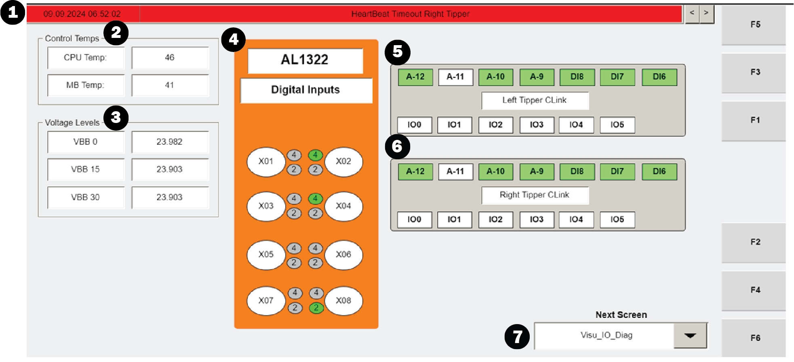
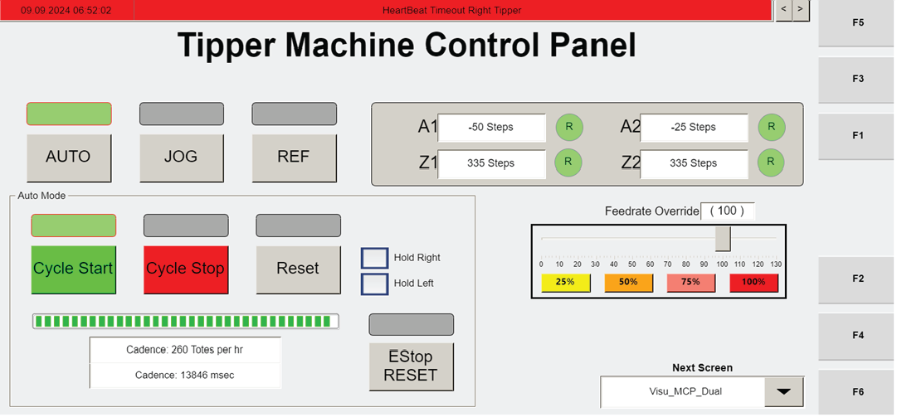
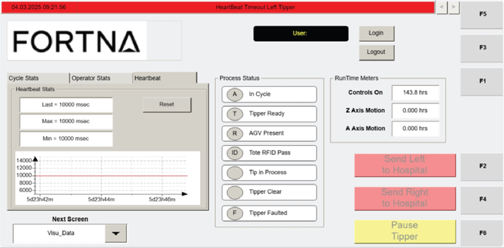
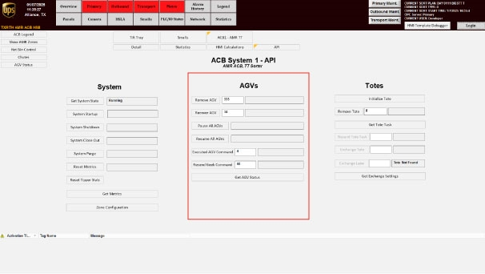
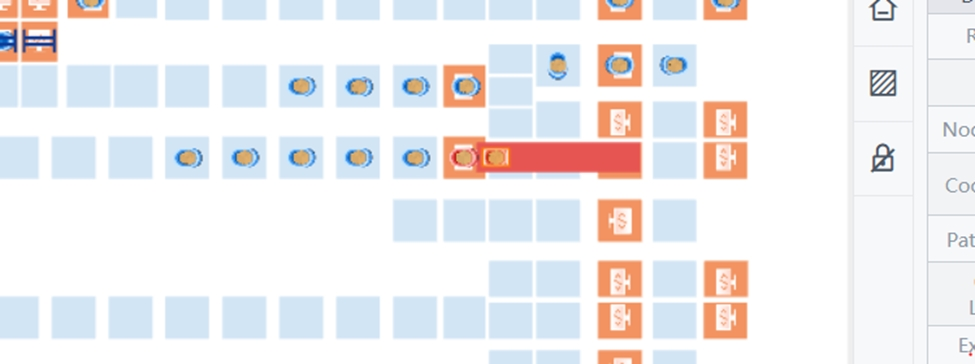

# Application-log and gateway-health investigation during robotic system outage

## Playbook Header

| Field | Value |
| --- | --- |
| Playbook ID | `playbook_incident_228086_wcswebapp_ignition_error_investigation` |
| Case ID | `228086` |
| Extraction Mode | `one_or_more_playbook_candidates_when_separable` |
| Confidence | `low` |
| Validation Status | `needs_sme_review` |

## Entry Symptoms

- Responders see clustered WCSWebApplication errors in Windows Event Viewer Application log.
- Responders are asked whether Ignition crashed.
- Ignition memory trend is reviewed because a crash is suspected.
- Ignition status page or uptime/response indicators are checked after suspected instability.
- A web application or webservice is described as faulted in incident notes.

## Affected Systems

- WCSWebApplication
- Windows Event Viewer Application log
- Windows Error Reporting
- Ignition gateway
- Ignition Systems Overview page
- Ignition memory trend
- database-related application layer

## Nodes

### 1 — Confirm whether the entry pattern is application-log or gateway-health instability (`diagnostic_decision`)

**Intent:** Determine whether responders are entering from clustered application errors, suspected Ignition crash, or gateway-health concerns rather than from direct fleet-state symptoms.

**Runbook Links:**

- `proc_review_visu_io_diag_screen_readings_for_operator_station_troubleshooting_v1` (high, score=0.4841, boosted=0.7341) — Review VISU_IO_DIAG Screen Readings For Operator Station Troubleshooting

**Decision Outcomes:**

- `unhealthy`: Entry pattern is driven by clustered application-log faults visible in Event Viewer.
- `inconclusive`: Primary concern is suspected Ignition crash or gateway instability rather than confirmed application-log clustering.
- `healthy`: Neither application-log clustering nor gateway-health instability is clearly established from the entry evidence.

**Branches:**

- `unhealthy` → `node_2` when application_log_errors_visible
- `inconclusive` → `node_3` when suspected_ignition_crash_or_gateway_unhealthy
- `healthy` → `node_6` when entry_pattern_not_confirmed

**Linked Runbook Procedures:**

#### Runbook: Review VISU_IO_DIAG Screen Readings For Operator Station Troubleshooting

- **Procedure ID:** `proc_review_visu_io_diag_screen_readings_for_operator_station_troubleshooting_v1`
- **Procedure Type:** `diagnostic`
- **Role:** `L1_support`
- **Merge Status:** `pass_through`

**Summary:**
Use the read-only VISU_IO_DIAG screen on the Operator Station HMI to inspect alarms or informational messages, HMI temperatures, voltage levels, and displayed input states during troubleshooting.

**When To Use:**
Use this procedure when troubleshooting at the Operator Station and read-only diagnostic information is needed from the VISU_IO_DIAG screen, including banner messages, control temperatures, voltage levels, and station input states.

**Safety Notes:**

- The VISU_IO_DIAG screen is read-only and can be used for troubleshooting.
- Do not attempt control changes from this screen.

- **Source:** `manual` / `manual_optisweep_om_v3`

**Procedure Steps:**

##### Step 1 — Open the VISU_IO_DIAG screen

**Responsible role:** L1_support

**Instruction:**
Open or navigate to the VISU_IO_DIAG screen using the HMI screen selection drop-down menu.

**Healthy condition:**
The VISU_IO_DIAG screen opens and its diagnostic sections are visible.

**Expected result:**
The VISU_IO_DIAG screen is displayed on the Operator Station HMI.

**Step Images:**

*VISU_IO_DIAG layout and the screen selection drop-down.*

*Operator station display controls and navigation reference for accessing Visu_IO_Diag.*

---

##### Step 2 — Check the informational banner

**Responsible role:** L1_support

**Instruction:**
Check the informational banner for any displayed alarms or informational messages.

**Healthy condition:**
The banner is visible and messages can be read.

**Expected result:**
Any current banner message is visible for review.

**Step Images:**

*Informational banner area on the VISU_IO_DIAG screen.*

---

##### Step 3 — Navigate through banner messages

**Responsible role:** L1_support

**Instruction:**
Use the arrows on the right side of the banner to navigate through available banner messages and note the displayed messages.

**Healthy condition:**
The arrows allow message navigation and the displayed messages can be observed.

**Expected result:**
Available banner messages are reviewed and noted.

**Step Images:**

*Banner area and the message navigation arrows on the right side.*

---

##### Step 4 — Review control temperatures

**Responsible role:** L1_support

**Instruction:**
Review the "Control Temps" section and observe the CPU and motherboard (MB) temperature readings.

**Healthy condition:**
The Control Temps section is visible and both CPU and MB readings are displayed.

**Expected result:**
CPU and motherboard temperature readings are visible and noted.

**Step Images:**

*"Control Temps" section showing CPU and MB temperature readings.*

---

##### Step 5 — Verify voltage levels

**Responsible role:** L1_support

**Instruction:**
Review the "Voltage Levels" section and verify the internal controller voltage reading is 24 V.

**Healthy condition:**
The Voltage Levels section shows the internal controller voltage at 24 V.

**Expected result:**
The internal controller voltage reading is visible and compared to the expected 24 V value.

**Step Images:**

*"Voltage Levels" section showing the internal controller voltage reading.*

---

##### Step 6 — Inspect station switch input states

**Responsible role:** L1_support

**Instruction:**
Inspect the section corresponding to the switch mounted on the station and observe which inputs are shown as on and off.

**Healthy condition:**
The station switch section is visible and input states are clearly shown as on or off.

**Expected result:**
The displayed on/off states for the station switch inputs are visible and noted.

**Step Images:**

*Section corresponding to the switch mounted on the station and its displayed on/off input states.*

---

##### Step 7 — Open detailed input information

**Responsible role:** L1_support

**Instruction:**
Select one of the input sections to open the window with more information about what the inputs are.

**Healthy condition:**
Selecting an input section opens a window providing more information on what the inputs are.

**Expected result:**
A window opens with more information about the selected inputs.

**Step Images:**

*Input sections on the VISU_IO_DIAG screen and the selectable area used to open more input information.*

---

##### Step 8 — Record observed diagnostic information

**Responsible role:** L1_support

**Instruction:**
Record the observed messages, temperatures, voltage reading, and input states for troubleshooting.

**Healthy condition:**
Messages, temperatures, voltage reading, and input states have been captured.

**Expected result:**
Observed VISU_IO_DIAG information is documented for use in troubleshooting.

---

**Success Criteria:**

- The VISU_IO_DIAG screen is accessed successfully.
- Banner messages, CPU temperature, motherboard temperature, internal controller voltage, and displayed input states are reviewed.
- Any additional input detail window needed for troubleshooting is opened successfully.
- Observed diagnostic information is recorded for troubleshooting.

**Failure Conditions:**

- The VISU_IO_DIAG screen cannot be accessed.
- Expected diagnostic sections are not available.
- The internal controller voltage is not 24 V.
- Banner messages or input detail windows cannot be reviewed as described.

---

### 2 — Inspect Windows Event Viewer for clustered application faults (`diagnostic_decision`)

**Intent:** Determine whether the application layer shows a concentrated error pattern that should influence recovery or escalation.

**Runbook Links:**

- `proc_review_visu_io_diag_screen_readings_for_operator_station_troubleshooting_v1` (high, score=0.4356, boosted=0.6856) — Review VISU_IO_DIAG Screen Readings For Operator Station Troubleshooting

**Decision Outcomes:**

- `unhealthy`: A concentrated application-fault pattern is present and should influence recovery or escalation.
- `inconclusive`: Some application events are present but do not clearly establish a platform fault pattern.
- `healthy`: No meaningful clustered application-fault pattern is found in the inspected window.

**Linked Runbook Procedures:**

#### Runbook: Review VISU_IO_DIAG Screen Readings For Operator Station Troubleshooting

- **Procedure ID:** `proc_review_visu_io_diag_screen_readings_for_operator_station_troubleshooting_v1`
- **Procedure Type:** `diagnostic`
- **Role:** `L1_support`
- **Merge Status:** `pass_through`

**Summary:**
Use the read-only VISU_IO_DIAG screen on the Operator Station HMI to inspect alarms or informational messages, HMI temperatures, voltage levels, and displayed input states during troubleshooting.

**When To Use:**
Use this procedure when troubleshooting at the Operator Station and read-only diagnostic information is needed from the VISU_IO_DIAG screen, including banner messages, control temperatures, voltage levels, and station input states.

**Safety Notes:**

- The VISU_IO_DIAG screen is read-only and can be used for troubleshooting.
- Do not attempt control changes from this screen.

- **Source:** `manual` / `manual_optisweep_om_v3`

**Procedure Steps:**

##### Step 1 — Open the VISU_IO_DIAG screen

**Responsible role:** L1_support

**Instruction:**
Open or navigate to the VISU_IO_DIAG screen using the HMI screen selection drop-down menu.

**Healthy condition:**
The VISU_IO_DIAG screen opens and its diagnostic sections are visible.

**Expected result:**
The VISU_IO_DIAG screen is displayed on the Operator Station HMI.

**Step Images:**

*VISU_IO_DIAG layout and the screen selection drop-down.*

*Operator station display controls and navigation reference for accessing Visu_IO_Diag.*

---

##### Step 2 — Check the informational banner

**Responsible role:** L1_support

**Instruction:**
Check the informational banner for any displayed alarms or informational messages.

**Healthy condition:**
The banner is visible and messages can be read.

**Expected result:**
Any current banner message is visible for review.

**Step Images:**

*Informational banner area on the VISU_IO_DIAG screen.*

---

##### Step 3 — Navigate through banner messages

**Responsible role:** L1_support

**Instruction:**
Use the arrows on the right side of the banner to navigate through available banner messages and note the displayed messages.

**Healthy condition:**
The arrows allow message navigation and the displayed messages can be observed.

**Expected result:**
Available banner messages are reviewed and noted.

**Step Images:**

*Banner area and the message navigation arrows on the right side.*

---

##### Step 4 — Review control temperatures

**Responsible role:** L1_support

**Instruction:**
Review the "Control Temps" section and observe the CPU and motherboard (MB) temperature readings.

**Healthy condition:**
The Control Temps section is visible and both CPU and MB readings are displayed.

**Expected result:**
CPU and motherboard temperature readings are visible and noted.

**Step Images:**

*"Control Temps" section showing CPU and MB temperature readings.*

---

##### Step 5 — Verify voltage levels

**Responsible role:** L1_support

**Instruction:**
Review the "Voltage Levels" section and verify the internal controller voltage reading is 24 V.

**Healthy condition:**
The Voltage Levels section shows the internal controller voltage at 24 V.

**Expected result:**
The internal controller voltage reading is visible and compared to the expected 24 V value.

**Step Images:**

*"Voltage Levels" section showing the internal controller voltage reading.*

---

##### Step 6 — Inspect station switch input states

**Responsible role:** L1_support

**Instruction:**
Inspect the section corresponding to the switch mounted on the station and observe which inputs are shown as on and off.

**Healthy condition:**
The station switch section is visible and input states are clearly shown as on or off.

**Expected result:**
The displayed on/off states for the station switch inputs are visible and noted.

**Step Images:**

*Section corresponding to the switch mounted on the station and its displayed on/off input states.*

---

##### Step 7 — Open detailed input information

**Responsible role:** L1_support

**Instruction:**
Select one of the input sections to open the window with more information about what the inputs are.

**Healthy condition:**
Selecting an input section opens a window providing more information on what the inputs are.

**Expected result:**
A window opens with more information about the selected inputs.

**Step Images:**

*Input sections on the VISU_IO_DIAG screen and the selectable area used to open more input information.*

---

##### Step 8 — Record observed diagnostic information

**Responsible role:** L1_support

**Instruction:**
Record the observed messages, temperatures, voltage reading, and input states for troubleshooting.

**Healthy condition:**
Messages, temperatures, voltage reading, and input states have been captured.

**Expected result:**
Observed VISU_IO_DIAG information is documented for use in troubleshooting.

---

**Success Criteria:**

- The VISU_IO_DIAG screen is accessed successfully.
- Banner messages, CPU temperature, motherboard temperature, internal controller voltage, and displayed input states are reviewed.
- Any additional input detail window needed for troubleshooting is opened successfully.
- Observed diagnostic information is recorded for troubleshooting.

**Failure Conditions:**

- The VISU_IO_DIAG screen cannot be accessed.
- Expected diagnostic sections are not available.
- The internal controller voltage is not 24 V.
- Banner messages or input detail windows cannot be reviewed as described.

---

### 3 — Assess Ignition gateway health using memory trend and status page (`diagnostic_decision`)

**Intent:** Determine whether available Ignition monitoring evidence supports a current gateway-health problem or weakens the crash hypothesis.

**Runbook Links:**

- `proc_review_heartbeat_statistics_on_the_visu_data_screen_v1` (high, score=0.4643, boosted=0.5943) — Review Heartbeat Statistics On The VISU_DATA Screen
  - gaps: No retrieved runbook explicitly covers Ignition Server memory trend review; No retrieved runbook explicitly covers Ignition Systems Overview or gateway uptime/response indicators; Retrieved candidate appears HMI/VISU focused rather than Ignition gateway focused

**Decision Outcomes:**

- `healthy`: Available monitoring evidence weakens the crash hypothesis and shows the gateway is currently responsive.
- `unhealthy`: Gateway-health evidence suggests a current problem and supported recovery may be needed.
- `inconclusive`: Monitoring evidence is insufficient to confirm either a crash or healthy gateway state.

**Branches:**

- `inconclusive` → `node_4` when Gateway recovery is needed and authorized

**Linked Runbook Procedures:**

#### Runbook: Review Heartbeat Statistics On The VISU_DATA Screen

- **Procedure ID:** `proc_review_heartbeat_statistics_on_the_visu_data_screen_v1`
- **Procedure Type:** `diagnostic`
- **Role:** `L1_support`
- **Merge Status:** `pass_through`

**Summary:**
Use the Heartbeat section on the VISU_DATA screen to review Last, Max, and Min heartbeat signal times between the tipper and WCS in milliseconds and determine whether a signal longer than 10 seconds is present, which the manual warns can cause operation issues due to mis-synchronization.

**When To Use:**
Use when troubleshooting communication-health or synchronization concerns between the tipper and WCS and when heartbeat timing evidence is needed from the operator station HMI VISU_DATA screen.

**Safety Notes:**

- The manual warns that a heartbeat signal longer than 10 seconds can cause operation issues with the tipper due to mis-synchronization.

- **Source:** `manual` / `manual_optisweep_om_v3`

**Procedure Steps:**

##### Step 1 — Open VISU_DATA and locate the Heartbeat section

**Responsible role:** L1_support

**Instruction:**
Open the VISU_DATA screen on the operator station HMI and locate the Heartbeat section that shows Last, Max, Min, and RESET.

**Healthy condition:**
The Heartbeat section is present and the Last, Max, and Min fields are readable.

**Expected result:**
The Heartbeat section is visible on the VISU_DATA screen.

**Step Images:**

*Heartbeat section with Last, Max, Min, and RESET.*

*Overall VISU_DATA screen layout to orient to the data screen.*

---

##### Step 2 — Read the Last heartbeat value

**Responsible role:** L1_support

**Instruction:**
Read the Last heartbeat value and interpret it as the most recent signal time in milliseconds.

**Healthy condition:**
A Last value is displayed and can be read in milliseconds.

**Expected result:**
The most recent heartbeat signal time is identified from the Last field.

**Step Images:**

*The Last field in the Heartbeat section.*

---

##### Step 3 — Read the Max heartbeat value

**Responsible role:** L1_support

**Instruction:**
Read the Max heartbeat value and interpret it as the longest signal time in milliseconds.

**Healthy condition:**
A Max value is displayed and can be read in milliseconds.

**Expected result:**
The longest heartbeat signal time is identified from the Max field.

**Step Images:**

*The Max field in the Heartbeat section.*

---

##### Step 4 — Read the Min heartbeat value

**Responsible role:** L1_support

**Instruction:**
Read the Min heartbeat value and interpret it as the shortest signal time in milliseconds.

**Healthy condition:**
A Min value is displayed and can be read in milliseconds.

**Expected result:**
The shortest heartbeat signal time is identified from the Min field.

**Step Images:**

*The Min field in the Heartbeat section.*

---

##### Step 5 — Check for heartbeat signal time longer than 10 seconds

**Responsible role:** L1_support

**Instruction:**
Check whether any displayed heartbeat signal time is longer than 10 seconds, using the source warning that signals longer than 10 seconds can cause operation issues with the tipper due to mis-synchronization.

**Healthy condition:**
No displayed heartbeat signal time indicates a duration longer than 10 seconds.

**Expected result:**
You determine whether the longer-than-10-seconds condition is present.

**Step Images:**

*Displayed Last, Max, and Min heartbeat timing values in the Heartbeat section.*

---

##### Step 6 — Record displayed heartbeat values for troubleshooting evidence

**Responsible role:** L1_support

**Instruction:**
Record the displayed Last, Max, and Min values if needed for troubleshooting evidence.

**Healthy condition:**
Last, Max, and Min values are captured accurately from the screen.

**Expected result:**
The displayed heartbeat values are documented for later review or escalation.

**Step Images:**

*The Last, Max, and Min values to be recorded.*

---

**Success Criteria:**

- The Heartbeat section on the VISU_DATA screen is located.
- The Last, Max, and Min heartbeat values are read and interpreted as milliseconds.
- A determination is made about whether any displayed heartbeat signal time is longer than 10 seconds.
- Displayed values are recorded if needed for troubleshooting evidence.

**Failure Conditions:**

- A heartbeat signal longer than 10 seconds is observed.
- The Heartbeat section is unavailable.
- Displayed heartbeat values are unreadable.

---

### 4 — Choose supported next step based on gateway responsiveness and service dependency checks (`branching_condition`)

**Intent:** Decide whether the path should continue with supported gateway/service recovery checks or move to escalation because the evidence does not support a safe local continuation.

**Runbook Links:**

- `proc_gather_required_fault_information_before_entering_the_grid_for_agv_recovery_v1` (medium, score=0.4669, boosted=0.4169) — Gather Required Fault Information Before Entering the Grid for AGV Recovery
  - gaps: No retrieved runbook explicitly covers approved Ignition gateway recovery decision criteria; No retrieved runbook explicitly covers waiting for gateway return to login/status state; No retrieved runbook explicitly covers OptiSweep GetAgvStatuses dependency verification after gateway recovery

**Decision Outcomes:**

- `healthy`: Gateway is responsive enough and dependent-service checks can proceed.
- `unhealthy`: Gateway or dependent-service state indicates continued platform trouble requiring escalation.
- `escalate`: Evidence does not support a safe or authorized local continuation.

**Branches:**

- `healthy` → `node_5` when gateway_responsive_and_api_checks_possible
- `unhealthy` → `node_6` when gateway_or_dependency_not_recovered
- `escalate` → `node_6` when recovery_not_authorized_or_not_safe

**Linked Runbook Procedures:**

#### Runbook: Gather Required Fault Information Before Entering the Grid for AGV Recovery

- **Procedure ID:** `proc_gather_required_fault_information_before_entering_the_grid_for_agv_recovery_v1`
- **Procedure Type:** `diagnostic`
- **Role:** `L2_support`
- **Merge Status:** `pass_through`

**Summary:**
Collect the source-required AGV and RMS details before going inside the grid (Dance Floor) to perform fault recovery.

**When To Use:**
Use before going inside the grid (also called the Dance Floor) for AGV fault recovery, to ensure the required Robot ID, RMS fault description, bin/tote status, tote ID when applicable, and under-rack empty-AGV zone status have been gathered.

**Safety Notes:**

- Entering the grid (Dance Floor) implies elevated operational risk per the candidate context.
- Before going inside the grid, make sure to have the required Robot ID, fault description from RMS, bin/tote status, tote ID when applicable, and under-rack empty-AGV zone status.
- Do not proceed into the grid without the documented information.

- **Source:** `manual` / `manual_optisweep_om_v3`

**Procedure Steps:**

##### Step 1 — Identify the Robot ID for the faulted AGV

**Responsible role:** L2_support

**Instruction:**
Identify and record the Robot ID for the faulted AGV before going inside the grid.

**Healthy condition:**
A single faulted AGV is clearly identified and its Robot ID is available for recovery preparation.

**Expected result:**
The Robot ID for the faulted AGV is known and recorded.

**Step Images:**

*Look for the AGV fault interface context associated with Robot ID and fault recovery information.*

*Look for AGV details/status context that may support identifying the affected AGV.*

---

##### Step 2 — Obtain the fault description from RMS

**Responsible role:** L2_support

**Instruction:**
Access RMS and obtain the fault description for the faulted AGV.

**Healthy condition:**
The RMS fault description is visible and clearly associated with the identified faulted AGV.

**Expected result:**
The RMS fault description for the faulted AGV is available and recorded.

**Step Images:**

*Look for the AGV fault screen context referenced for RMS fault description during fault recovery.*

---

##### Step 3 — Check whether RMS indicates the AGV is holding a bin

**Responsible role:** L2_support

**Instruction:**
Check in RMS whether the faulted AGV is indicated as holding a bin.

**Healthy condition:**
RMS clearly indicates whether the faulted AGV is or is not holding a bin.

**Expected result:**
The bin/tote holding status of the faulted AGV is known.

**Step Images:**

*Look for fault recovery screen context related to RMS fault and tote/bin status.*

---

##### Step 4 — Record the tote ID if the AGV is holding a bin

**Responsible role:** L2_support

**Instruction:**
If RMS indicates the faulted AGV is holding a bin, record the tote ID.

**Healthy condition:**
A tote ID is documented for a faulted AGV that RMS shows as holding a bin, or the step is not applicable because no bin is held.

**Expected result:**
The tote ID is recorded when the faulted AGV is holding a bin.

**Step Images:**

*Look for screen context related to tote ID during AGV fault recovery.*

*Look for a faulted AGV with tote context that may help interpret tote-related recovery information.*

---

##### Step 5 — Verify under-rack empty-AGV zone status when applicable

**Responsible role:** L2_support

**Instruction:**
If the faulted AGV is under a rack, verify whether that AGV is the empty AGV for that zone.

**Healthy condition:**
For an AGV under a rack, it is known whether that AGV is the empty AGV for the zone; otherwise the step is not applicable.

**Expected result:**
The under-rack empty-AGV zone status is confirmed when applicable.

**Step Images:**

*Look for no-empty-AGV zone context relevant to determining whether the under-rack AGV is the empty AGV for that zone.*

*Look for AGV positioning and zone context that may help interpret under-rack AGV status.*

---

##### Step 6 — Confirm all required information before entering the grid

**Responsible role:** L2_support

**Instruction:**
Confirm that you have the Robot ID, RMS fault description, bin/tote status, tote ID when applicable, and under-rack empty-AGV zone status when applicable before going inside the grid.

**Healthy condition:**
The required information set is complete and ready for use during AGV recovery.

**Expected result:**
All source-required pre-entry information has been collected and confirmed.

**Step Images:**

*Use as a reference for AGV fault recovery context while confirming the collected information.*

---

**Success Criteria:**

- The Robot ID for the faulted AGV is documented.
- The RMS fault description is documented.
- The AGV bin/tote holding status is documented.
- The tote ID is documented when RMS indicates the AGV is holding a bin.
- The under-rack empty-AGV zone status is documented when applicable.
- The information is confirmed before entering the grid.

**Failure Conditions:**

- Robot ID cannot be confirmed.
- RMS fault description cannot be obtained.
- Bin/tote holding status cannot be determined.
- Tote ID cannot be confirmed when the AGV is holding a bin.
- Under-rack empty-AGV zone status cannot be confirmed when applicable.
- Any required information is missing before grid entry.

---

### 5 — Validate gateway and dependent service responsiveness after supported recovery (`validation_gate`)

**Intent:** Confirm that the gateway is back up and that dependent service/API checks are responsive enough to hand control back to the main operational recovery flow.

**Runbook Links:**

- `proc_gather_required_fault_information_before_entering_the_grid_for_agv_recovery_v1` (high, score=0.5252, boosted=0.5152) — Gather Required Fault Information Before Entering the Grid for AGV Recovery
  - gaps: No retrieved runbook explicitly covers Ignition gateway post-recovery validation; No retrieved runbook explicitly covers GetAgvStatuses API verification; Retrieved candidates are AGV/HMI oriented rather than gateway/API validation oriented

**Decision Outcomes:**

- `healthy`: Gateway and dependent service are responsive after supported recovery.
- `unhealthy`: Post-recovery validation shows the platform or dependency is still not functioning correctly.
- `inconclusive`: Validation evidence is incomplete or ambiguous after recovery activity.

**Linked Runbook Procedures:**

#### Runbook: Gather Required Fault Information Before Entering the Grid for AGV Recovery

- **Procedure ID:** `proc_gather_required_fault_information_before_entering_the_grid_for_agv_recovery_v1`
- **Procedure Type:** `diagnostic`
- **Role:** `L2_support`
- **Merge Status:** `pass_through`

**Summary:**
Collect the source-required AGV and RMS details before going inside the grid (Dance Floor) to perform fault recovery.

**When To Use:**
Use before going inside the grid (also called the Dance Floor) for AGV fault recovery, to ensure the required Robot ID, RMS fault description, bin/tote status, tote ID when applicable, and under-rack empty-AGV zone status have been gathered.

**Safety Notes:**

- Entering the grid (Dance Floor) implies elevated operational risk per the candidate context.
- Before going inside the grid, make sure to have the required Robot ID, fault description from RMS, bin/tote status, tote ID when applicable, and under-rack empty-AGV zone status.
- Do not proceed into the grid without the documented information.

- **Source:** `manual` / `manual_optisweep_om_v3`

**Procedure Steps:**

##### Step 1 — Identify the Robot ID for the faulted AGV

**Responsible role:** L2_support

**Instruction:**
Identify and record the Robot ID for the faulted AGV before going inside the grid.

**Healthy condition:**
A single faulted AGV is clearly identified and its Robot ID is available for recovery preparation.

**Expected result:**
The Robot ID for the faulted AGV is known and recorded.

**Step Images:**

*Look for the AGV fault interface context associated with Robot ID and fault recovery information.*

*Look for AGV details/status context that may support identifying the affected AGV.*

---

##### Step 2 — Obtain the fault description from RMS

**Responsible role:** L2_support

**Instruction:**
Access RMS and obtain the fault description for the faulted AGV.

**Healthy condition:**
The RMS fault description is visible and clearly associated with the identified faulted AGV.

**Expected result:**
The RMS fault description for the faulted AGV is available and recorded.

**Step Images:**

*Look for the AGV fault screen context referenced for RMS fault description during fault recovery.*

---

##### Step 3 — Check whether RMS indicates the AGV is holding a bin

**Responsible role:** L2_support

**Instruction:**
Check in RMS whether the faulted AGV is indicated as holding a bin.

**Healthy condition:**
RMS clearly indicates whether the faulted AGV is or is not holding a bin.

**Expected result:**
The bin/tote holding status of the faulted AGV is known.

**Step Images:**

*Look for fault recovery screen context related to RMS fault and tote/bin status.*

---

##### Step 4 — Record the tote ID if the AGV is holding a bin

**Responsible role:** L2_support

**Instruction:**
If RMS indicates the faulted AGV is holding a bin, record the tote ID.

**Healthy condition:**
A tote ID is documented for a faulted AGV that RMS shows as holding a bin, or the step is not applicable because no bin is held.

**Expected result:**
The tote ID is recorded when the faulted AGV is holding a bin.

**Step Images:**

*Look for screen context related to tote ID during AGV fault recovery.*

*Look for a faulted AGV with tote context that may help interpret tote-related recovery information.*

---

##### Step 5 — Verify under-rack empty-AGV zone status when applicable

**Responsible role:** L2_support

**Instruction:**
If the faulted AGV is under a rack, verify whether that AGV is the empty AGV for that zone.

**Healthy condition:**
For an AGV under a rack, it is known whether that AGV is the empty AGV for the zone; otherwise the step is not applicable.

**Expected result:**
The under-rack empty-AGV zone status is confirmed when applicable.

**Step Images:**

*Look for no-empty-AGV zone context relevant to determining whether the under-rack AGV is the empty AGV for that zone.*

*Look for AGV positioning and zone context that may help interpret under-rack AGV status.*

---

##### Step 6 — Confirm all required information before entering the grid

**Responsible role:** L2_support

**Instruction:**
Confirm that you have the Robot ID, RMS fault description, bin/tote status, tote ID when applicable, and under-rack empty-AGV zone status when applicable before going inside the grid.

**Healthy condition:**
The required information set is complete and ready for use during AGV recovery.

**Expected result:**
All source-required pre-entry information has been collected and confirmed.

**Step Images:**

*Use as a reference for AGV fault recovery context while confirming the collected information.*

---

**Success Criteria:**

- The Robot ID for the faulted AGV is documented.
- The RMS fault description is documented.
- The AGV bin/tote holding status is documented.
- The tote ID is documented when RMS indicates the AGV is holding a bin.
- The under-rack empty-AGV zone status is documented when applicable.
- The information is confirmed before entering the grid.

**Failure Conditions:**

- Robot ID cannot be confirmed.
- RMS fault description cannot be obtained.
- Bin/tote holding status cannot be determined.
- Tote ID cannot be confirmed when the AGV is holding a bin.
- Under-rack empty-AGV zone status cannot be confirmed when applicable.
- Any required information is missing before grid entry.

---

### 6 — Escalate unresolved application-layer or memory/log-growth concerns (`escalation_gate`)

**Intent:** Stop and escalate when application faults remain unexplained or when the incident evidence only supports specialist investigation rather than further supported frontline action.

**Runbook Links:**

- `proc_gather_required_fault_information_before_entering_the_grid_for_agv_recovery_v1` (high, score=0.3975, boosted=0.5275) — Gather Required Fault Information Before Entering the Grid for AGV Recovery
  - gaps: No retrieved runbook explicitly covers escalation handoff for unresolved application-layer faults; No retrieved runbook explicitly covers packaging Event Viewer screenshots and Ignition monitoring captures; No retrieved runbook explicitly covers tentative memory/log-growth concern documentation

**Decision Outcomes:**

- `escalate`: Application-layer faults remain unexplained or only tentative platform theories are available.
- `inconclusive`: Evidence package is incomplete but local recovery path is still unsupported.

**Linked Runbook Procedures:**

#### Runbook: Gather Required Fault Information Before Entering the Grid for AGV Recovery

- **Procedure ID:** `proc_gather_required_fault_information_before_entering_the_grid_for_agv_recovery_v1`
- **Procedure Type:** `diagnostic`
- **Role:** `L2_support`
- **Merge Status:** `pass_through`

**Summary:**
Collect the source-required AGV and RMS details before going inside the grid (Dance Floor) to perform fault recovery.

**When To Use:**
Use before going inside the grid (also called the Dance Floor) for AGV fault recovery, to ensure the required Robot ID, RMS fault description, bin/tote status, tote ID when applicable, and under-rack empty-AGV zone status have been gathered.

**Safety Notes:**

- Entering the grid (Dance Floor) implies elevated operational risk per the candidate context.
- Before going inside the grid, make sure to have the required Robot ID, fault description from RMS, bin/tote status, tote ID when applicable, and under-rack empty-AGV zone status.
- Do not proceed into the grid without the documented information.

- **Source:** `manual` / `manual_optisweep_om_v3`

**Procedure Steps:**

##### Step 1 — Identify the Robot ID for the faulted AGV

**Responsible role:** L2_support

**Instruction:**
Identify and record the Robot ID for the faulted AGV before going inside the grid.

**Healthy condition:**
A single faulted AGV is clearly identified and its Robot ID is available for recovery preparation.

**Expected result:**
The Robot ID for the faulted AGV is known and recorded.

**Step Images:**

*Look for the AGV fault interface context associated with Robot ID and fault recovery information.*

*Look for AGV details/status context that may support identifying the affected AGV.*

---

##### Step 2 — Obtain the fault description from RMS

**Responsible role:** L2_support

**Instruction:**
Access RMS and obtain the fault description for the faulted AGV.

**Healthy condition:**
The RMS fault description is visible and clearly associated with the identified faulted AGV.

**Expected result:**
The RMS fault description for the faulted AGV is available and recorded.

**Step Images:**

*Look for the AGV fault screen context referenced for RMS fault description during fault recovery.*

---

##### Step 3 — Check whether RMS indicates the AGV is holding a bin

**Responsible role:** L2_support

**Instruction:**
Check in RMS whether the faulted AGV is indicated as holding a bin.

**Healthy condition:**
RMS clearly indicates whether the faulted AGV is or is not holding a bin.

**Expected result:**
The bin/tote holding status of the faulted AGV is known.

**Step Images:**

*Look for fault recovery screen context related to RMS fault and tote/bin status.*

---

##### Step 4 — Record the tote ID if the AGV is holding a bin

**Responsible role:** L2_support

**Instruction:**
If RMS indicates the faulted AGV is holding a bin, record the tote ID.

**Healthy condition:**
A tote ID is documented for a faulted AGV that RMS shows as holding a bin, or the step is not applicable because no bin is held.

**Expected result:**
The tote ID is recorded when the faulted AGV is holding a bin.

**Step Images:**

*Look for screen context related to tote ID during AGV fault recovery.*

*Look for a faulted AGV with tote context that may help interpret tote-related recovery information.*

---

##### Step 5 — Verify under-rack empty-AGV zone status when applicable

**Responsible role:** L2_support

**Instruction:**
If the faulted AGV is under a rack, verify whether that AGV is the empty AGV for that zone.

**Healthy condition:**
For an AGV under a rack, it is known whether that AGV is the empty AGV for the zone; otherwise the step is not applicable.

**Expected result:**
The under-rack empty-AGV zone status is confirmed when applicable.

**Step Images:**

*Look for no-empty-AGV zone context relevant to determining whether the under-rack AGV is the empty AGV for that zone.*

*Look for AGV positioning and zone context that may help interpret under-rack AGV status.*

---

##### Step 6 — Confirm all required information before entering the grid

**Responsible role:** L2_support

**Instruction:**
Confirm that you have the Robot ID, RMS fault description, bin/tote status, tote ID when applicable, and under-rack empty-AGV zone status when applicable before going inside the grid.

**Healthy condition:**
The required information set is complete and ready for use during AGV recovery.

**Expected result:**
All source-required pre-entry information has been collected and confirmed.

**Step Images:**

*Use as a reference for AGV fault recovery context while confirming the collected information.*

---

**Success Criteria:**

- The Robot ID for the faulted AGV is documented.
- The RMS fault description is documented.
- The AGV bin/tote holding status is documented.
- The tote ID is documented when RMS indicates the AGV is holding a bin.
- The under-rack empty-AGV zone status is documented when applicable.
- The information is confirmed before entering the grid.

**Failure Conditions:**

- Robot ID cannot be confirmed.
- RMS fault description cannot be obtained.
- Bin/tote holding status cannot be determined.
- Tote ID cannot be confirmed when the AGV is holding a bin.
- Under-rack empty-AGV zone status cannot be confirmed when applicable.
- Any required information is missing before grid entry.

---

## Branch Graph

| From Node | Outcome | Condition | Next Node |
| --- | --- | --- | --- |
| `node_1` | `unhealthy` | application_log_errors_visible | `node_2` |
| `node_1` | `inconclusive` | suspected_ignition_crash_or_gateway_unhealthy | `node_3` |
| `node_1` | `healthy` | entry_pattern_not_confirmed | `node_6` |
| `node_3` | `inconclusive` | Gateway recovery is needed and authorized | `node_4` |
| `node_4` | `healthy` | gateway_responsive_and_api_checks_possible | `node_5` |
| `node_4` | `unhealthy` | gateway_or_dependency_not_recovered | `node_6` |
| `node_4` | `escalate` | recovery_not_authorized_or_not_safe | `node_6` |
| `node_4` | `healthy` | gateway_responsive_and_api_checks_possible | `node_5` |
| `node_4` | `unhealthy` | gateway_or_dependency_not_recovered | `node_6` |
| `node_4` | `escalate` | recovery_not_authorized_or_not_safe | `node_6` |
| `` | `unhealthy` | application_log_errors_visible | `node_2` |
| `` | `inconclusive` | suspected_ignition_crash_or_gateway_unhealthy | `node_3` |
| `` | `healthy` | entry_pattern_not_confirmed | `node_6` |
| `` | `healthy` | gateway_responsive_and_api_checks_possible | `node_5` |
| `` | `unhealthy` | gateway_or_dependency_not_recovered | `node_6` |
| `` | `escalate` | recovery_not_authorized_or_not_safe | `node_6` |
