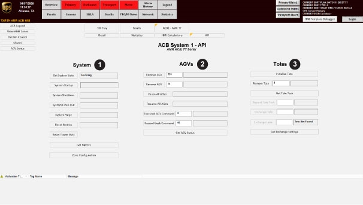
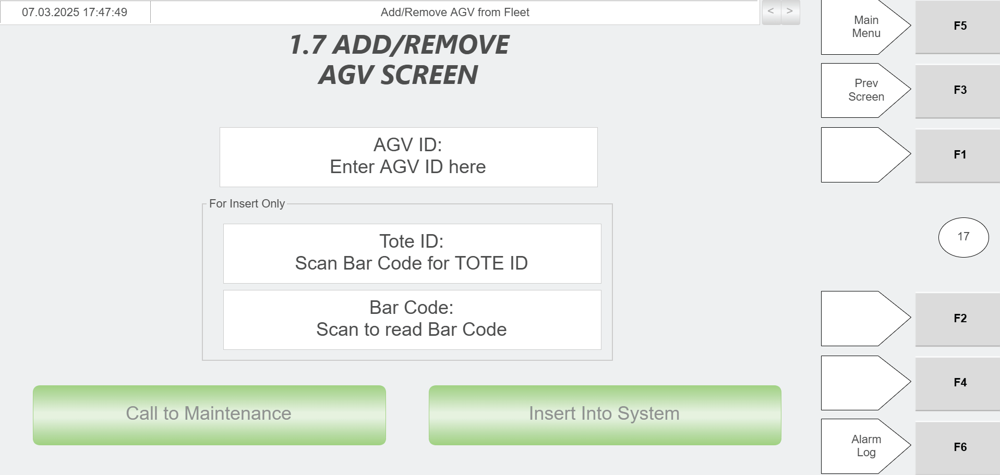
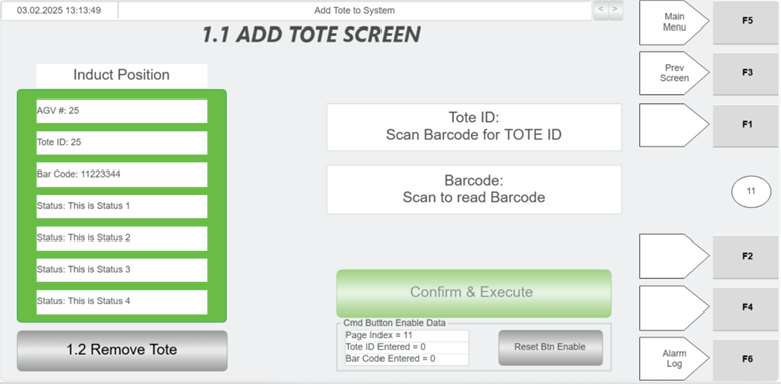
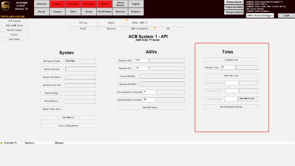

# Zone cannot get a pair and AMRs divert to hospital after recent robot replacement or remove/add activity

## Playbook Header

| Field | Value |
| --- | --- |
| Playbook ID | `playbook_incident_228723_zone5_pairing_hospital_diversion_after_robot_change` |
| Case ID | `228723` |
| Extraction Mode | `one_or_more_playbook_candidates_when_separable` |
| Confidence | `medium` |
| Validation Status | `needs_sme_review` |

## Entry Symptoms

- Site reports the ACB system is down
- A specific zone, especially zone 5 in this incident, is unable to get a pair
- After an AMR with low battery or an AMR replacement attempt, AMRs begin going to the hospital lane
- The issue appears after the site attempted to add, remove, or replace one or more AGVs or AMRs

## Affected Systems

- ACB system
- AMR/robot fleet
- RMS
- Zone 5 pairing behavior
- Hospital lane / hospital workflow

## Nodes

### 1 — Confirm the pairing-failure and hospital-diversion symptom pattern (`diagnostic_decision`)

**Intent:** Determine whether the current incident matches the observable pattern of a zone unable to get a pair after recent robot handling changes, with AMRs diverting to the hospital.

**Runbook Links:**

- `proc_gather_required_fault_information_before_entering_the_grid_for_agv_recovery_v1` (high, score=0.6, boosted=0.59) — Gather Required Fault Information Before Entering the Grid for AGV Recovery
  - gaps: No explicit RMS fleet or mapping inspection scope in title; No explicit zone pairing verification; No explicit recent robot add/remove/replacement history review; AGV recovery framing is narrower than the incident entry-pattern confirmation need

**Decision Outcomes:**

- `healthy`: Reported symptoms do not match the target pattern of zone pairing failure plus broad hospital diversion after recent robot handling changes.
- `unhealthy`: Incident matches the target pattern: a specific zone cannot get a pair and AMRs are diverting to hospital after recent robot handling changes.
- `inconclusive`: Some symptoms are present but the site or available RMS views do not yet confirm the full pattern.

**Branches:**

- `inconclusive` → `node_2` when Zone cannot get a pair and AMRs are going to the hospital after recent robot replacement or add/remove activity

**Linked Runbook Procedures:**

#### Runbook: Gather Required Fault Information Before Entering the Grid for AGV Recovery

- **Procedure ID:** `proc_gather_required_fault_information_before_entering_the_grid_for_agv_recovery_v1`
- **Procedure Type:** `diagnostic`
- **Role:** `L2_support`
- **Merge Status:** `pass_through`

**Summary:**
Collect the source-required AGV and RMS details before going inside the grid (Dance Floor) to perform fault recovery.

**When To Use:**
Use before going inside the grid (also called the Dance Floor) for AGV fault recovery, to ensure the required Robot ID, RMS fault description, bin/tote status, tote ID when applicable, and under-rack empty-AGV zone status have been gathered.

**Safety Notes:**

- Entering the grid (Dance Floor) implies elevated operational risk per the candidate context.
- Before going inside the grid, make sure to have the required Robot ID, fault description from RMS, bin/tote status, tote ID when applicable, and under-rack empty-AGV zone status.
- Do not proceed into the grid without the documented information.

- **Source:** `manual` / `manual_optisweep_om_v3`

**Procedure Steps:**

##### Step 1 — Identify the Robot ID for the faulted AGV

**Responsible role:** L2_support

**Instruction:**
Identify and record the Robot ID for the faulted AGV before going inside the grid.

**Healthy condition:**
A single faulted AGV is clearly identified and its Robot ID is available for recovery preparation.

**Expected result:**
The Robot ID for the faulted AGV is known and recorded.

**Step Images:**

*Look for the AGV fault interface context associated with Robot ID and fault recovery information.*

*Look for AGV details/status context that may support identifying the affected AGV.*

---

##### Step 2 — Obtain the fault description from RMS

**Responsible role:** L2_support

**Instruction:**
Access RMS and obtain the fault description for the faulted AGV.

**Healthy condition:**
The RMS fault description is visible and clearly associated with the identified faulted AGV.

**Expected result:**
The RMS fault description for the faulted AGV is available and recorded.

**Step Images:**

*Look for the AGV fault screen context referenced for RMS fault description during fault recovery.*

---

##### Step 3 — Check whether RMS indicates the AGV is holding a bin

**Responsible role:** L2_support

**Instruction:**
Check in RMS whether the faulted AGV is indicated as holding a bin.

**Healthy condition:**
RMS clearly indicates whether the faulted AGV is or is not holding a bin.

**Expected result:**
The bin/tote holding status of the faulted AGV is known.

**Step Images:**

*Look for fault recovery screen context related to RMS fault and tote/bin status.*

---

##### Step 4 — Record the tote ID if the AGV is holding a bin

**Responsible role:** L2_support

**Instruction:**
If RMS indicates the faulted AGV is holding a bin, record the tote ID.

**Healthy condition:**
A tote ID is documented for a faulted AGV that RMS shows as holding a bin, or the step is not applicable because no bin is held.

**Expected result:**
The tote ID is recorded when the faulted AGV is holding a bin.

**Step Images:**

*Look for screen context related to tote ID during AGV fault recovery.*

*Look for a faulted AGV with tote context that may help interpret tote-related recovery information.*

---

##### Step 5 — Verify under-rack empty-AGV zone status when applicable

**Responsible role:** L2_support

**Instruction:**
If the faulted AGV is under a rack, verify whether that AGV is the empty AGV for that zone.

**Healthy condition:**
For an AGV under a rack, it is known whether that AGV is the empty AGV for the zone; otherwise the step is not applicable.

**Expected result:**
The under-rack empty-AGV zone status is confirmed when applicable.

**Step Images:**

*Look for no-empty-AGV zone context relevant to determining whether the under-rack AGV is the empty AGV for that zone.*

*Look for AGV positioning and zone context that may help interpret under-rack AGV status.*

---

##### Step 6 — Confirm all required information before entering the grid

**Responsible role:** L2_support

**Instruction:**
Confirm that you have the Robot ID, RMS fault description, bin/tote status, tote ID when applicable, and under-rack empty-AGV zone status when applicable before going inside the grid.

**Healthy condition:**
The required information set is complete and ready for use during AGV recovery.

**Expected result:**
All source-required pre-entry information has been collected and confirmed.

**Step Images:**

*Use as a reference for AGV fault recovery context while confirming the collected information.*

---

**Success Criteria:**

- The Robot ID for the faulted AGV is documented.
- The RMS fault description is documented.
- The AGV bin/tote holding status is documented.
- The tote ID is documented when RMS indicates the AGV is holding a bin.
- The under-rack empty-AGV zone status is documented when applicable.
- The information is confirmed before entering the grid.

**Failure Conditions:**

- Robot ID cannot be confirmed.
- RMS fault description cannot be obtained.
- Bin/tote holding status cannot be determined.
- Tote ID cannot be confirmed when the AGV is holding a bin.
- Under-rack empty-AGV zone status cannot be confirmed when applicable.
- Any required information is missing before grid entry.

---

### 2 — Check whether recent remove/add or replacement activity is part of the incident context (`branching_condition`)

**Intent:** Choose the next troubleshooting direction based on whether the symptom pattern follows recent robot replacement, add, or remove/add handling.

**Runbook Links:**

- `proc_gather_required_fault_information_before_entering_the_grid_for_agv_recovery_v1` (high, score=0.5537, boosted=0.5437) — Gather Required Fault Information Before Entering the Grid for AGV Recovery
  - gaps: No explicit recent robot add/remove/replacement workflow review; No explicit RMS roster or hospital-flow history review; Does not clearly distinguish fleet-change issue from unrelated zone fault

**Decision Outcomes:**

- `healthy`: No recent robot handling changes are confirmed, so the incident does not fit the fleet-change branch strongly.
- `unhealthy`: Recent robot handling changes are confirmed and likely relevant to the current symptoms.
- `inconclusive`: Recent handling changes are suspected but not yet firmly established.

**Branches:**

- `unhealthy` → `node_3` when recent_robot_changes_confirmed
- `healthy` → `node_6` when recent_robot_changes_not_confirmed

**Linked Runbook Procedures:**

#### Runbook: Gather Required Fault Information Before Entering the Grid for AGV Recovery

- **Procedure ID:** `proc_gather_required_fault_information_before_entering_the_grid_for_agv_recovery_v1`
- **Procedure Type:** `diagnostic`
- **Role:** `L2_support`
- **Merge Status:** `pass_through`

**Summary:**
Collect the source-required AGV and RMS details before going inside the grid (Dance Floor) to perform fault recovery.

**When To Use:**
Use before going inside the grid (also called the Dance Floor) for AGV fault recovery, to ensure the required Robot ID, RMS fault description, bin/tote status, tote ID when applicable, and under-rack empty-AGV zone status have been gathered.

**Safety Notes:**

- Entering the grid (Dance Floor) implies elevated operational risk per the candidate context.
- Before going inside the grid, make sure to have the required Robot ID, fault description from RMS, bin/tote status, tote ID when applicable, and under-rack empty-AGV zone status.
- Do not proceed into the grid without the documented information.

- **Source:** `manual` / `manual_optisweep_om_v3`

**Procedure Steps:**

##### Step 1 — Identify the Robot ID for the faulted AGV

**Responsible role:** L2_support

**Instruction:**
Identify and record the Robot ID for the faulted AGV before going inside the grid.

**Healthy condition:**
A single faulted AGV is clearly identified and its Robot ID is available for recovery preparation.

**Expected result:**
The Robot ID for the faulted AGV is known and recorded.

**Step Images:**

*Look for the AGV fault interface context associated with Robot ID and fault recovery information.*

*Look for AGV details/status context that may support identifying the affected AGV.*

---

##### Step 2 — Obtain the fault description from RMS

**Responsible role:** L2_support

**Instruction:**
Access RMS and obtain the fault description for the faulted AGV.

**Healthy condition:**
The RMS fault description is visible and clearly associated with the identified faulted AGV.

**Expected result:**
The RMS fault description for the faulted AGV is available and recorded.

**Step Images:**

*Look for the AGV fault screen context referenced for RMS fault description during fault recovery.*

---

##### Step 3 — Check whether RMS indicates the AGV is holding a bin

**Responsible role:** L2_support

**Instruction:**
Check in RMS whether the faulted AGV is indicated as holding a bin.

**Healthy condition:**
RMS clearly indicates whether the faulted AGV is or is not holding a bin.

**Expected result:**
The bin/tote holding status of the faulted AGV is known.

**Step Images:**

*Look for fault recovery screen context related to RMS fault and tote/bin status.*

---

##### Step 4 — Record the tote ID if the AGV is holding a bin

**Responsible role:** L2_support

**Instruction:**
If RMS indicates the faulted AGV is holding a bin, record the tote ID.

**Healthy condition:**
A tote ID is documented for a faulted AGV that RMS shows as holding a bin, or the step is not applicable because no bin is held.

**Expected result:**
The tote ID is recorded when the faulted AGV is holding a bin.

**Step Images:**

*Look for screen context related to tote ID during AGV fault recovery.*

*Look for a faulted AGV with tote context that may help interpret tote-related recovery information.*

---

##### Step 5 — Verify under-rack empty-AGV zone status when applicable

**Responsible role:** L2_support

**Instruction:**
If the faulted AGV is under a rack, verify whether that AGV is the empty AGV for that zone.

**Healthy condition:**
For an AGV under a rack, it is known whether that AGV is the empty AGV for the zone; otherwise the step is not applicable.

**Expected result:**
The under-rack empty-AGV zone status is confirmed when applicable.

**Step Images:**

*Look for no-empty-AGV zone context relevant to determining whether the under-rack AGV is the empty AGV for that zone.*

*Look for AGV positioning and zone context that may help interpret under-rack AGV status.*

---

##### Step 6 — Confirm all required information before entering the grid

**Responsible role:** L2_support

**Instruction:**
Confirm that you have the Robot ID, RMS fault description, bin/tote status, tote ID when applicable, and under-rack empty-AGV zone status when applicable before going inside the grid.

**Healthy condition:**
The required information set is complete and ready for use during AGV recovery.

**Expected result:**
All source-required pre-entry information has been collected and confirmed.

**Step Images:**

*Use as a reference for AGV fault recovery context while confirming the collected information.*

---

**Success Criteria:**

- The Robot ID for the faulted AGV is documented.
- The RMS fault description is documented.
- The AGV bin/tote holding status is documented.
- The tote ID is documented when RMS indicates the AGV is holding a bin.
- The under-rack empty-AGV zone status is documented when applicable.
- The information is confirmed before entering the grid.

**Failure Conditions:**

- Robot ID cannot be confirmed.
- RMS fault description cannot be obtained.
- Bin/tote holding status cannot be determined.
- Tote ID cannot be confirmed when the AGV is holding a bin.
- Under-rack empty-AGV zone status cannot be confirmed when applicable.
- Any required information is missing before grid entry.

---

### 3 — Inspect RMS for abnormal robot roster or mapping state tied to the incident (`diagnostic_decision`)

**Intent:** Determine whether one or more robots involved in the recent change appear abnormal in RMS, such as not mapped, improperly rostered, or otherwise inconsistent with normal tasking behavior.

**Runbook Links:**

- `proc_interpret_agv_bump_exception_codes_on_the_bump_fault_screen_v1` (high, score=0.5177, boosted=0.8077) — Interpret AGV BUMP Exception Codes On The Bump Fault Screen

**Decision Outcomes:**

- `healthy`: No supported abnormal robot state is identified in available RMS checks.
- `unhealthy`: A specific robot appears abnormal in RMS and is a plausible blocker to normal pairing and fleet behavior.
- `inconclusive`: RMS evidence is incomplete or ambiguous and does not yet support a safe corrective action.

**Branches:**

- `unhealthy` → `node_4` when A specific robot appears abnormal in RMS, such as not mapped or otherwise inconsistent with normal tasking
- `unhealthy` → `node_6` when No supported abnormal robot state is identified, or the needed correction is outside role authority

**Linked Runbook Procedures:**

#### Runbook: Interpret AGV BUMP Exception Codes On The Bump Fault Screen

- **Procedure ID:** `proc_interpret_agv_bump_exception_codes_on_the_bump_fault_screen_v1`
- **Procedure Type:** `reference`
- **Role:** `L1_support`
- **Merge Status:** `pass_through`

**Summary:**
Use the documented BUMP exception codes in the source manual to identify whether an AGV BUMP fault corresponds to a front collision bar trigger or an obstacle avoidance trigger, and record the interpretation with the AGV fault details.

**When To Use:**
Use when reviewing an AGV BUMP fault in RMS or on the AGV Bump Fault Screen and you need to interpret the documented meaning of exception code 21057 or 21060 from the source manual.

**Safety Notes:**

- This runbook is a reference/interpretation aid only and does not authorize physical intervention or unsupported recovery actions.
- The source states that before going inside the grid (the Dance Floor), specific AGV fault information should be gathered first: Robot ID, fault description from RMS, whether the AGV is holding a bin and tote ID, and whether an AGV under a rack is the empty AGV for that zone.

- **Source:** `manual` / `manual_optisweep_om_v3`

**Procedure Steps:**

##### Step 1 — Open or view the AGV Bump Fault Screen or related fault information

**Responsible role:** L1_support

**Instruction:**
Open or view the AGV Bump Fault Screen or related RMS fault information for the affected AGV.

**Healthy condition:**
The affected AGV fault information is displayed and available for inspection.

**Expected result:**
The AGV BUMP fault details are visible for review.

**Step Images:**

*The AGV "Bump" Fault Screen shown in Figure 5-2, used as the reference screen for BUMP fault information.*

---

##### Step 2 — Locate the displayed BUMP exception code

**Responsible role:** L1_support

**Instruction:**
Locate the displayed exception code associated with the BUMP fault.

**Healthy condition:**
The exception code is clearly visible and can be read for comparison.

**Expected result:**
A specific BUMP exception code is identified from the displayed fault information.

**Step Images:**

*The BUMP fault display area where the exception code information appears.*

---

##### Step 3 — Compare the displayed code to the documented values

**Responsible role:** L1_support

**Instruction:**
Compare the displayed exception code to the documented values in the source manual.

**Healthy condition:**
The displayed code matches one of the documented values: 21057 or 21060.

**Expected result:**
The displayed code is matched to a documented exception meaning or identified as not covered by the source.

**Step Images:**

*The BUMP fault screen context while comparing the displayed exception code to the documented code meanings.*

---

##### Step 4 — Interpret code 21057 as front collision bar triggered

**Responsible role:** L1_support

**Instruction:**
If the code is 21057, record that the robot front collision bar triggered.

**Healthy condition:**
The interpretation recorded for code 21057 is "Robot front collision bar triggers."

**Expected result:**
Code 21057 is interpreted using the source-provided meaning.

---

##### Step 5 — Interpret code 21060 as obstacle avoidance triggered

**Responsible role:** L1_support

**Instruction:**
If the code is 21060, record that the robot triggered obstacle avoidance.

**Healthy condition:**
The interpretation recorded for code 21060 is "The robot triggers the obstacle avoidance."

**Expected result:**
Code 21060 is interpreted using the source-provided meaning.

---

##### Step 6 — Record the Robot ID, RMS fault description, and interpreted meaning

**Responsible role:** L1_support

**Instruction:**
Record the Robot ID and the fault description from RMS together with the interpreted exception meaning.

**Healthy condition:**
The record includes Robot ID, RMS fault description, and the correct interpretation for code 21057 or 21060.

**Expected result:**
The AGV fault record includes the Robot ID, RMS fault description, and the documented meaning of the exception code.

**Step Images:**

*The AGV Bump Fault Screen context while capturing the Robot ID and fault information for documentation.*

---

**Success Criteria:**

- The displayed AGV BUMP exception code is identified and matched to a documented source value.
- Code 21057 is recorded as "Robot front collision bar triggers" when present.
- Code 21060 is recorded as "The robot triggers the obstacle avoidance" when present.
- The Robot ID and RMS fault description are recorded together with the interpreted exception meaning.

**Failure Conditions:**

- The BUMP fault information cannot be accessed or read.
- The displayed exception code is not 21057 or 21060.
- The user attempts to infer additional meanings or corrective actions not supported by the source.
- Required AGV fault details such as Robot ID or RMS fault description are missing.

---

### 4 — Perform approved isolation or removal of the suspect robot from the active system (`procedure_reference`)

**Intent:** If RMS and incident context support a suspect robot as the likely blocker, perform the authorized robot-isolation or removal action rather than continuing to operate it in the active fleet.

**Runbook Links:**

- `proc_remove_an_agv_from_the_system_using_the_api_screen_v1` (high, score=0.5597, boosted=0.7297) — Remove An AGV From The System Using The API Screen
  - gaps: Title does not explicitly mention hospital-flow handling; Title does not explicitly mention charging-state considerations; Node allows isolation or removal; candidate is removal-specific
- `proc_remove_a_faulted_motionless_agv_from_the_floor_and_restore_operation_v1` (high, score=0.5778, boosted=0.7478) — Remove A Faulted Motionless AGV From The Floor And Restore Operation
  - gaps: Focuses on motionless faulted AGV on the floor rather than RMS-managed roster removal; No explicit API/system removal step in title; No explicit hospital-flow or charging-state handling

**Branches:**

- `inconclusive` → `node_5` when Approved isolation or removal has been completed

**Linked Runbook Procedures:**

#### Runbook: Remove An AGV From The System Using The API Screen

- **Procedure ID:** `proc_remove_an_agv_from_the_system_using_the_api_screen_v1`
- **Procedure Type:** `recovery`
- **Role:** `L2_support`
- **Merge Status:** `pass_through`

**Summary:**
Remove a specified AGV from the system from the AGVs section of the API screen by entering the AGV ID and using the Remove AGV control. The source also states that if the AGV has an issue it must be physically removed from the system, and if it has a tote it must be taken to the hospital where the tote is removed and later recovered when put back in the system.

**When To Use:**
Use when a specified AGV must be removed from the system using its AGV ID from the AGVs section of the API screen, including recovery situations where the AGV has an issue and must be removed from service.

**Safety Notes:**

- The source states that if an AGV has an issue, it must be physically removed from the system.
- If the AGV has a tote, it must be taken to the hospital where the tote is removed.
- This source section does not provide detailed physical handling or hospital safety steps; follow site-specific safety and handling procedures.

- **Source:** `manual` / `manual_optisweep_om_v3`

**Procedure Steps:**

##### Step 1 — Open the AGVs section of the API screen

**Responsible role:** L2_support

**Instruction:**
Open the API screen and navigate to the AGVs section.

**Healthy condition:**
The AGV API Controls area is open and the Remove AGV control is available.

**Expected result:**
The AGVs section of the API screen is visible.

**Step Images:**

*API screen entry point and overall ACB API interface.*

*AGVs section of the API screen and the Remove AGV control.*

---

##### Step 2 — Locate the Remove AGV control and AGV ID field

**Responsible role:** L2_support

**Instruction:**
In the AGVs section, locate the Remove AGV control and the AGV ID entry field.

**Healthy condition:**
The operator can clearly identify where to enter the AGV ID and where to trigger removal.

**Expected result:**
The Remove AGV control and AGV ID field are identified and ready for use.

**Step Images:**

*Remove AGV control and AGV ID entry area in the AGV API Controls screen.*

---

##### Step 3 — Enter the AGV ID

**Responsible role:** L2_support

**Instruction:**
Enter the AGV ID for the AGV to be removed.

**Healthy condition:**
The intended AGV ID is present in the entry field.

**Expected result:**
The target AGV ID is entered in the AGV ID field.

**Step Images:**

*AGV ID entry field used with Remove AGV.*

---

##### Step 4 — Use Remove AGV to remove the AGV from the system

**Responsible role:** L2_support

**Instruction:**
Use the Remove AGV control to remove that AGV from the system.

**Healthy condition:**
The AGV is no longer in service in the system after the removal action.

**Expected result:**
The specified AGV is removed from the system.

**Step Images:**

*Remove AGV control in the AGV API Controls screen.*

---

##### Step 5 — Physically remove the AGV if it has an issue

**Responsible role:** L2_support

**Instruction:**
If the AGV has an issue, physically remove the AGV from the system.

**Healthy condition:**
The AGV is no longer physically present in the active system where it can affect operation.

**Expected result:**
The issue-affected AGV is physically removed from the system.

**Step Images:**

*Hospital HMI Add/Remove AGV screen associated with removing an AGV from service.*

---

##### Step 6 — Take a tote-carrying AGV to the hospital and remove the tote

**Responsible role:** L2_support

**Instruction:**
If the AGV has a tote, take the AGV to the hospital and remove the tote there.

**Healthy condition:**
The AGV reaches the hospital process point and the tote is removed there.

**Expected result:**
The tote is removed from the AGV at the hospital.

**Step Images:**

*Hospital HMI Add/Remove AGV screen for AGV handling at the hospital station.*

---

##### Step 7 — Return the tote to the system for recovery

**Responsible role:** L2_support

**Instruction:**
Return the tote to the system so it can be recovered when it is put back in the system.

**Healthy condition:**
The tote is put back into the system and is available for recovery.

**Expected result:**
The tote is returned for recovery back into the system.

**Step Images:**

*Add Tote or confirmation-related screen associated with returning a tote into the system.*

*Tote API Controls area relevant to tote-related system actions.*

---

**Success Criteria:**

- The specified AGV is removed from the system using the AGV ID.
- If the AGV had an issue, it is physically removed from the system.
- If the AGV had a tote, the tote is removed at the hospital and returned to the system for recovery.

**Failure Conditions:**

- The API screen or AGVs section cannot be accessed.
- The Remove AGV control or AGV ID field cannot be used.
- The AGV is not removed from the system after the removal action.
- A problem AGV cannot be physically removed from the system.
- A tote on the AGV cannot be removed at the hospital or cannot be returned for recovery.

#### Runbook: Remove A Faulted Motionless AGV From The Floor And Restore Operation

- **Procedure ID:** `proc_remove_a_faulted_motionless_agv_from_the_floor_and_restore_operation_v1`
- **Procedure Type:** `recovery`
- **Role:** `L2_support`
- **Merge Status:** `pass_through`

**Summary:**
Recover from an AGV motionless-on-floor fault by locating the faulted AGV, identifying and stopping the correct E-stop zone, removing the AGV from the floor, then restoring operation with the documented E-stop release and blue RESET sequence.

**When To Use:**
Use when an AGV is faulted and motionless on the floor and the documented troubleshooting sequence calls for locating the AGV, stopping the appropriate E-stop zone, removing the AGV, and resetting the system.

**Safety Notes:**

- This procedure is not marked support-safe because the source does not describe the safe handling method for physically removing the AGV.
- Use site safety controls and local procedures for physical AGV removal; this source does not provide those details.
- Stop and escalate if the AGV cannot be safely removed.

- **Source:** `manual` / `manual_optisweep_om_v3`

**Procedure Steps:**

##### Step 1 — Locate the faulted AGV

**Responsible role:** L2_support

**Instruction:**
Locate the faulted AGV on the floor. If needed, reference RMS for AGV error information to help identify the AGV.

**Healthy condition:**
The specific AGV requiring recovery is clearly identified from floor observation and/or RMS error information.

**Expected result:**
The faulted motionless AGV is identified.

**Step Images:**

*Use as a visual example of a faulted AGV screen context during recovery.*

---

##### Step 2 — Identify the appropriate E-stop zone

**Responsible role:** L2_support

**Instruction:**
Reference the E-stop zone map to identify the appropriate E-stop zone for the faulted AGV.

**Healthy condition:**
The E-stop zone corresponding to the faulted AGV location is known before the zone is stopped.

**Expected result:**
The correct E-stop zone is identified.

---

##### Step 3 — Stop the appropriate E-stop zone

**Responsible role:** L2_support

**Instruction:**
Press E-STOP to stop the appropriate E-stop zone.

**Healthy condition:**
The intended E-stop zone is stopped and the area is isolated for AGV removal.

**Expected result:**
The appropriate E-stop zone is stopped.

---

##### Step 4 — Remove the faulted AGV from the floor

**Responsible role:** L2_support

**Instruction:**
Remove the faulted AGV from the floor.

**Healthy condition:**
The faulted AGV is no longer on the floor in the affected area.

**Expected result:**
The faulted AGV is removed from the floor.

---

##### Step 5 — Release the E-stop

**Responsible role:** L2_support

**Instruction:**
Pull E-STOP.

**Healthy condition:**
The E-stop is pulled out/released and the system is ready for reset.

**Expected result:**
The E-stop is released.

**Step Images:**

*Reference ESTOP clearing and RESET context associated with pulling out ESTOP and clearing faults.*

---

##### Step 6 — Press the blue RESET button

**Responsible role:** L2_support

**Instruction:**
Press the blue RESET button.

**Healthy condition:**
The reset completes without additional fault indication.

**Expected result:**
The reset is accepted and the system clears the fault condition.

**Step Images:**

*Candidate-provided image support for a faulted AGV screen during the fault recovery procedure.*

*Reference RESET-related HMI context associated with clearing faults after ESTOP is pulled out.*

---

##### Step 7 — Verify the system resumes operation

**Responsible role:** L2_support

**Instruction:**
Verify that the system resumes operation.

**Healthy condition:**
Normal operation resumes after the reset sequence.

**Expected result:**
The system resumes operation.

---

**Success Criteria:**

- The faulted AGV is identified.
- The appropriate E-stop zone is stopped.
- The faulted AGV is removed from the floor.
- The E-stop is released and the blue RESET button is pressed.
- The system resumes operation.

**Failure Conditions:**

- The faulted AGV cannot be identified from floor observation and RMS reference.
- The correct E-stop zone cannot be determined.
- The AGV cannot be safely removed.
- The reset sequence does not clear the fault.
- The system does not resume operation after the documented reset sequence.

---

### 5 — Validate that pairing and fleet behavior have returned to normal (`validation_gate`)

**Intent:** Confirm that the zone can pair again and that AMRs are no longer broadly diverting to the hospital after the suspect robot is isolated.

**Runbook Links:**

- `proc_verify_agvs_are_in_the_szonestaging_state_on_the_hmi_v1` (high, score=0.5587, boosted=0.7287) — Verify AGVs Are in the "szonestaging" State on the HMI
  - gaps: No explicit zone pairing validation; No explicit hospital-diversion validation; No explicit suspect robot isolation confirmation; No explicit monitoring-period stability check

**Decision Outcomes:**

- `healthy`: Pairing and fleet behavior have returned to normal after the suspect robot was isolated or removed.
- `unhealthy`: The approved action did not restore normal pairing or fleet behavior.
- `inconclusive`: Recovery cannot yet be confirmed because monitoring is incomplete or observations conflict.

**Branches:**

- `unhealthy` → `node_6` when Pairing failure or hospital-diversion behavior persists after the approved action

**Linked Runbook Procedures:**

#### Runbook: Verify AGVs Are in the "szonestaging" State on the HMI

- **Procedure ID:** `proc_verify_agvs_are_in_the_szonestaging_state_on_the_hmi_v1`
- **Procedure Type:** `diagnostic`
- **Role:** `L1_support`
- **Merge Status:** `pass_through`

**Summary:**
Confirm on the HMI that the AGVs being checked are displayed in the documented "szonestaging" state before restart or resume actions in AGV fault recovery.

**When To Use:**
Use this check when AGV fault recovery or restart guidance requires confirmation that AGVs are in the documented ready state before restarting or resuming the system.

**Safety Notes:**

- Stop and escalate if the HMI does not show AGV state or if the AGVs are not shown as "szonestaging" when this verification is required.
- Do not infer equivalent AGV states that are not explicitly documented in the source.

- **Source:** `manual` / `manual_optisweep_om_v3`

**Procedure Steps:**

##### Step 1 — Open the HMI view showing AGV state

**Responsible role:** L1_support

**Instruction:**
Open or view the HMI area where AGV state is displayed for the AGVs being checked.

**Healthy condition:**
The AGV state field or status area is visible on the HMI.

**Expected result:**
The HMI view showing AGV state is visible.

**Step Images:**

*Use the nearby page 90 AGV recovery screen as contextual visual support for the HMI-based AGV status verification; review the AGV status area referenced by the source.*

---

##### Step 2 — Identify the AGV state value

**Responsible role:** L1_support

**Instruction:**
Identify the AGV state value shown on the HMI for the AGVs being checked.

**Healthy condition:**
The HMI clearly shows a readable AGV state value.

**Expected result:**
A visible AGV state value is identified for each AGV being checked.

**Step Images:**

*Look for the AGV status/state information referenced by the page 90 recovery guidance.*

---

##### Step 3 — Verify the state is "szonestaging"

**Responsible role:** L1_support

**Instruction:**
Verify that the displayed AGV state is exactly "szonestaging" for the AGVs being checked.

**Healthy condition:**
The displayed AGV state is exactly "szonestaging".

**Expected result:**
The AGVs are confirmed either to be in "szonestaging" or not in the required state.

**Step Images:**

*Confirm the AGV status/state matches the documented value "szonestaging" referenced by the source.*

---

##### Step 4 — Confirm readiness before restart or resume

**Responsible role:** L1_support

**Instruction:**
Record or confirm that the AGVs are in the documented ready state before proceeding with restart or resume actions.

**Healthy condition:**
The AGVs have been confirmed as being in "szonestaging" before restart or resume actions.

**Expected result:**
A clear confirmation is made that the AGVs are in the documented ready state, or escalation is initiated if they are not.

---

**Success Criteria:**

- The HMI displays AGV state for the AGVs being checked.
- The displayed AGV state is confirmed as exactly "szonestaging".
- The AGVs are confirmed in the documented ready state before restart or resume actions.

**Failure Conditions:**

- The HMI does not show AGV state.
- The AGV state cannot be identified or read.
- The AGV state is not "szonestaging" when this verification is required.
- Proceeding would require inferring an undocumented equivalent state.

---

### 6 — Stop and escalate if supported fleet-state checks do not identify a safe recovery path or validation fails (`escalation_gate`)

**Intent:** Hand off when the observable symptom pattern persists but the available RMS checks do not clearly identify a supported robot-isolation path, or when the issue remains after the approved action.

**Runbook Links:**

- `proc_gather_required_fault_information_before_entering_the_grid_for_agv_recovery_v1` (high, score=0.5656, boosted=0.7356) — Gather Required Fault Information Before Entering the Grid for AGV Recovery
  - gaps: No explicit escalation or handoff packaging; No explicit RMS screenshot/export collection guidance; No explicit unresolved roster/mapping issue evidence checklist

**Linked Runbook Procedures:**

#### Runbook: Gather Required Fault Information Before Entering the Grid for AGV Recovery

- **Procedure ID:** `proc_gather_required_fault_information_before_entering_the_grid_for_agv_recovery_v1`
- **Procedure Type:** `diagnostic`
- **Role:** `L2_support`
- **Merge Status:** `pass_through`

**Summary:**
Collect the source-required AGV and RMS details before going inside the grid (Dance Floor) to perform fault recovery.

**When To Use:**
Use before going inside the grid (also called the Dance Floor) for AGV fault recovery, to ensure the required Robot ID, RMS fault description, bin/tote status, tote ID when applicable, and under-rack empty-AGV zone status have been gathered.

**Safety Notes:**

- Entering the grid (Dance Floor) implies elevated operational risk per the candidate context.
- Before going inside the grid, make sure to have the required Robot ID, fault description from RMS, bin/tote status, tote ID when applicable, and under-rack empty-AGV zone status.
- Do not proceed into the grid without the documented information.

- **Source:** `manual` / `manual_optisweep_om_v3`

**Procedure Steps:**

##### Step 1 — Identify the Robot ID for the faulted AGV

**Responsible role:** L2_support

**Instruction:**
Identify and record the Robot ID for the faulted AGV before going inside the grid.

**Healthy condition:**
A single faulted AGV is clearly identified and its Robot ID is available for recovery preparation.

**Expected result:**
The Robot ID for the faulted AGV is known and recorded.

**Step Images:**

*Look for the AGV fault interface context associated with Robot ID and fault recovery information.*

*Look for AGV details/status context that may support identifying the affected AGV.*

---

##### Step 2 — Obtain the fault description from RMS

**Responsible role:** L2_support

**Instruction:**
Access RMS and obtain the fault description for the faulted AGV.

**Healthy condition:**
The RMS fault description is visible and clearly associated with the identified faulted AGV.

**Expected result:**
The RMS fault description for the faulted AGV is available and recorded.

**Step Images:**

*Look for the AGV fault screen context referenced for RMS fault description during fault recovery.*

---

##### Step 3 — Check whether RMS indicates the AGV is holding a bin

**Responsible role:** L2_support

**Instruction:**
Check in RMS whether the faulted AGV is indicated as holding a bin.

**Healthy condition:**
RMS clearly indicates whether the faulted AGV is or is not holding a bin.

**Expected result:**
The bin/tote holding status of the faulted AGV is known.

**Step Images:**

*Look for fault recovery screen context related to RMS fault and tote/bin status.*

---

##### Step 4 — Record the tote ID if the AGV is holding a bin

**Responsible role:** L2_support

**Instruction:**
If RMS indicates the faulted AGV is holding a bin, record the tote ID.

**Healthy condition:**
A tote ID is documented for a faulted AGV that RMS shows as holding a bin, or the step is not applicable because no bin is held.

**Expected result:**
The tote ID is recorded when the faulted AGV is holding a bin.

**Step Images:**

*Look for screen context related to tote ID during AGV fault recovery.*

*Look for a faulted AGV with tote context that may help interpret tote-related recovery information.*

---

##### Step 5 — Verify under-rack empty-AGV zone status when applicable

**Responsible role:** L2_support

**Instruction:**
If the faulted AGV is under a rack, verify whether that AGV is the empty AGV for that zone.

**Healthy condition:**
For an AGV under a rack, it is known whether that AGV is the empty AGV for the zone; otherwise the step is not applicable.

**Expected result:**
The under-rack empty-AGV zone status is confirmed when applicable.

**Step Images:**

*Look for no-empty-AGV zone context relevant to determining whether the under-rack AGV is the empty AGV for that zone.*

*Look for AGV positioning and zone context that may help interpret under-rack AGV status.*

---

##### Step 6 — Confirm all required information before entering the grid

**Responsible role:** L2_support

**Instruction:**
Confirm that you have the Robot ID, RMS fault description, bin/tote status, tote ID when applicable, and under-rack empty-AGV zone status when applicable before going inside the grid.

**Healthy condition:**
The required information set is complete and ready for use during AGV recovery.

**Expected result:**
All source-required pre-entry information has been collected and confirmed.

**Step Images:**

*Use as a reference for AGV fault recovery context while confirming the collected information.*

---

**Success Criteria:**

- The Robot ID for the faulted AGV is documented.
- The RMS fault description is documented.
- The AGV bin/tote holding status is documented.
- The tote ID is documented when RMS indicates the AGV is holding a bin.
- The under-rack empty-AGV zone status is documented when applicable.
- The information is confirmed before entering the grid.

**Failure Conditions:**

- Robot ID cannot be confirmed.
- RMS fault description cannot be obtained.
- Bin/tote holding status cannot be determined.
- Tote ID cannot be confirmed when the AGV is holding a bin.
- Under-rack empty-AGV zone status cannot be confirmed when applicable.
- Any required information is missing before grid entry.

---

## Branch Graph

| From Node | Outcome | Condition | Next Node |
| --- | --- | --- | --- |
| `node_1` | `inconclusive` | Zone cannot get a pair and AMRs are going to the hospital after recent robot replacement or add/remove activity | `node_2` |
| `node_2` | `unhealthy` | recent_robot_changes_confirmed | `node_3` |
| `node_2` | `healthy` | recent_robot_changes_not_confirmed | `node_6` |
| `node_3` | `unhealthy` | A specific robot appears abnormal in RMS, such as not mapped or otherwise inconsistent with normal tasking | `node_4` |
| `node_3` | `unhealthy` | No supported abnormal robot state is identified, or the needed correction is outside role authority | `node_6` |
| `node_4` | `inconclusive` | Approved isolation or removal has been completed | `node_5` |
| `node_5` | `unhealthy` | Pairing failure or hospital-diversion behavior persists after the approved action | `node_6` |
| `node_2` | `unhealthy` | recent_robot_changes_confirmed | `node_3` |
| `node_2` | `healthy` | recent_robot_changes_not_confirmed | `node_6` |
| `` | `unhealthy` | pattern_confirmed | `node_2` |
| `` | `unhealthy` | recent_robot_handling_changes_confirmed | `node_3` |
| `` | `unhealthy` | abnormal_robot_identified_in_rms | `node_4` |
| `` | `escalate` | no_supported_abnormal_state_or_out_of_authority | `node_6` |
| `` | `inconclusive` | approved_isolation_or_removal_completed | `node_5` |
| `` | `unhealthy` | validation_failed_after_action | `node_6` |
